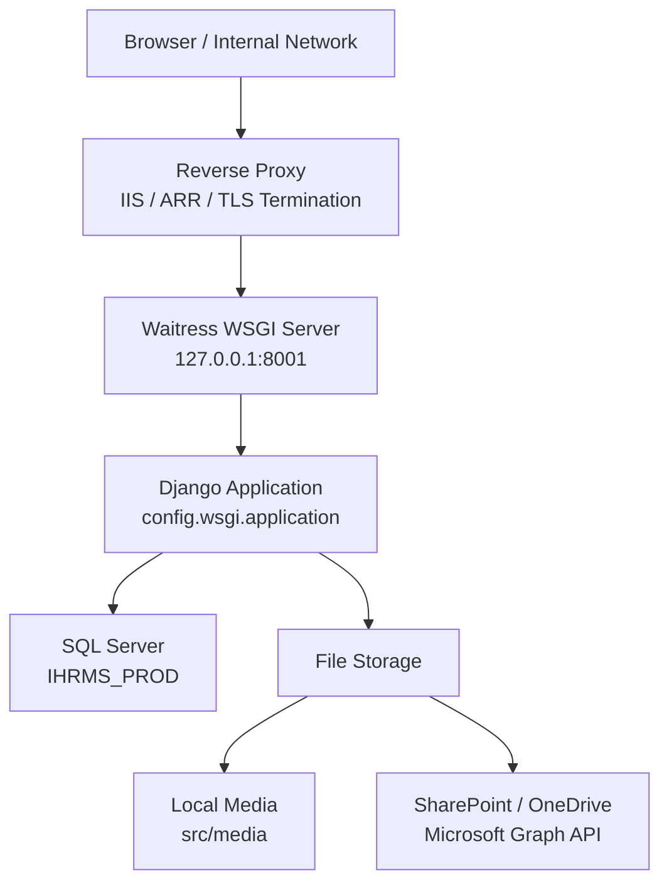
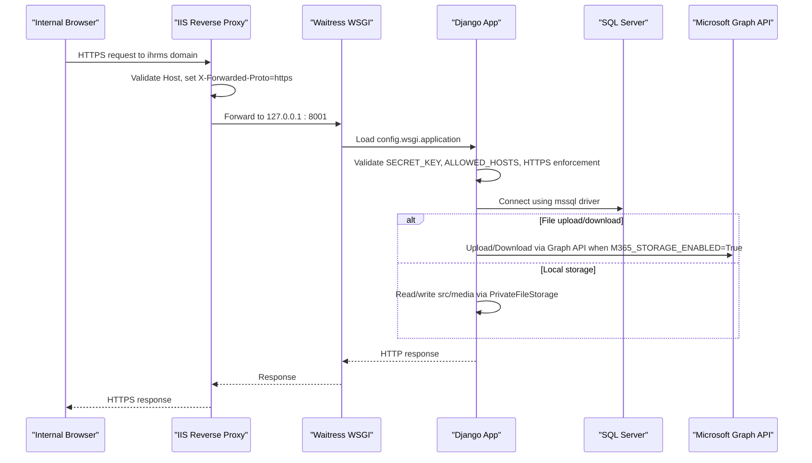
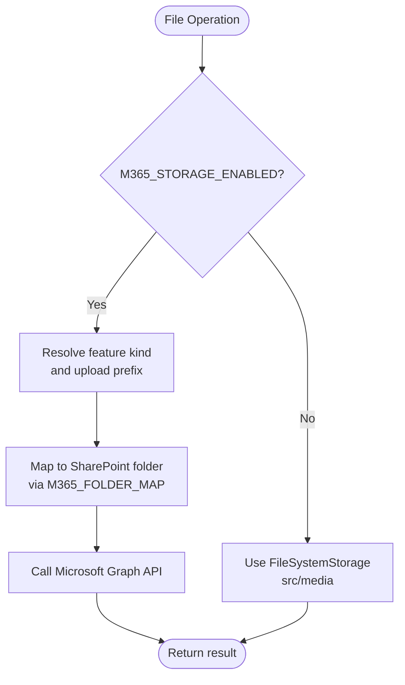
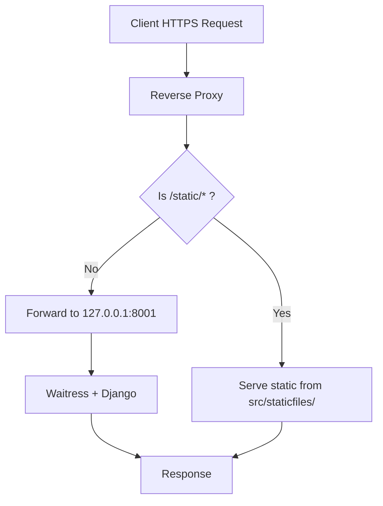
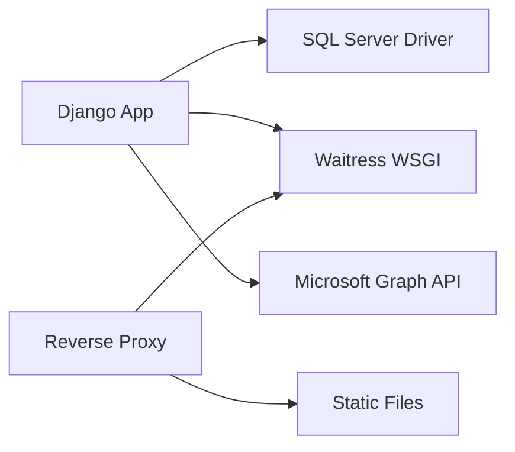

# Deployment Topology

<cite>
**Referenced Files in This Document**   
- [README.md](file://README.md)
- [08_Deployment_Standards.md](file://docs/08_Deployment_Standards.md)
- [Server_Trial_Readiness_2026-09-27.md](file://docs/Server_Trial_Readiness_2026-09-27.md)
- [Huong_Dan_Setup_TaskScheduler_SIT_UAT.md](file://docs/Huong_Dan_Setup_TaskScheduler_SIT_UAT.md)
- [settings.py](file://src/config/settings.py)
- [wsgi.py](file://src/config/wsgi.py)
- [storage.py (M365)](file://src/apps/m365/storage.py)
- [storage.py (security)](file://src/apps/security/storage.py)
- [backup README.md](file://ops/backup/README.md)
</cite>

## Table of Contents
1. [Introduction](#introduction)
2. [Project Structure](#project-structure)
3. [Core Components](#core-components)
4. [Architecture Overview](#architecture-overview)
5. [Detailed Component Analysis](#detailed-component-analysis)
6. [Dependency Analysis](#dependency-analysis)
7. [Performance Considerations](#performance-considerations)
8. [Troubleshooting Guide](#troubleshooting-guide)
9. [Conclusion](#conclusion)
10. [Appendices](#appendices)

## Introduction
This document defines the production deployment topology for IHRMS on Windows Server, using Waitress as the WSGI server behind a reverse proxy with TLS termination. It covers SQL Server database setup, file storage options (local `src/media` versus Microsoft 365 SharePoint), environment variable management, configuration validation, hardening, backup and disaster recovery, monitoring and logging, scaling guidance for NGOs, environment differences, migration strategy, and troubleshooting for common deployment issues.

The repository targets an internal corporate network, with documented minimum server specifications, separate databases per environment, and explicit requirements for HTTPS enforcement, secure cookies, and trusted proxy headers.

**Section sources**
- [README.md:36-47](file://README.md#L36-L47)
- [08_Deployment_Standards.md:37-89](file://docs/08_Deployment_Standards.md#L37-L89)

## Project Structure
IHRMS is a Django application under `src/`. Configuration lives in `src/config/`, business logic is split into Django apps under `src/apps/`, operational scripts are under `ops/`, and deployment standards are documented under `docs/`.

**Diagram sources**
- [settings.py:193-225](file://src/config/settings.py#L193-L225)
- [settings.py:274-279](file://src/config/settings.py#L274-L279)
- [storage.py (M365):1-22](file://src/apps/m365/storage.py#L1-L22)
- [Server_Trial_Readiness_2026-09-27.md:79-90](file://docs/Server_Trial_Readiness_2026-09-27.md#L79-L90)

**Section sources**
- [README.md:1-5](file://README.md#L1-L5)
- [08_Deployment_Standards.md:37-89](file://docs/08_Deployment_Standards.md#L37-L89)

## Core Components
- **Application runtime**: Django 5.2.17 with Python 3.12.
- **WSGI server**: Waitress, bound to loopback only.
- **Reverse proxy**: IIS or equivalent, terminating TLS and forwarding requests to Waitress.
- **Database**: SQL Server with ODBC Driver 17; separate databases per environment.
- **File storage**: Local filesystem via `PrivateFileStorage` or Microsoft 365 SharePoint through Graph API.
- **Security**: HTTPS enforcement, secure cookies, CSRF trusted origins, session timeouts, login lockout via Axes.
- **Logging**: Rotating log files under project root `Logs/`.
- **Backups**: PowerShell-based full and transaction log backups managed by Windows Task Scheduler.

Key configuration entry points:
- `src/config/settings.py`: environment variables, database, security, storage, logging.
- `src/config/wsgi.py`: standard Django WSGI application exposed to Waitress.
- `src/apps/m365/storage.py`: SharePoint-backed storage adapter.
- `src/apps/security/storage.py`: private URL routing for local media.

**Section sources**
- [README.md:36-47](file://README.md#L36-L47)
- [settings.py:13-35](file://src/config/settings.py#L13-L35)
- [settings.py:193-225](file://src/config/settings.py#L193-L225)
- [settings.py:274-279](file://src/config/settings.py#L274-L279)
- [settings.py:483-545](file://src/config/settings.py#L483-L545)
- [wsgi.py:10-16](file://src/config/wsgi.py#L10-L16)
- [storage.py (M365):33-70](file://src/apps/m365/storage.py#L33-L70)
- [storage.py (security):6-12](file://src/apps/security/storage.py#L6-L12)

## Architecture Overview
The production topology uses a reverse proxy to terminate TLS and forward HTTP(S) requests to Waitress on the loopback interface. Django reads configuration from `.env` at startup and validates critical settings for UAT and production.

**Diagram sources**
- [settings.py:28-86](file://src/config/settings.py#L28-L86)
- [settings.py:193-225](file://src/config/settings.py#L193-L225)
- [settings.py:274-332](file://src/config/settings.py#L274-L332)
- [storage.py (M365):75-127](file://src/apps/m365/storage.py#L75-L127)
- [Server_Trial_Readiness_2026-09-27.md:79-90](file://docs/Server_Trial_Readiness_2026-09-27.md#L79-L90)
- [Huong_Dan_Setup_TaskScheduler_SIT_UAT.md:221-259](file://docs/Huong_Dan_Setup_TaskScheduler_SIT_UAT.md#L221-L259)

## Detailed Component Analysis

### Production Environment Variables and Validation
Environment variables are loaded from `.env` at the project root. Critical validations include:
- `SECRET_KEY` must be present and sufficiently random for UAT/production.
- `APP_ENV` controls environment-specific behavior; UAT/production require `DEBUG=False` and `ENABLE_HTTPS_ENFORCEMENT=True`.
- `ALLOWED_HOSTS` must be explicitly configured for UAT/production.
- `CSRF_TRUSTED_ORIGINS` should match the public HTTPS hostname.
- `ENABLE_HTTPS_ENFORCEMENT` enables SSL redirect, secure cookies, and proxy SSL header handling.
- `SECURE_HSTS_SECONDS` and related HSTS flags are optional and environment-specific.

Recommended variables:
- `SECRET_KEY`: generated per environment.
- `APP_ENV`: development, test, uat, production.
- `DB_ENGINE`: sqlite3 for development; mssql for SIT/UAT/production.
- `DB_NAME`, `DB_HOST`, `DB_PORT`, `DB_USER`, `DB_PASSWORD`, `DB_DRIVER`, `DB_TRUSTED_CONNECTION`, `DB_EXTRA_PARAMS`.
- `M365_TENANT_ID`, `M365_CLIENT_ID`, `M365_CLIENT_SECRET`, `M365_SHAREPOINT_HOSTNAME`, `M365_SHAREPOINT_SITE_PATH`, `M365_SHAREPOINT_LIBRARY`, `M365_STORAGE_ENABLED`.
- `ENABLE_HTTPS_ENFORCEMENT`, `ALLOWED_HOSTS`, `CSRF_TRUSTED_ORIGINS`, `SECURE_HSTS_SECONDS`.

Validation failures raise `ImproperlyConfigured`, preventing unsafe deployments.

**Section sources**
- [settings.py:13-35](file://src/config/settings.py#L13-L35)
- [settings.py:37-86](file://src/config/settings.py#L37-L86)
- [settings.py:197-225](file://src/config/settings.py#L197-L225)
- [settings.py:285-332](file://src/config/settings.py#L285-L332)

### SQL Server Database Setup
For production:
- Use a dedicated SQL Server instance and database named per environment (e.g., `IHRMS_PROD`).
- Configure `DB_ENGINE=mssql`, `DB_NAME`, `DB_HOST`, `DB_PORT=1433`, `DB_DRIVER="ODBC Driver 17 for SQL Server"`.
- For Windows Integrated Authentication, set `DB_TRUSTED_CONNECTION=yes` and run the application under a service account with SQL permissions.
- For SQL authentication, set `DB_TRUSTED_CONNECTION=no` and provide `DB_USER` and `DB_PASSWORD`.
- In production, if no extra parameters are provided, encryption is enforced with `Encrypt=yes;TrustServerCertificate=no`.

Migration and data safety:
- Run migrations only after confirming the target database and performing a backup.
- Use `manage.py check --deploy`, `makemigrations --check --dry-run`, and `migrate --plan` before applying changes.

**Section sources**
- [settings.py:197-225](file://src/config/settings.py#L197-L225)
- [Server_Trial_Readiness_2026-09-27.md:57-71](file://docs/Server_Trial_Readiness_2026-09-27.md#L57-L71)

### File Storage: Local vs SharePoint
Local storage:
- Default backend is `apps.security.storage.PrivateFileStorage`, which returns a private URL routed through the application’s authorization layer.
- Files are stored under `MEDIA_ROOT` (`src/media`) and served via `/media/`.

SharePoint storage:
- When `M365_STORAGE_ENABLED=True`, uploads/downloads go through Microsoft Graph API to a configured SharePoint document library.
- Folder mapping is controlled by `M365_FOLDER_MAP` and `M365_UPLOAD_PREFIX_MAP`; legacy fields like `M365_LIBRARY_DOCUMENTS` remain supported.
- The storage adapter resolves remote names based on feature kind and upload prefix, ensuring backward compatibility.

Access control:
- Local media URLs are not direct paths; they resolve to a private endpoint requiring authentication.
- SharePoint access requires valid Graph credentials and appropriate site/library permissions.

**Diagram sources**
- [storage.py (M365):75-127](file://src/apps/m365/storage.py#L75-L127)
- [storage.py (M365):129-163](file://src/apps/m365/storage.py#L129-L163)
- [settings.py:274-332](file://src/config/settings.py#L274-L332)

**Section sources**
- [settings.py:274-332](file://src/config/settings.py#L274-L332)
- [storage.py (security):6-12](file://src/apps/security/storage.py#L6-L12)
- [storage.py (M365):1-22](file://src/apps/m365/storage.py#L1-L22)
- [storage.py (M365):75-163](file://src/apps/m365/storage.py#L75-L163)

### Microsoft 365 Integration Requirements
Required configuration:
- Tenant ID, client ID, and client secret for Graph API authentication.
- SharePoint hostname and site path.
- Document library name and folder mappings for each feature area.
- Enable `M365_STORAGE_ENABLED` only after credentials and ACLs are verified.

Operational notes:
- SharePoint retention and backup follow Microsoft 365 policies.
- Test accounts and isolated libraries should be used during SIT/UAT.
- Ensure Graph API permissions cover upload, download, delete, and metadata operations.

**Section sources**
- [settings.py:285-332](file://src/config/settings.py#L285-L332)
- [storage.py (M365):33-70](file://src/apps/m365/storage.py#L33-L70)
- [Server_Trial_Readiness_2026-09-27.md:19-26](file://docs/Server_Trial_Readiness_2026-09-27.md#L19-L26)

### Reverse Proxy and Waitress Hardening
- Waitress listens only on `127.0.0.1:8001` and must not be exposed directly to LAN/internet.
- Reverse proxy terminates TLS and forwards requests to Waitress.
- Proxy must set `X-Forwarded-Proto=https` so Django recognizes HTTPS.
- Waitress must be started with `--trusted-proxy=127.0.0.1` and `--trusted-proxy-headers` including `x-forwarded-proto`, `x-forwarded-for`, `x-forwarded-host`, `x-forwarded-port`.
- Static files should be served directly by the reverse proxy from `src/staticfiles/` to reduce load on Django.

**Diagram sources**
- [Huong_Dan_Setup_TaskScheduler_SIT_UAT.md:221-259](file://docs/Huong_Dan_Setup_TaskScheduler_SIT_UAT.md#L221-L259)
- [Server_Trial_Readiness_2026-09-27.md:79-90](file://docs/Server_Trial_Readiness_2026-09-27.md#L79-L90)

**Section sources**
- [Server_Trial_Readiness_2026-09-27.md:79-90](file://docs/Server_Trial_Readiness_2026-09-27.md#L79-L90)
- [Huong_Dan_Setup_TaskScheduler_SIT_UAT.md:221-259](file://docs/Huong_Dan_Setup_TaskScheduler_SIT_UAT.md#L221-L259)

### Logging and Log Aggregation
- Logs are written to `Logs/app.log` and `Logs/error.log` with rotating handlers (5 MB per file, 30 backups).
- Root logger level is INFO; Django request errors are captured separately.
- Sensitive exceptions are filtered via `SafeExceptionFilter`.
- For centralized aggregation, configure external log shipping (Windows Event Log, file watchers, or agent-based collectors) to forward `Logs/` files to a SIEM or log platform.

Retention policy:
- Standard specifies 90 days retention; current implementation retains ~30 rotated files. Align rotation and offloading to meet organizational retention requirements.

**Section sources**
- [settings.py:483-545](file://src/config/settings.py#L483-L545)
- [08_Deployment_Standards.md:679-707](file://docs/08_Deployment_Standards.md#L679-L707)

### Backup and Disaster Recovery
Backup strategy:
- Full backup daily at 22:00.
- Transaction log backup every hour.
- Retention: daily 30 days, weekly 12 weeks, monthly 12 months.
- RPO target: 24 hours; actual RPO is approximately 1 hour due to hourly logs.
- RTO target: 8 hours; measure via quarterly restore drills.

Operational procedures:
- Use PowerShell scripts under `ops/backup/` scheduled via Windows Task Scheduler.
- Scripts support SQL Server Express and Standard/Enterprise editions.
- Verify backups with checksums and `RESTORE VERIFYONLY`.
- Perform quarterly restore drills on a separate SQL instance and document results.

Disaster types covered:
- Server failure, database corruption, storage failure, network failure, security incident.

**Section sources**
- [backup README.md:1-20](file://ops/backup/README.md#L1-L20)
- [backup README.md:23-84](file://ops/backup/README.md#L23-L84)
- [backup README.md:88-146](file://ops/backup/README.md#L88-L146)
- [08_Deployment_Standards.md:505-619](file://docs/08_Deployment_Standards.md#L505-L619)

### Monitoring and Alerting
Monitor:
- CPU, memory, disk, network, application health, database health.
- Services: authentication, payroll, task processing, workflow, Microsoft 365 integration.
- Database metrics: size, deadlocks, slow queries, failed logins, backup status.

Alert channels:
- Outlook and Microsoft Teams.

Critical alerts:
- Application stop, database offline, authentication failure, backup failure.

**Section sources**
- [08_Deployment_Standards.md:623-751](file://docs/08_Deployment_Standards.md#L623-L751)

### Scaling Considerations for NGO Organizations
Guidance:
- Small NGOs (tens of users): single Windows Server node, shared SQL Server instance, local media acceptable if retention and backup are handled.
- Medium NGOs (hundreds of users): consider dedicated SQL Server, enable SharePoint storage for scalable document management, and centralize logs.
- Large NGOs (thousands of users): evaluate multiple application nodes behind a load balancer, read replicas for reporting, and enterprise-grade monitoring/alerting.

Constraints:
- Current codebase does not implement horizontal session sharing or distributed caching; sessions rely on cookies and server-side state.
- File storage choice impacts scalability: SharePoint scales better for large document volumes than local filesystem.

[No sources needed since this section provides general guidance]

### Environment Differences and Migration Strategy
Environments:
- Development: SQLite or local SQL Server, DEBUG allowed, HTTP acceptable.
- SIT: isolated database and storage, HTTPS via reverse proxy, strict configuration checks.
- UAT: user acceptance testing with sample data and Microsoft 365 test account.
- Production: hardened configuration, HTTPS enforcement, secure secrets, monitored and backed up.

Migration process:
- Review migration script, perform backup, execute migration, verify schema and smoke tests.
- Do not apply migrations to production without approval and rollback plan.
- Keep environment-specific `.env` files out of version control.

**Section sources**
- [08_Deployment_Standards.md:71-183](file://docs/08_Deployment_Standards.md#L71-L183)
- [08_Deployment_Standards.md:439-459](file://docs/08_Deployment_Standards.md#L439-L459)
- [Server_Trial_Readiness_2026-09-27.md:57-71](file://docs/Server_Trial_Readiness_2026-09-27.md#L57-L71)

## Dependency Analysis
The application depends on:
- Python 3.12 and Django 5.2.17.
- SQL Server ODBC Driver 17.
- Waitress for WSGI serving on Windows.
- Microsoft Graph API for SharePoint/OneDrive integration.
- Reverse proxy (IIS/ARR) for TLS termination and static file optimization.

**Diagram sources**
- [README.md:36-47](file://README.md#L36-L47)
- [settings.py:197-225](file://src/config/settings.py#L197-L225)
- [storage.py (M365):33-70](file://src/apps/m365/storage.py#L33-L70)

**Section sources**
- [README.md:36-47](file://README.md#L36-L47)
- [settings.py:197-225](file://src/config/settings.py#L197-L225)

## Performance Considerations
- Serve static assets directly from the reverse proxy to reduce Django load.
- Avoid exposing Waitress directly; enforce TLS at the proxy layer.
- Use SharePoint for large document sets to avoid local disk bottlenecks.
- Monitor database performance and query latency; tune indexes and connection pooling as needed.
- Rotate logs appropriately and ship them centrally to prevent disk exhaustion.

[No sources needed since this section provides general guidance]

## Troubleshooting Guide

### Database Connectivity Issues
Symptoms:
- Application fails to start or cannot connect to SQL Server.
- Errors about missing driver or authentication.

Checks:
- Confirm `DB_ENGINE=mssql`, correct `DB_NAME`, `DB_HOST`, `DB_PORT`.
- For Windows Integrated Authentication, ensure `DB_TRUSTED_CONNECTION=yes` and the service account has SQL permissions.
- For SQL authentication, ensure `DB_TRUSTED_CONNECTION=no` and credentials are correct.
- Verify ODBC Driver 17 is installed.
- Validate that the application can reach the SQL Server network endpoint.

**Section sources**
- [settings.py:197-225](file://src/config/settings.py#L197-L225)
- [Server_Trial_Readiness_2026-09-27.md:19-26](file://docs/Server_Trial_Readiness_2026-09-27.md#L19-L26)

### File Permission Problems
Symptoms:
- Upload/download failures for local media.
- SharePoint upload errors due to insufficient permissions.

Checks:
- Local media: ensure the service account has write access to `src/media` and `Logs/`.
- SharePoint: confirm Graph credentials and site/library ACLs; use isolated libraries for SIT/UAT.
- Verify `M365_STORAGE_ENABLED` matches intended storage backend.

**Section sources**
- [storage.py (security):6-12](file://src/apps/security/storage.py#L6-L12)
- [storage.py (M365):75-127](file://src/apps/m365/storage.py#L75-L127)
- [Server_Trial_Readiness_2026-09-27.md:19-26](file://docs/Server_Trial_Readiness_2026-09-27.md#L19-L26)

### External API Authentication Problems
Symptoms:
- Graph API calls fail with authentication or authorization errors.
- SharePoint folders not found or inaccessible.

Checks:
- Validate `M365_TENANT_ID`, `M365_CLIENT_ID`, `M365_CLIENT_SECRET`.
- Confirm `M365_SHAREPOINT_HOSTNAME`, `M365_SHAREPOINT_SITE_PATH`, and `M365_SHAREPOINT_LIBRARY`.
- Ensure Graph API permissions include required scopes for upload/download/delete.
- Test with a minimal operation against a test library before enabling production storage.

**Section sources**
- [settings.py:285-332](file://src/config/settings.py#L285-L332)
- [storage.py (M365):33-70](file://src/apps/m365/storage.py#L33-L70)

### HTTPS Redirect Loops
Symptoms:
- Browser shows infinite redirects or ERR_TOO_MANY_REDIRECTS.

Root causes:
- Missing or incorrect `X-Forwarded-Proto` header from reverse proxy.
- Waitress not configured with trusted proxy and trusted headers.
- Django `ENABLE_HTTPS_ENFORCEMENT` enabled without proper proxy configuration.

Fixes:
- Configure reverse proxy to set `HTTP_X_FORWARDED_PROTO=https`.
- Start Waitress with `--trusted-proxy=127.0.0.1` and `--trusted-proxy-headers="x-forwarded-proto,x-forwarded-for,x-forwarded-host,x-forwarded-port"`.
- Ensure `SECURE_PROXY_SSL_HEADER=("HTTP_X_FORWARDED_PROTO", "https")` is applied when HTTPS enforcement is enabled.

**Section sources**
- [settings.py:56-73](file://src/config/settings.py#L56-L73)
- [Server_Trial_Readiness_2026-09-27.md:79-90](file://docs/Server_Trial_Readiness_2026-09-27.md#L79-L90)
- [Huong_Dan_Setup_TaskScheduler_SIT_UAT.md:221-259](file://docs/Huong_Dan_Setup_TaskScheduler_SIT_UAT.md#L221-L259)

### Static Files Not Loading
Symptoms:
- CSS/JS missing in browser despite successful login.

Checks:
- Run `collectstatic` to populate `src/staticfiles/`.
- Configure reverse proxy to serve `/static/` directly from `src/staticfiles/`.
- Exclude `/static/` from reverse proxy rewrite rules to bypass Django.

**Section sources**
- [Huong_Dan_Setup_TaskScheduler_SIT_UAT.md:221-259](file://docs/Huong_Dan_Setup_TaskScheduler_SIT_UAT.md#L221-L259)

## Conclusion
IHRMS production deployment on Windows Server relies on a hardened reverse proxy, loopback-bound Waitress, SQL Server, and either local media or SharePoint storage. Environment variables must be carefully managed and validated, especially for UAT and production. Backups, restores, monitoring, and logging are essential for operational resilience. Scaling should consider organizational size and document volume, with SharePoint recommended for larger deployments. Follow the documented migration and hardening steps to ensure safe, reliable go-live.

[No sources needed since this section summarizes without analyzing specific files]

## Appendices

### Recommended .env Checklist
- `SECRET_KEY`: unique, randomly generated per environment.
- `APP_ENV`: development, test, uat, production.
- `DEBUG`: True only for local development.
- `ENABLE_HTTPS_ENFORCEMENT`: True for UAT/production.
- `ALLOWED_HOSTS`: explicit hostnames for UAT/production.
- `CSRF_TRUSTED_ORIGINS`: HTTPS origin matching public hostname.
- `DB_ENGINE`: sqlite3 for dev; mssql for SIT/UAT/production.
- `DB_NAME`, `DB_HOST`, `DB_PORT`, `DB_USER`, `DB_PASSWORD`, `DB_DRIVER`, `DB_TRUSTED_CONNECTION`, `DB_EXTRA_PARAMS`.
- `M365_TENANT_ID`, `M365_CLIENT_ID`, `M365_CLIENT_SECRET`, `M365_SHAREPOINT_HOSTNAME`, `M365_SHAREPOINT_SITE_PATH`, `M365_SHAREPOINT_LIBRARY`, `M365_STORAGE_ENABLED`.

**Section sources**
- [settings.py:28-86](file://src/config/settings.py#L28-L86)
- [settings.py:197-225](file://src/config/settings.py#L197-L225)
- [settings.py:285-332](file://src/config/settings.py#L285-L332)
- [Server_Trial_Readiness_2026-09-27.md:37-55](file://docs/Server_Trial_Readiness_2026-09-27.md#L37-L55)