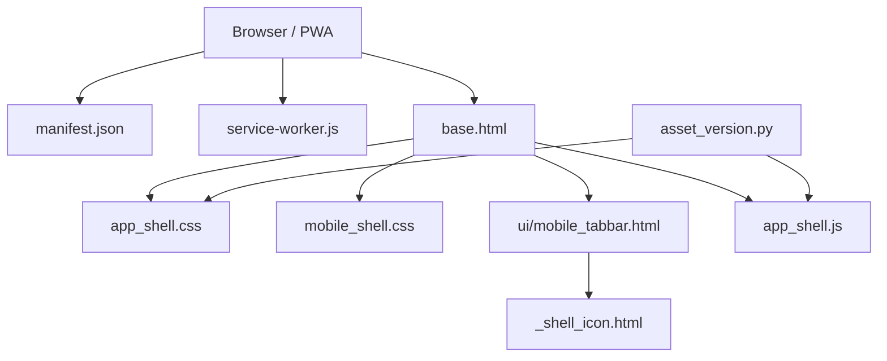
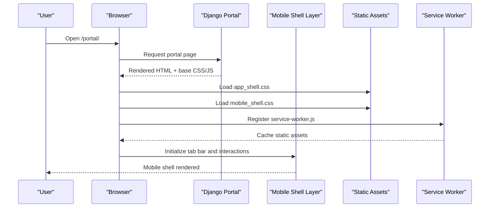
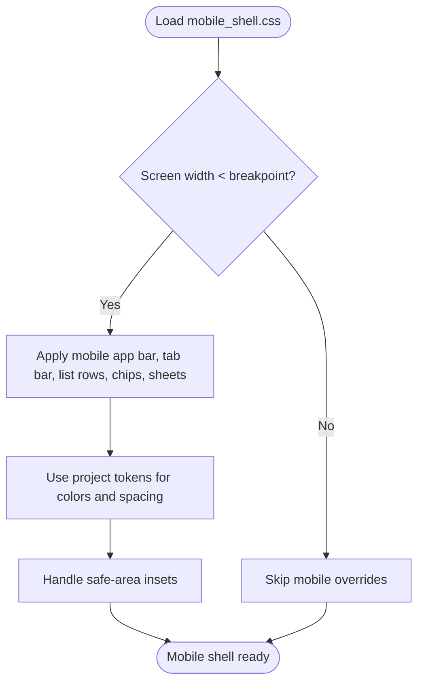
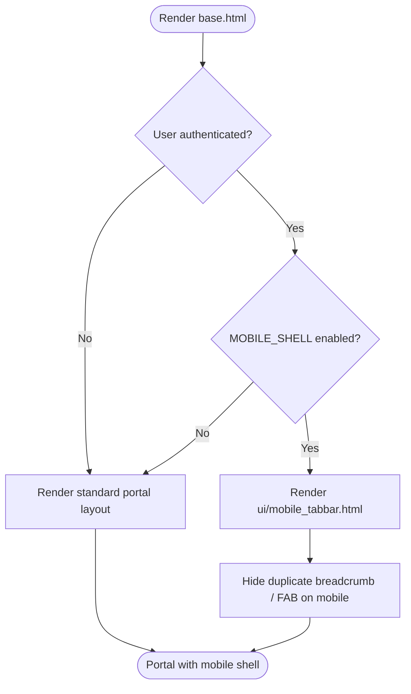
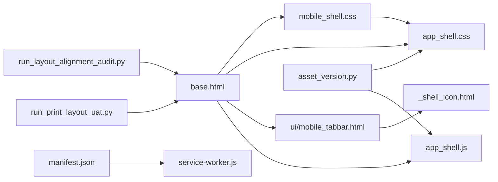

# Mobile Application Shell

> Generated reference snapshot (October 2026). Consult AGENTS.md and docs/PROJECT_WORK_LOG.md for current decisions and validation. The PWA shell described here is existing web behavior; the separately approved React Native mobile application has not been implemented by this document.

<cite>
**Referenced Files in This Document**
- [README.md](file://README.md)
- [06_Frontend_Standards.md](file://docs/06_Frontend_Standards.md)
- [mobile_shell.css](file://src/static/css/mobile_shell.css)
- [app_shell.css](file://src/static/css/app_shell.css)
- [base.html](file://src/templates/base.html)
- [_shell_icon.html](file://src/templates/_shell_icon.html)
- [mobile_tabbar.html](file://src/templates/ui/mobile_tabbar.html)
- [app_shell.js](file://src/static/js/app_shell.js)
- [service-worker.js](file://src/static/js/service-worker.js)
- [manifest.json](file://src/static/manifest.json)
- [asset_version.py](file://src/apps/common/asset_version.py)
- [index.html](file://outputs/mobile-app-plan-20261021/index.html)
- [prototype.html](file://outputs/mobile-app-plan-20261021/prototype.html)
- [run_layout_alignment_audit.py](file://ops/run_layout_alignment_audit.py)
- [run_print_layout_uat.py](file://ops/run_print_layout_uat.py)
</cite>

## Table of Contents
1. [Introduction](#introduction)
2. [Project Structure](#project-structure)
3. [Core Components](#core-components)
4. [Architecture Overview](#architecture-overview)
5. [Detailed Component Analysis](#detailed-component-analysis)
6. [Dependency Analysis](#dependency-analysis)
7. [Performance Considerations](#performance-considerations)
8. [Troubleshooting Guide](#troubleshooting-guide)
9. [Conclusion](#conclusion)

## Introduction
This document describes the mobile application shell for IHRMS, a Django-based internal Human Resources and Administration Management System. The mobile shell is implemented as a progressive web app layer that adapts the existing portal to small screens without rewriting business logic or duplicating permissions. It introduces a compact top bar, a five-tab bottom navigation, mobile-friendly list rows, chips, action bars, filter sheets, and responsive table behavior. The design avoids changing desktop layouts and print templates by confining new styles to screen-only media queries and a dedicated mobile stylesheet.

The project’s main entry point is the Django portal under `/portal/`, with administrative access under `/admin/`. Development runs on port 8001 by default, and the repository includes operational scripts for testing, screenshots, layout audits, and browser UAT.

**Section sources**
- [README.md:5-70](file://README.md#L5-L70)

## Project Structure
The mobile shell spans static assets, Django templates, and operational documentation:

- Static CSS: `mobile_shell.css` provides the mobile-first shell; `app_shell.css` contains shared shell tokens and layout rules.
- Templates: `base.html` integrates the mobile tab bar and conditional shell elements; `_shell_icon.html` supplies reusable icons; `ui/mobile_tabbar.html` renders the bottom navigation.
- JavaScript: `app_shell.js` handles shell interactions; `service-worker.js` manages caching; `manifest.json` enables installation.
- Asset versioning: `asset_version.py` registers shell assets so cache busting applies consistently.
- Planning and prototypes: `outputs/mobile-app-plan-20261021/index.html` documents decisions, phases, and measured findings; `prototype.html` hosts an interactive prototype iframe.
- Operational checks: `run_layout_alignment_audit.py` validates layout across widths and themes; `run_print_layout_uat.py` guards print behavior.

**Diagram sources**
- [base.html](file://src/templates/base.html)
- [app_shell.css](file://src/static/css/app_shell.css)
- [mobile_shell.css](file://src/static/css/mobile_shell.css)
- [mobile_tabbar.html](file://src/templates/ui/mobile_tabbar.html)
- [_shell_icon.html](file://src/templates/_shell_icon.html)
- [app_shell.js](file://src/static/js/app_shell.js)
- [manifest.json](file://src/static/manifest.json)
- [service-worker.js](file://src/static/js/service-worker.js)
- [asset_version.py](file://src/apps/common/asset_version.py)

**Section sources**
- [mobile_shell.css](file://src/static/css/mobile_shell.css)
- [app_shell.css](file://src/static/css/app_shell.css)
- [base.html](file://src/templates/base.html)
- [_shell_icon.html](file://src/templates/_shell_icon.html)
- [mobile_tabbar.html](file://src/templates/ui/mobile_tabbar.html)
- [app_shell.js](file://src/static/js/app_shell.js)
- [service-worker.js](file://src/static/js/service-worker.js)
- [manifest.json](file://src/static/manifest.json)
- [asset_version.py](file://src/apps/common/asset_version.py)
- [index.html](file://outputs/mobile-app-plan-20261021/index.html)
- [prototype.html](file://outputs/mobile-app-plan-20261021/prototype.html)

## Core Components
The mobile shell consists of these core components:

- Mobile shell CSS (`mobile_shell.css`)
  - Defines the mobile viewport behavior, safe-area handling, app bar, tab bar, list rows, chips, action bars, filter sheets, segmented controls, and responsive tables.
  - Uses project tokens from `ui_tokens.css` rather than introducing ad-hoc colors.
- Shared shell CSS (`app_shell.css`)
  - Provides base shell spacing, typography rhythm, sidebar width, active states, and content max-width rules used across desktop and mobile.
- Template integration (`base.html`, `_shell_icon.html`, `ui/mobile_tabbar.html`)
  - Adds the mobile tab bar conditionally based on authentication and settings.
  - Hides redundant breadcrumbs and floating action buttons on mobile where appropriate.
  - Reuses icon partials for consistent SVG usage.
- JavaScript shell (`app_shell.js`)
  - Manages tab state, drawer toggles, and lightweight interactions required by the mobile UI.
- PWA configuration (`manifest.json`, `service-worker.js`)
  - Enables installability and caches static assets safely without caching HTML or sensitive data.
- Asset versioning (`asset_version.py`)
  - Registers `css/app_shell.css` and `js/app_shell.js` so cache-busting applies consistently during development and deployment.

Key implementation patterns:
- Mobile-only changes are wrapped in screen media queries to avoid affecting desktop and print.
- Tab bar rendering is gated by login state and a feature flag to allow quick rollback.
- List views replace wide tables with compact rows below defined breakpoints.
- Filter panels move into bottom sheets to preserve visible content area.

**Section sources**
- [mobile_shell.css](file://src/static/css/mobile_shell.css)
- [app_shell.css](file://src/static/css/app_shell.css)
- [base.html](file://src/templates/base.html)
- [_shell_icon.html](file://src/templates/_shell_icon.html)
- [mobile_tabbar.html](file://src/templates/ui/mobile_tabbar.html)
- [app_shell.js](file://src/static/js/app_shell.js)
- [manifest.json](file://src/static/manifest.json)
- [service-worker.js](file://src/static/js/service-worker.js)
- [asset_version.py](file://src/apps/common/asset_version.py)

## Architecture Overview
The mobile shell extends the existing Django portal without adding a separate API layer. The browser loads the portal template, which includes shared shell CSS, mobile-specific CSS, and JavaScript. The manifest and service worker enable PWA capabilities while keeping business logic in Django.

**Diagram sources**
- [base.html](file://src/templates/base.html)
- [app_shell.css](file://src/static/css/app_shell.css)
- [mobile_shell.css](file://src/static/css/mobile_shell.css)
- [app_shell.js](file://src/static/js/app_shell.js)
- [service-worker.js](file://src/static/js/service-worker.js)
- [manifest.json](file://src/static/manifest.json)

## Detailed Component Analysis

### Mobile Shell CSS (`mobile_shell.css`)
Responsibilities:
- Define mobile app bar height, sticky positioning, and safe-area insets.
- Implement the five-tab bottom navigation with icon sizing, label sizing, badges, and accessibility attributes.
- Convert wide tables into scrollable containers with a sticky first column and edge shadows.
- Provide mobile list rows, chips, segmented controls, and bottom sheet filters.
- Ensure input fields meet minimum touch targets and font sizes to prevent iOS zoom.

Design constraints:
- No `@media print` blocks; print templates remain untouched.
- Colors and tokens come from the project’s token system.
- Breakpoints isolate mobile behavior from desktop.

**Diagram sources**
- [mobile_shell.css](file://src/static/css/mobile_shell.css)

**Section sources**
- [mobile_shell.css](file://src/static/css/mobile_shell.css)

### Shared Shell CSS (`app_shell.css`)
Responsibilities:
- Establish baseline shell rhythm, sidebar width, active states, and content max-width.
- Provide shared classes reused by both desktop and mobile shells.
- Avoid overriding mobile-specific behavior unless explicitly scoped.

Interaction with mobile shell:
- Mobile shell builds on top of shared tokens and layout conventions.
- Changes here affect all pages, so they must be reviewed carefully.

**Section sources**
- [app_shell.css](file://src/static/css/app_shell.css)

### Template Integration (`base.html`, `_shell_icon.html`, `ui/mobile_tabbar.html`)
Responsibilities:
- Integrate the mobile tab bar into the portal layout.
- Conditionally render the tab bar only when authenticated and enabled.
- Hide redundant breadcrumb sections on mobile where the app bar already shows context.
- Reuse icon partials for consistent SVG markup and accessibility.

Control flow:
- If user is logged in and mobile shell is enabled, render tab bar.
- Otherwise, fall back to standard portal layout.

**Diagram sources**
- [base.html](file://src/templates/base.html)
- [mobile_tabbar.html](file://src/templates/ui/mobile_tabbar.html)
- [_shell_icon.html](file://src/templates/_shell_icon.html)

**Section sources**
- [base.html](file://src/templates/base.html)
- [_shell_icon.html](file://src/templates/_shell_icon.html)
- [mobile_tabbar.html](file://src/templates/ui/mobile_tabbar.html)

### JavaScript Shell (`app_shell.js`)
Responsibilities:
- Manage tab selection state and update ARIA attributes.
- Toggle drawer visibility for the “More” module.
- Coordinate with bottom sheet filters and action bars.
- Keep interactions lightweight and compatible with existing portal scripts.

Error handling:
- Guard against missing DOM nodes before attaching event listeners.
- Preserve keyboard and screen reader compatibility.

**Section sources**
- [app_shell.js](file://src/static/js/app_shell.js)

### PWA Configuration (`manifest.json`, `service-worker.js`)
Responsibilities:
- `manifest.json`: defines app name, start URL, display mode, and icons for installation.
- `service-worker.js`: caches static assets from the same origin, excludes HTML, API responses, and sensitive data.

Policy:
- Caching improves asset load speed but does not make the app fully offline-capable for business data.
- Versioning of cached assets should be updated intentionally to force refreshes.

**Section sources**
- [manifest.json](file://src/static/manifest.json)
- [service-worker.js](file://src/static/js/service-worker.js)

### Asset Versioning (`asset_version.py`)
Responsibilities:
- Register `css/app_shell.css` and `js/app_shell.js` for cache busting.
- Ensure updates to shell assets are reflected in deployed environments.

Impact:
- Prevents stale shell CSS/JS from being served after deployments.
- Reduces debugging time caused by browser cache mismatches.

**Section sources**
- [asset_version.py](file://src/apps/common/asset_version.py)

## Dependency Analysis
The mobile shell depends on shared shell styles, template infrastructure, and PWA assets. Operational scripts validate layout and print behavior.

**Diagram sources**
- [mobile_shell.css](file://src/static/css/mobile_shell.css)
- [app_shell.css](file://src/static/css/app_shell.css)
- [base.html](file://src/templates/base.html)
- [mobile_tabbar.html](file://src/templates/ui/mobile_tabbar.html)
- [_shell_icon.html](file://src/templates/_shell_icon.html)
- [app_shell.js](file://src/static/js/app_shell.js)
- [manifest.json](file://src/static/manifest.json)
- [service-worker.js](file://src/static/js/service-worker.js)
- [asset_version.py](file://src/apps/common/asset_version.py)
- [run_layout_alignment_audit.py](file://ops/run_layout_alignment_audit.py)
- [run_print_layout_uat.py](file://ops/run_print_layout_uat.py)

**Section sources**
- [asset_version.py](file://src/apps/common/asset_version.py)
- [run_layout_alignment_audit.py](file://ops/run_layout_alignment_audit.py)
- [run_print_layout_uat.py](file://ops/run_print_layout_uat.py)

## Performance Considerations
- Keep mobile CSS scoped to screen media queries to avoid unnecessary processing on desktop and print.
- Use project tokens instead of runtime color calculations to reduce CSS complexity.
- Prefer lightweight JavaScript interactions over heavy frameworks.
- Limit service worker caching to static assets; do not cache dynamic HTML or sensitive data.
- Use asset versioning to ensure users receive updated shell files promptly.

[No sources needed since this section provides general guidance]

## Troubleshooting Guide
Common issues and resolutions:

- Missing portal shell on mobile
  - Symptom: Layout audit reports missing `.ui-main` or portal shell.
  - Resolution: Verify `base.html` still renders the main content container and that mobile shell integration did not remove it.

- Desktop layout regression
  - Symptom: Sidebar width, content max-width, or active states change unexpectedly.
  - Resolution: Check `app_shell.css` for unintended overrides; ensure mobile overrides are inside screen media queries.

- Print template breakage
  - Symptom: HCNS print output changes after mobile shell changes.
  - Resolution: Confirm no `@media print` blocks were added to mobile CSS; run print UAT script.

- Tab bar not appearing
  - Symptom: Bottom navigation is absent even on mobile.
  - Resolution: Check authentication gating and feature flag; verify `ui/mobile_tabbar.html` is included.

- Stale assets after deployment
  - Symptom: Users see old shell CSS/JS.
  - Resolution: Ensure `asset_version.py` registers shell assets and that cache busting is applied.

Operational validation:
- Run layout alignment audit across multiple widths and themes.
- Run print layout UAT to guard against print regressions.
- Follow frontend standards for portal mobile layout and PWA caching policy.

**Section sources**
- [run_layout_alignment_audit.py](file://ops/run_layout_alignment_audit.py)
- [run_print_layout_uat.py](file://ops/run_print_layout_uat.py)
- [06_Frontend_Standards.md](file://docs/06_Frontend_Standards.md)

## Conclusion
The mobile application shell extends IHRMS with a mobile-first PWA layer that preserves existing business logic, permissions, and print behavior. It introduces a compact app bar, five-tab navigation, mobile-friendly lists and forms, and responsive tables. The implementation is guarded by operational audits and follows frontend standards for mobile layout and caching. Future phases can expand route coverage, improve approval flows, and enhance PWA capabilities without requiring a native rewrite.

[No sources needed since this section summarizes without analyzing specific files]
