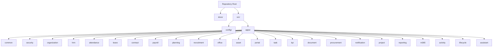
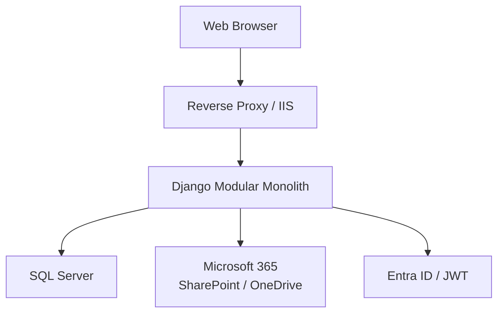
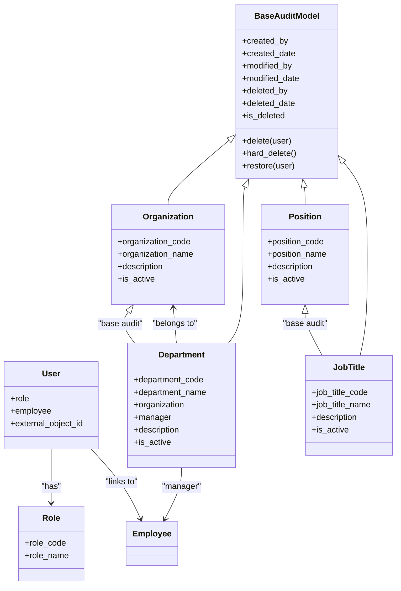
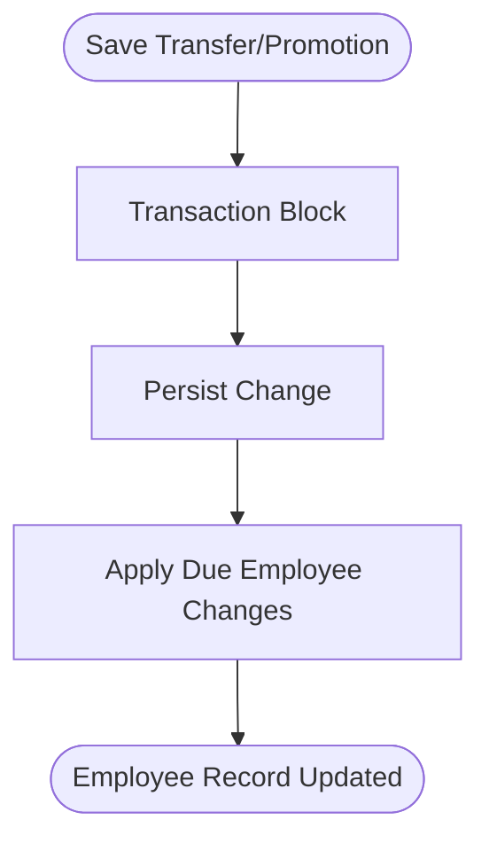
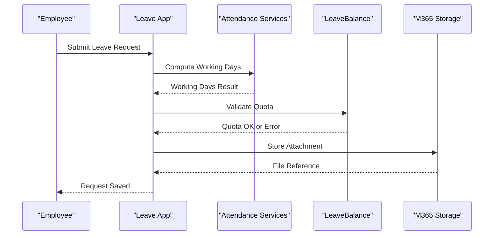
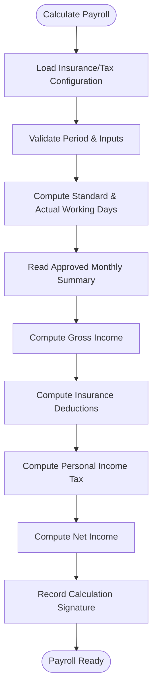
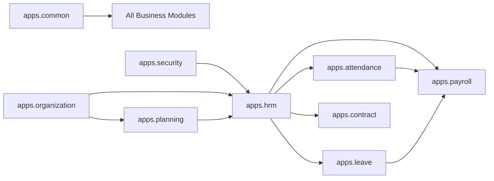
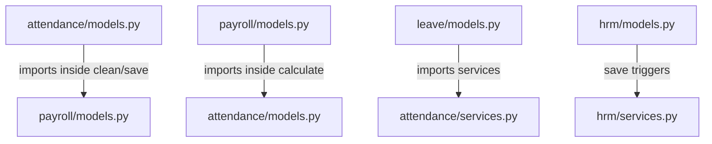

# Module Boundaries & Dependencies

<cite>
**Referenced Files in This Document**
- [README.md](file://README.md)
- [02_Solution_Architecture.md](file://docs/02_Solution_Architecture.md)
- [16_Django_Module_Blueprint.md](file://docs/16_Django_Module_Blueprint.md)
- [settings.py](file://src/config/settings.py)
- [common/models.py](file://src/apps/common/models.py)
- [security/models.py](file://src/apps/security/models.py)
- [organization/models.py](file://src/apps/organization/models.py)
- [hrm/models.py](file://src/apps/hrm/models.py)
- [attendance/models.py](file://src/apps/attendance/models.py)
- [leave/models.py](file://src/apps/leave/models.py)
- [contract/models.py](file://src/apps/contract/models.py)
- [payroll/models.py](file://src/apps/payroll/models.py)
- [planning/models.py](file://src/apps/planning/models.py)
</cite>

## Table of Contents
1. [Introduction](#introduction)
2. [Project Structure](#project-structure)
3. [Core Components](#core-components)
4. [Architecture Overview](#architecture-overview)
5. [Detailed Component Analysis](#detailed-component-analysis)
6. [Dependency Analysis](#dependency-analysis)
7. [Performance Considerations](#performance-considerations)
8. [Troubleshooting Guide](#troubleshooting-guide)
9. [Conclusion](#conclusion)
10. [Appendices](#appendices)

## Introduction
This document explains the module boundaries and dependency relationships across the 24 Django applications that make up IHRMS. It focuses on how core modules (security, organization), HR operations (hrm, contract, document), time management (attendance, leave), financial systems (payroll, planning), and administrative services (recruitment, office, asset) interact. It also documents shared utilities in apps/common, shows which modules depend on others, highlights potential circular dependency risks, and provides guidelines for adding new modules while preserving system integrity.

IHRMS is a modular monolith: all business logic runs inside one Django application, but domain responsibilities are clearly separated by apps. The repository root contains documentation, scripts, and configuration; the Django source lives under src/, with each feature as an app under src/apps/.

**Section sources**
- [README.md:1-90](file://README.md#L1-L90)
- [02_Solution_Architecture.md:47-53](file://docs/02_Solution_Architecture.md#L47-L53)

## Project Structure
The project follows a layered, modular design. At the top level:
- docs/ holds architecture, standards, and operational guides.
- src/config/ contains Django settings, URLs, and WSGI/ASGI entry points.
- src/apps/ contains the 24 Django applications.
- src/templates/ and src/static/ provide shared presentation assets.
- ops/ contains test runners, UAT scripts, and maintenance tools.

**Diagram sources**
- [settings.py:111-143](file://src/config/settings.py#L111-L143)

**Section sources**
- [settings.py:111-143](file://src/config/settings.py#L111-L143)
- [02_Solution_Architecture.md:365-388](file://docs/02_Solution_Architecture.md#L365-L388)

## Core Components
IHRMS organizes its capabilities into clear domains:

- Core foundation
  - security: authentication, roles, permissions, audit events, storage policy.
  - common: cross-cutting models, upload helpers, UI choices, middleware, number formatting.
  - organization: organizational structure, departments, positions, job titles.

- HR operations
  - hrm: employee master data, transfers, promotions, rewards, discipline, profile change requests.
  - contract: contracts and appendices tied to employees.
  - document: document categories, approvals, dispatch workflows.

- Time management
  - attendance: shifts, attendance records, holidays, working calendar, timesheets, monthly summaries.
  - leave: leave types, requests, approvals, balances, quota validation.

- Financial systems
  - payroll: salary history, insurance/tax configuration, pay periods, payroll calculation, payslips.
  - planning: headcount plans, training courses/enrollments, annual budgets, events.

- Administrative services
  - recruitment: recruitment requests, candidates, interviews, offers.
  - office: room/vehicle booking and related administration.
  - asset: asset lifecycle and inventory.

- Cross-cutting services
  - portal: employee-facing portal, dashboards, reporting views.
  - task, kpi, project, procurement, notification, reporting, m365, activity, lifecycle, assistant: supporting features integrated through shared models and services.

Shared utilities in apps/common provide:
- BaseAuditModel and soft-delete behavior for consistent auditing and safe deletion.
- Upload path builders and validators used by multiple modules.
- UI status and choice helpers.
- Middleware that applies due employee changes and protects sensitive responses.

**Section sources**
- [common/models.py:56-93](file://src/apps/common/models.py#L56-L93)
- [security/models.py:5-46](file://src/apps/security/models.py#L5-L46)
- [organization/models.py:5-71](file://src/apps/organization/models.py#L5-L71)
- [hrm/models.py:11-224](file://src/apps/hrm/models.py#L11-L224)
- [contract/models.py:6-76](file://src/apps/contract/models.py#L6-L76)
- [attendance/models.py:10-302](file://src/apps/attendance/models.py#L10-L302)
- [leave/models.py:38-280](file://src/apps/leave/models.py#L38-L280)
- [payroll/models.py:33-532](file://src/apps/payroll/models.py#L33-L532)
- [planning/models.py:12-166](file://src/apps/planning/models.py#L12-L166)

## Architecture Overview
IHRMS implements a modular monolith with layered separation:
- Presentation: templates, portal views, admin interface.
- API: URL routes and view layers per app.
- Service: business logic in services or model methods.
- Repository/Data access: Django ORM queries within models/services.
- Database: SQL Server (or SQLite in development).

External integrations include Microsoft 365 (SharePoint/OneDrive) and Entra ID-based authentication flows.

**Diagram sources**
- [02_Solution_Architecture.md:97-125](file://docs/02_Solution_Architecture.md#L97-L125)
- [02_Solution_Architecture.md:528-588](file://docs/02_Solution_Architecture.md#L528-L588)
- [settings.py:269-332](file://src/config/settings.py#L269-L332)

## Detailed Component Analysis

### Core Foundation: security, common, organization
- security defines User, Role, and SecurityEvent. User links to Role and Employee, centralizing identity and authorization.
- common provides BaseAuditModel and SoftDeleteManager, ensuring every business model has created/modified/deleted metadata and safe deletion semantics.
- organization defines Organization, Department, Position, JobTitle, forming the structural backbone referenced by other modules.

**Diagram sources**
- [common/models.py:56-93](file://src/apps/common/models.py#L56-L93)
- [security/models.py:5-46](file://src/apps/security/models.py#L5-L46)
- [organization/models.py:5-71](file://src/apps/organization/models.py#L5-L71)

**Section sources**
- [common/models.py:56-93](file://src/apps/common/models.py#L56-L93)
- [security/models.py:5-46](file://src/apps/security/models.py#L5-L46)
- [organization/models.py:5-71](file://src/apps/organization/models.py#L5-L71)

### HR Operations: hrm, contract, document
- hrm manages Employee and lifecycle events such as transfers and promotions. Transfers and promotions trigger due employee changes via services.
- contract ties contracts and appendices to employees and contract types.
- document handles document categories, approvals, and dispatch workflows.

**Diagram sources**
- [hrm/models.py:125-186](file://src/apps/hrm/models.py#L125-L186)

**Section sources**
- [hrm/models.py:11-224](file://src/apps/hrm/models.py#L11-L224)
- [contract/models.py:6-76](file://src/apps/contract/models.py#L6-L76)

### Time Management: attendance, leave
- attendance tracks work shifts, attendance records, holidays, working calendars, timesheet entries, and monthly summaries. Monthly summaries require approval before affecting payroll.
- leave manages leave types, requests, approvals, and balances. Leave days are computed using attendance’s standard working days.

**Diagram sources**
- [leave/models.py:15-176](file://src/apps/leave/models.py#L15-L176)
- [leave/models.py:206-280](file://src/apps/leave/models.py#L206-L280)
- [attendance/models.py:89-170](file://src/apps/attendance/models.py#L89-L170)

**Section sources**
- [attendance/models.py:10-302](file://src/apps/attendance/models.py#L10-L302)
- [leave/models.py:38-280](file://src/apps/leave/models.py#L38-L280)

### Financial Systems: payroll, planning
- payroll computes gross income, insurance deductions, personal income tax, and net pay based on configured rates and approved attendance data. It enforces period locking and input/output signatures to ensure reproducibility.
- planning manages headcount plans, training courses/enrollments, annual budgets, and events. Headcount calculations reference active employees from hrm.

**Diagram sources**
- [payroll/models.py:371-514](file://src/apps/payroll/models.py#L371-L514)

**Section sources**
- [payroll/models.py:33-532](file://src/apps/payroll/models.py#L33-L532)
- [planning/models.py:12-166](file://src/apps/planning/models.py#L12-L166)

### Administrative Services: recruitment, office, asset
- recruitment manages recruitment requests, candidates, interviews, and offers.
- office supports room and vehicle bookings.
- asset manages asset records and lifecycle.

These modules primarily depend on common utilities and may integrate with notifications and document storage.

**Section sources**
- [settings.py:111-143](file://src/config/settings.py#L111-L143)

## Dependency Analysis
The following diagram maps key inter-module dependencies derived from model references and service calls:

Potential circular dependency risks:
- attendance.models imports payroll.models inside clean/save to enforce period locks.
- payroll.models imports attendance.models inside calculate to read approved summaries.
- leave.models imports attendance.services to compute working days.
- hrm.models triggers services that may import payroll or attendance indirectly.

Mitigation patterns already present:
- Lazy imports inside methods reduce startup-time cycles.
- Clear ownership: attendance owns timesheet/monthly summary; payroll consumes approved summaries; leave consumes attendance services.

**Diagram sources**
- [attendance/models.py:113-167](file://src/apps/attendance/models.py#L113-L167)
- [payroll/models.py:405-446](file://src/apps/payroll/models.py#L405-L446)
- [leave/models.py:15-18](file://src/apps/leave/models.py#L15-L18)
- [hrm/models.py:146-183](file://src/apps/hrm/models.py#L146-L183)

**Section sources**
- [attendance/models.py:113-167](file://src/apps/attendance/models.py#L113-L167)
- [payroll/models.py:405-446](file://src/apps/payroll/models.py#L405-L446)
- [leave/models.py:15-18](file://src/apps/leave/models.py#L15-L18)
- [hrm/models.py:146-183](file://src/apps/hrm/models.py#L146-L183)

## Performance Considerations
- Use select_related and prefetch_related when querying across foreign keys between organization, hrm, attendance, and payroll.
- Avoid heavy computations in model save paths; prefer background tasks for batch payroll or report generation.
- Lock rows with select_for_update only where necessary (e.g., payroll period and employee updates during timesheet edits).
- Cache frequently accessed master data (insurance rates, tax brackets, holiday calendars) where appropriate.
- Keep file uploads routed through shared storage backends to avoid local disk bottlenecks.

[No sources needed since this section provides general guidance]

## Troubleshooting Guide
Common issues and their likely causes:
- Circular import errors during startup: caused by direct top-level imports between attendance and payroll. Resolve by moving imports inside functions/methods or consolidating shared logic in services.
- Locked payroll period errors: occur when trying to modify timesheets or monthly summaries after locking. Ensure approval workflow completes before payroll lock.
- Leave quota validation failures: indicate missing leave balance allocations or overlapping requests. Verify LeaveBalance records and request date ranges.
- Overlapping salary or dependent registration errors: indicate duplicate effective periods. Adjust end dates or replace existing records.

Operational checks:
- Run Django check and migrations to validate configuration and schema consistency.
- Review logs in Logs/app.log and Logs/error.log for stack traces and safe exception filtering.
- Confirm environment variables for database, secrets, and M365 storage are correctly set.

**Section sources**
- [settings.py:477-545](file://src/config/settings.py#L477-L545)
- [payroll/models.py:351-358](file://src/apps/payroll/models.py#L351-L358)
- [leave/models.py:91-176](file://src/apps/leave/models.py#L91-L176)
- [payroll/models.py:55-80](file://src/apps/payroll/models.py#L55-L80)

## Conclusion
IHRMS achieves clear module boundaries through dedicated Django apps, shared base models, and explicit dependency directions. Core modules (security, organization) provide foundational entities; HR operations (hrm, contract, document) manage personnel lifecycle; time management (attendance, leave) captures work and absence data; financial systems (payroll, planning) compute compensation and plan resources; administrative services (recruitment, office, asset) support operational needs. Shared utilities in apps/common ensure consistent auditing, uploads, and UI helpers. The plugin-like architecture allows new modules to be added by following established patterns, registering in INSTALLED_APPS, and depending only on lower-layer modules.

[No sources needed since this section summarizes without analyzing specific files]

## Appendices

### Plugin-like Architecture Guidelines for New Modules
- Create a new app under src/apps/<new_module>.
- Define models inheriting from BaseAuditModel for consistent auditing and soft delete.
- Place business logic in services.py and keep models focused on data and validation.
- Register the app in INSTALLED_APPS and configure Jazzmin order if it should appear in admin navigation.
- Use lazy imports to avoid circular dependencies with peer modules.
- Integrate with common utilities for uploads, number formatting, and UI choices.
- Add tests in the app’s tests.py or tests directory.
- If exposing APIs, define urls.py and views or DRF endpoints consistently with other modules.

**Section sources**
- [16_Django_Module_Blueprint.md:39-65](file://docs/16_Django_Module_Blueprint.md#L39-L65)
- [settings.py:111-143](file://src/config/settings.py#L111-L143)
- [common/models.py:56-93](file://src/apps/common/models.py#L56-L93)