# Audit Logging & Security Events

<cite>
**Referenced Files in This Document**   
- [models.py](file://src/apps/security/models.py)
- [signals.py](file://src/apps/security/signals.py)
- [middleware.py](file://src/apps/security/middleware.py)
- [logging.py](file://src/apps/security/logging.py)
- [login_handler.py](file://src/apps/security/login_handler.py)
- [admin.py](file://src/apps/security/admin.py)
- [files.py](file://src/apps/security/files.py)
- [views.py](file://src/apps/assistant/views.py)
- [reports_planning.py](file://src/apps/portal/views/reports_planning.py)
- [views.py](file://src/apps/reporting/views.py)
- [settings.py](file://src/config/settings.py)
- [04_Security_Design.md](file://docs/04_Security_Design.md)
</cite>

## Table of Contents
1. [Introduction](#introduction)
2. [Project Structure](#project-structure)
3. [Core Components](#core-components)
4. [Architecture Overview](#architecture-overview)
5. [Detailed Component Analysis](#detailed-component-analysis)
6. [Dependency Analysis](#dependency-analysis)
7. [Performance Considerations](#performance-considerations)
8. [Troubleshooting Guide](#troubleshooting-guide)
9. [Conclusion](#conclusion)

## Introduction
This document explains the audit logging and security events system implemented for the application. It covers:
- The security event data model and its design constraints.
- Signal-based capture of authentication events.
- View-level recording of file downloads and data exports.
- Request/response middleware behavior related to session safety and response headers.
- Application logging configuration, safe exception handling, and log retention.
- Admin interface access controls for reviewing security events.
- Query patterns for security analysis and reporting.
- Performance considerations for high-volume logging and compliance guidance.

The system intentionally records metadata rather than sensitive business values, filenames, query strings, or secrets.

## Project Structure
The audit and security event functionality is primarily located under the `security` Django app, with additional event recording in feature apps that perform sensitive operations such as file downloads and data exports.

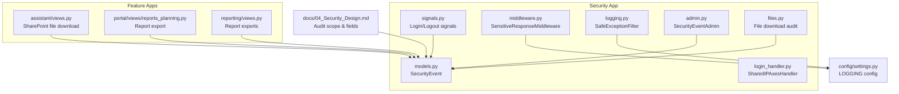

**Diagram sources**
- [models.py:35-46](file://src/apps/security/models.py#L35-L46)
- [signals.py:7-15](file://src/apps/security/signals.py#L7-L15)
- [middleware.py:7-28](file://src/apps/security/middleware.py#L7-L28)
- [logging.py:6-13](file://src/apps/security/logging.py#L6-L13)
- [login_handler.py:9-24](file://src/apps/security/login_handler.py#L9-L24)
- [admin.py:52-67](file://src/apps/security/admin.py#L52-L67)
- [files.py:50-50](file://src/apps/security/files.py#L50-L50)
- [views.py:157-157](file://src/apps/assistant/views.py#L157-L157)
- [reports_planning.py:86-86](file://src/apps/portal/views/reports_planning.py#L86-L86)
- [views.py:81-120](file://src/apps/reporting/views.py#L81-L120)
- [settings.py:486-545](file://src/config/settings.py#L486-L545)
- [04_Security_Design.md:591-667](file://docs/04_Security_Design.md#L591-L667)

**Section sources**
- [models.py:35-46](file://src/apps/security/models.py#L35-L46)
- [settings.py:486-545](file://src/config/settings.py#L486-L545)
- [04_Security_Design.md:591-667](file://docs/04_Security_Design.md#L591-L667)

## Core Components
- **SecurityEvent model**: Stores user, action, resource, optional record identifier, and timestamp. It is designed to store only access metadata and never sensitive values.
- **Authentication signals**: Automatically record login and logout events using Django’s built-in authentication signals.
- **View-level audit points**: File downloads and data exports create `SecurityEvent` records with specific actions and resources.
- **Sensitive response middleware**: Enforces idle session expiration and prevents caching of authenticated responses.
- **Safe exception filter**: Prevents persisting exception payloads when `DEBUG=False`.
- **Shared IP Axes handler**: Adjusts failed-login scoring across username and shared IP thresholds.
- **Admin interface**: Read-only view of security events restricted to privileged roles.

**Section sources**
- [models.py:35-46](file://src/apps/security/models.py#L35-L46)
- [signals.py:7-15](file://src/apps/security/signals.py#L7-L15)
- [files.py:50-50](file://src/apps/security/files.py#L50-L50)
- [views.py:157-157](file://src/apps/assistant/views.py#L157-L157)
- [reports_planning.py:86-86](file://src/apps/portal/views/reports_planning.py#L86-L86)
- [views.py:81-120](file://src/apps/reporting/views.py#L81-L120)
- [middleware.py:7-28](file://src/apps/security/middleware.py#L7-L28)
- [logging.py:6-13](file://src/apps/security/logging.py#L6-L13)
- [login_handler.py:9-24](file://src/apps/security/login_handler.py#L9-L24)
- [admin.py:52-67](file://src/apps/security/admin.py#L52-L67)

## Architecture Overview
The audit system combines three layers:
1. **Signal layer**: Captures authentication lifecycle events without requiring explicit code in views.
2. **Application layer**: Feature modules explicitly record sensitive operations like file downloads and data exports.
3. **Infrastructure layer**: Middleware protects sessions and responses; logging configuration ensures safe, rotated logs.

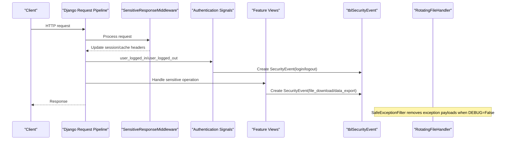

**Diagram sources**
- [middleware.py:12-28](file://src/apps/security/middleware.py#L12-L28)
- [signals.py:7-15](file://src/apps/security/signals.py#L7-L15)
- [files.py:50-50](file://src/apps/security/files.py#L50-L50)
- [views.py:157-157](file://src/apps/assistant/views.py#L157-L157)
- [reports_planning.py:86-86](file://src/apps/portal/views/reports_planning.py#L86-L86)
- [views.py:81-120](file://src/apps/reporting/views.py#L81-L120)
- [logging.py:6-13](file://src/apps/security/logging.py#L6-L13)

## Detailed Component Analysis

### Security Event Model
The `SecurityEvent` model stores minimal, non-sensitive metadata about security-relevant actions.

| Field | Purpose | Notes |
|---|---|---|
| `user` | Identifies the actor | Nullable; may be absent for background or unauthenticated contexts |
| `action` | Categorizes the event | Examples include `login`, `logout`, `file_download`, `data_export` |
| `resource` | Describes the target area | Examples include `authentication`, `export_employees`, report URL names, or model labels |
| `record_id` | Optional stable reference | Used for hashed or normalized identifiers where appropriate |
| `occurred_at` | Timestamp | Indexed for efficient time-based queries |

Design constraint: The model comment explicitly states it should not store values, filenames, query strings, or secrets.

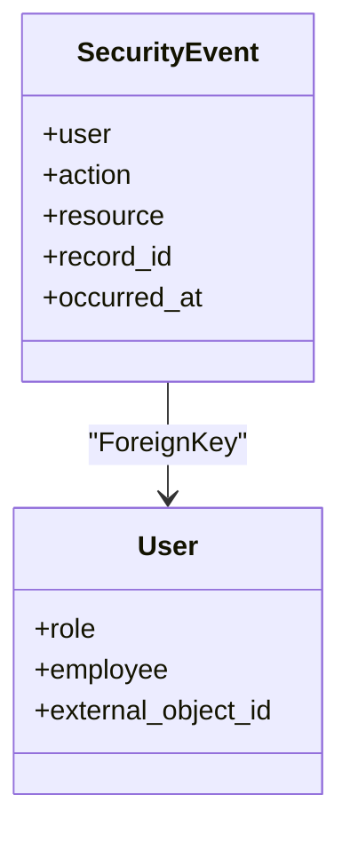

**Diagram sources**
- [models.py:35-46](file://src/apps/security/models.py#L35-L46)
- [models.py:17-32](file://src/apps/security/models.py#L17-L32)

**Section sources**
- [models.py:35-46](file://src/apps/security/models.py#L35-L46)

### Authentication Signal Handlers
Login and logout events are captured through Django’s authentication signals. Login always creates an event; logout creates an event only when a user object is present.

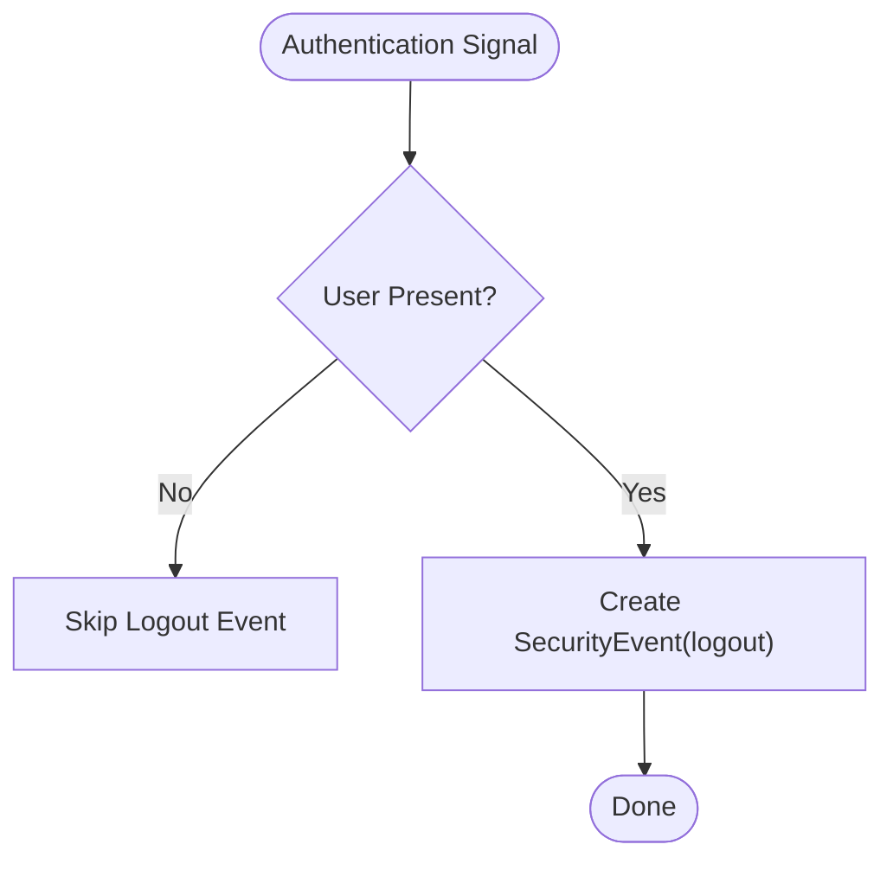

**Diagram sources**
- [signals.py:7-15](file://src/apps/security/signals.py#L7-L15)

**Section sources**
- [signals.py:7-15](file://src/apps/security/signals.py#L7-L15)

### File Download Audit Point
When a protected file is downloaded, the system records a `file_download` event. The resource uses the model label, and the record identifier is the object’s primary key.

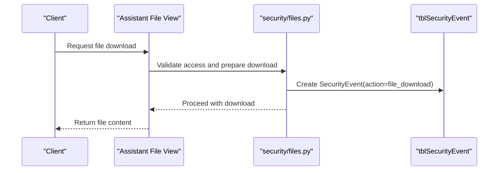

**Diagram sources**
- [files.py:50-50](file://src/apps/security/files.py#L50-L50)
- [views.py:157-157](file://src/apps/assistant/views.py#L157-L157)

**Section sources**
- [files.py:50-50](file://src/apps/security/files.py#L50-L50)
- [views.py:157-157](file://src/apps/assistant/views.py#L157-L157)

### Data Export Audit Points
Data exports are recorded with action `data_export`. Resources vary by module:
- Reporting views use the URL name as the resource.
- Planning report exports use a constructed audit label.
- HCNS document exports use a slug-based resource.

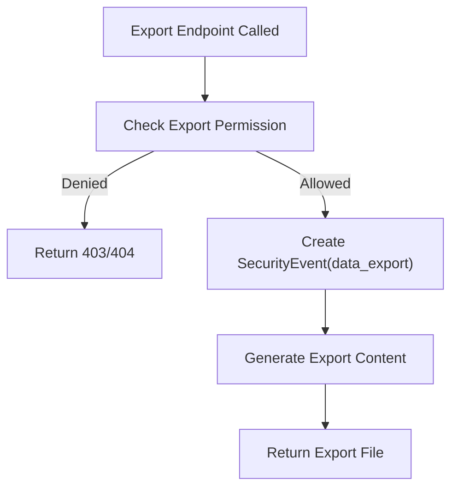

**Diagram sources**
- [views.py:81-120](file://src/apps/reporting/views.py#L81-L120)
- [reports_planning.py:86-86](file://src/apps/portal/views/reports_planning.py#L86-L86)

**Section sources**
- [views.py:81-120](file://src/apps/reporting/views.py#L81-L120)
- [reports_planning.py:86-86](file://src/apps/portal/views/reports_planning.py#L86-L86)

### Sensitive Response Middleware
The middleware enforces two important behaviors:
- Idle session expiration based on `SESSION_IDLE_TIMEOUT`.
- Cache protection for authenticated responses by setting private, no-store, no-cache, must-revalidate headers and additional legacy cache-control headers.

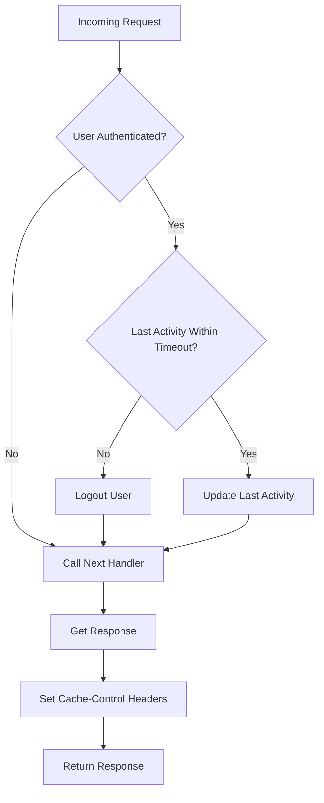

**Diagram sources**
- [middleware.py:12-28](file://src/apps/security/middleware.py#L12-L28)

**Section sources**
- [middleware.py:7-28](file://src/apps/security/middleware.py#L7-L28)

### Safe Exception Filter
The `SafeExceptionFilter` replaces exception payloads with a safe message when `DEBUG=False`. This prevents SQL statements, Graph API calls, or other secrets from being persisted in logs.

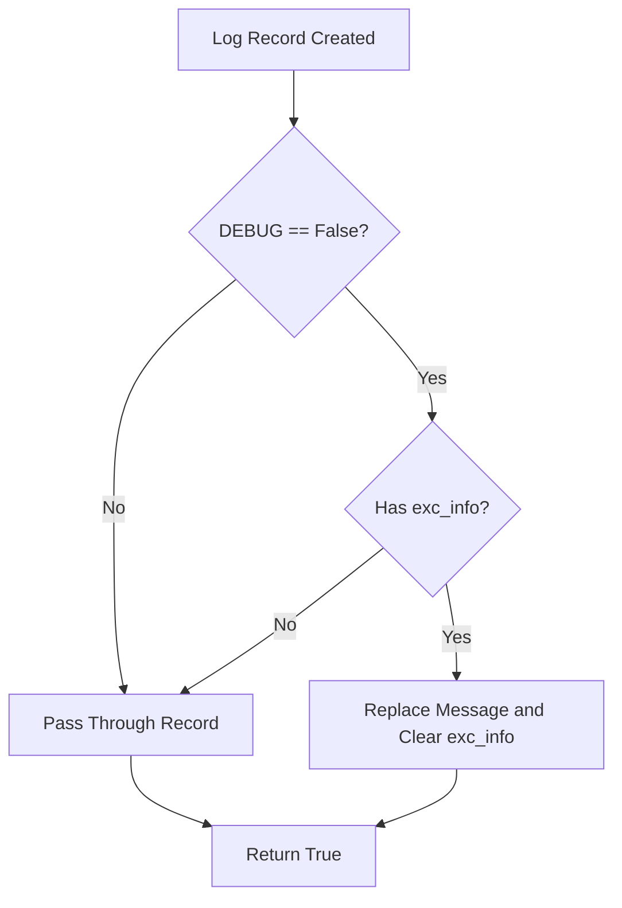

**Diagram sources**
- [logging.py:6-13](file://src/apps/security/logging.py#L6-L13)

**Section sources**
- [logging.py:6-13](file://src/apps/security/logging.py#L6-L13)

### Shared IP Axes Handler
The custom Axes handler supports separate thresholds for username failures and shared IP failures. It scales the IP failure score so the configured IP limit is reached at `AXES_IP_FAILURE_LIMIT`, while still respecting the per-username limit. On successful login, it resets only the successful username’s attempts, preserving shared IP risk signals.

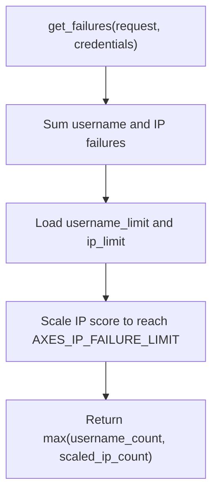

**Diagram sources**
- [login_handler.py:9-19](file://src/apps/security/login_handler.py#L9-L19)

**Section sources**
- [login_handler.py:9-24](file://src/apps/security/login_handler.py#L9-L24)

### Admin Interface for Security Events
The `SecurityEventAdmin` provides read-only access to security events. Only `SUPER_ADMIN` and `SYS_ADMIN` can view them, and no add/change/delete permissions are granted.

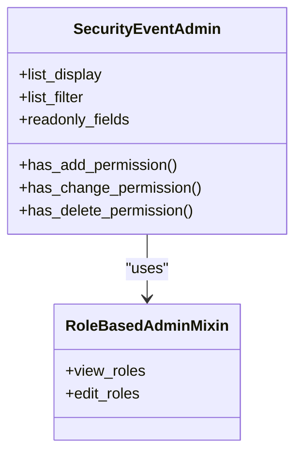

**Diagram sources**
- [admin.py:52-67](file://src/apps/security/admin.py#L52-L67)

**Section sources**
- [admin.py:52-67](file://src/apps/security/admin.py#L52-L67)

### Audit Trail Format and Design Alignment
The design document defines the intended audit scope and fields. The current implementation focuses on security events and application logging rather than full row-level change auditing for every business model.

Key alignment points:
- Logged actions include `login`, `logout`, `file_download`, and `data_export`.
- The design lists broader actions such as `create`, `update`, `delete`, `approve`, `reject`, `cancel`; these are not uniformly represented by the current `SecurityEvent` model.
- The design specifies fields like `TableName`, `RecordID`, `OldValue`, `NewValue`, `ChangedBy`, `ChangedDate`, `IPAddress`; the current `SecurityEvent` model stores `user`, `action`, `resource`, `record_id`, and `occurred_at`, but does not store old/new values or IP address.

**Section sources**
- [04_Security_Design.md:591-667](file://docs/04_Security_Design.md#L591-L667)
- [models.py:35-46](file://src/apps/security/models.py#L35-L46)

## Dependency Analysis
The audit system has clear boundaries:
- `signals.py` depends on `models.SecurityEvent` and Django authentication signals.
- Feature views depend on `models.SecurityEvent` to record sensitive operations.
- `middleware.py` depends on Django settings and session/cache utilities.
- `logging.py` depends on Django settings to determine whether to sanitize exceptions.
- `login_handler.py` depends on Axes and Django settings for lockout parameters.
- `admin.py` registers `SecurityEvent` with role-based restrictions.

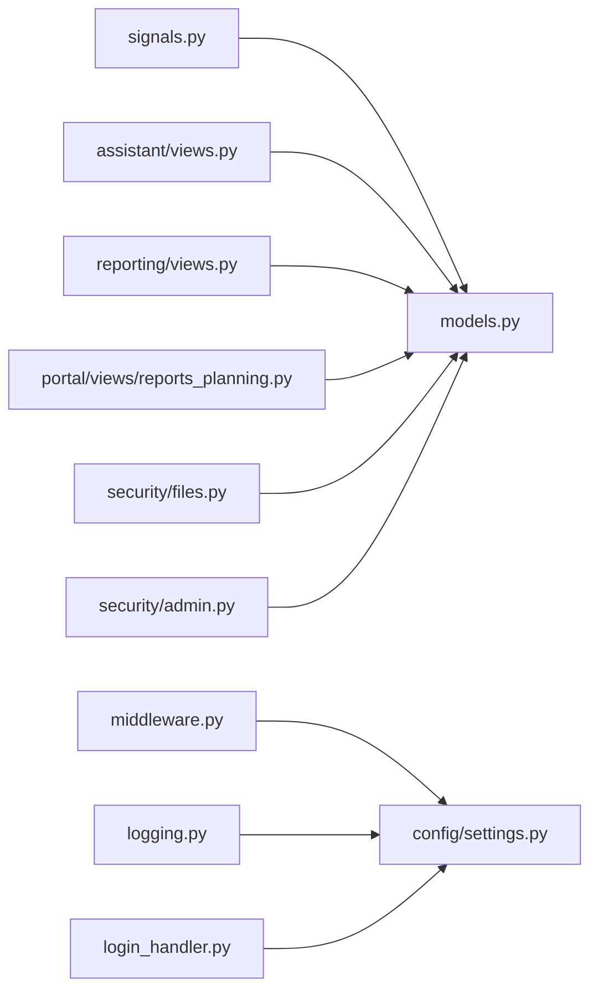

**Diagram sources**
- [signals.py:1-15](file://src/apps/security/signals.py#L1-L15)
- [models.py:35-46](file://src/apps/security/models.py#L35-L46)
- [views.py:157-157](file://src/apps/assistant/views.py#L157-L157)
- [views.py:81-120](file://src/apps/reporting/views.py#L81-L120)
- [reports_planning.py:86-86](file://src/apps/portal/views/reports_planning.py#L86-L86)
- [files.py:50-50](file://src/apps/security/files.py#L50-L50)
- [middleware.py:1-28](file://src/apps/security/middleware.py#L1-L28)
- [logging.py:1-13](file://src/apps/security/logging.py#L1-L13)
- [login_handler.py:1-24](file://src/apps/security/login_handler.py#L1-L24)
- [admin.py:52-67](file://src/apps/security/admin.py#L52-L67)
- [settings.py:486-545](file://src/config/settings.py#L486-L545)

**Section sources**
- [signals.py:1-15](file://src/apps/security/signals.py#L1-L15)
- [models.py:35-46](file://src/apps/security/models.py#L35-L46)
- [middleware.py:1-28](file://src/apps/security/middleware.py#L1-L28)
- [logging.py:1-13](file://src/apps/security/logging.py#L1-L13)
- [login_handler.py:1-24](file://src/apps/security/login_handler.py#L1-L24)
- [admin.py:52-67](file://src/apps/security/admin.py#L52-L67)
- [settings.py:486-545](file://src/config/settings.py#L486-L545)

## Performance Considerations
- **Database writes**: Each `SecurityEvent.objects.create()` call performs a database insert. For high-volume exports or frequent file downloads, this can increase write load. Consider batching or asynchronous processing if volume grows significantly.
- **Index usage**: `occurred_at` is indexed, making time-range queries efficient. Avoid scanning large unfiltered result sets.
- **Logging rotation**: Rotating file handlers rotate at 5 MB and retain 30 backups. This limits disk growth but does not replace centralized log aggregation.
- **Exception sanitization**: The safe exception filter avoids writing large or sensitive traceback payloads in production, reducing I/O and leakage risk.
- **Session checks**: Middleware updates session activity and adds headers on every request. This is lightweight but should be reviewed if request throughput becomes extremely high.

[No sources needed since this section provides general guidance]

## Troubleshooting Guide

### Missing Security Events
- Verify that the relevant view or signal path actually executes.
- Confirm that the user is authenticated when expected; anonymous users will have a null `user` field.
- Check that the action and resource values match expectations.

**Section sources**
- [signals.py:7-15](file://src/apps/security/signals.py#L7-L15)
- [files.py:50-50](file://src/apps/security/files.py#L50-L50)
- [views.py:81-120](file://src/apps/reporting/views.py#L81-L120)

### Excessive Failed Login Lockouts
- Review `AXES_LOCKOUT_PARAMETERS` and `AXES_IP_FAILURE_LIMIT`.
- Confirm that `SharedIPAxesHandler` is configured as required by the custom handler.
- Understand that a successful login resets only the successful username’s attempts, not all attempts on the same IP.

**Section sources**
- [login_handler.py:9-24](file://src/apps/security/login_handler.py#L9-L24)

### Sensitive Data Appearing in Logs
- Ensure `DEBUG=False` in production so `SafeExceptionFilter` suppresses exception payloads.
- Verify that audit handlers do not manually log request bodies, query strings, filenames, or secrets.

**Section sources**
- [logging.py:6-13](file://src/apps/security/logging.py#L6-L13)
- [models.py:35-36](file://src/apps/security/models.py#L35-L36)

### Unable to View Security Events in Admin
- Only `SUPER_ADMIN` and `SYS_ADMIN` can view security events.
- Add/change/delete permissions are disabled in `SecurityEventAdmin`.

**Section sources**
- [admin.py:52-67](file://src/apps/security/admin.py#L52-L67)

## Conclusion
The audit and security events system captures authentication lifecycle events and selected sensitive operations such as file downloads and data exports. It prioritizes metadata-only storage, safe exception logging, session protection, and admin-read-only access to security events. While the design document describes a broader audit trail including old/new values and IP addresses, the current implementation focuses on `SecurityEvent` metadata and application logging. For compliance requirements demanding immutable, full-change audit trails, the system would need extension beyond the current model and middleware.

[No sources needed since this section summarizes without analyzing specific files]