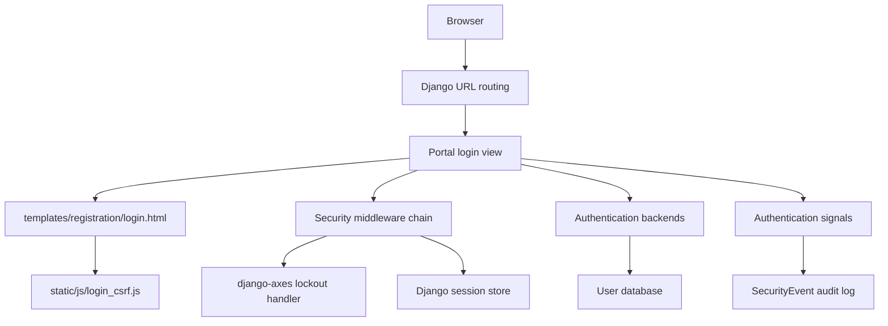
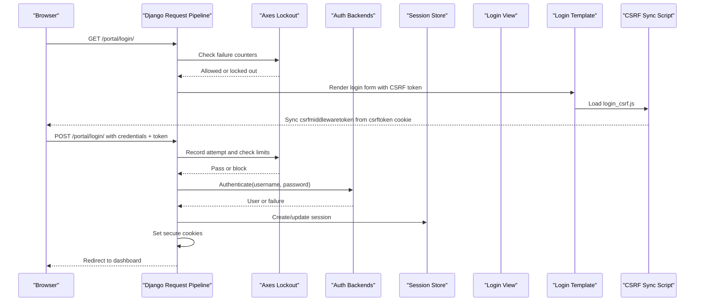
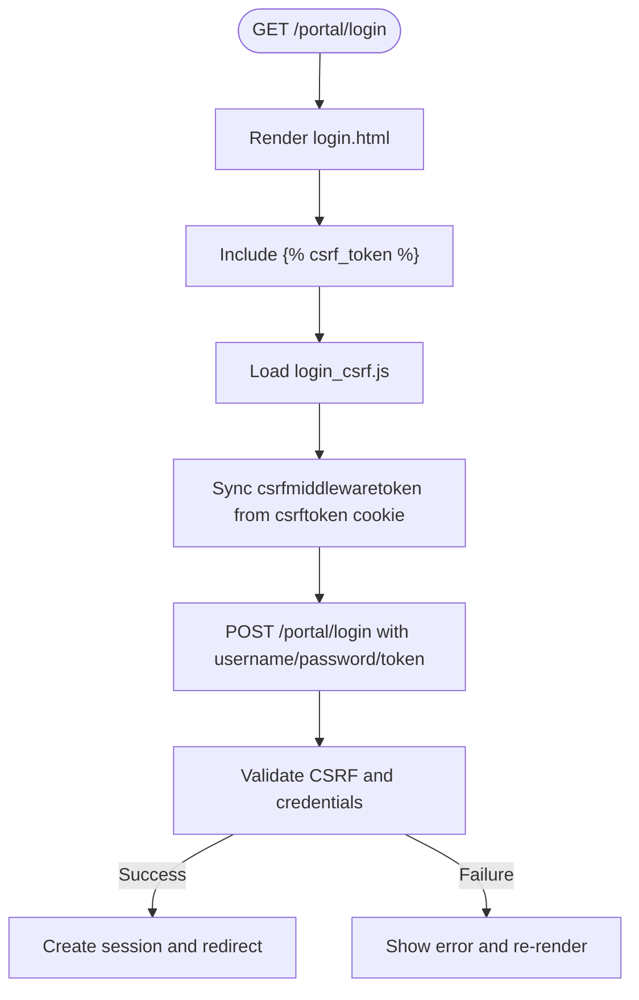
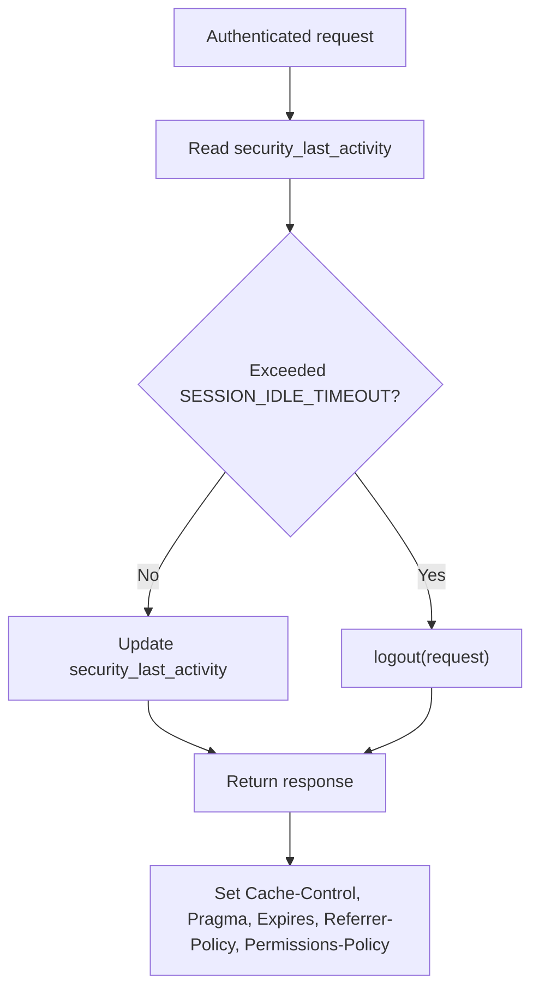
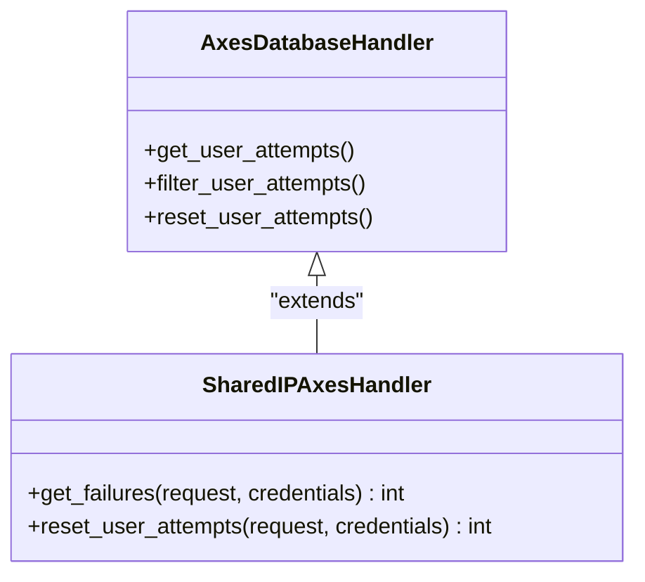
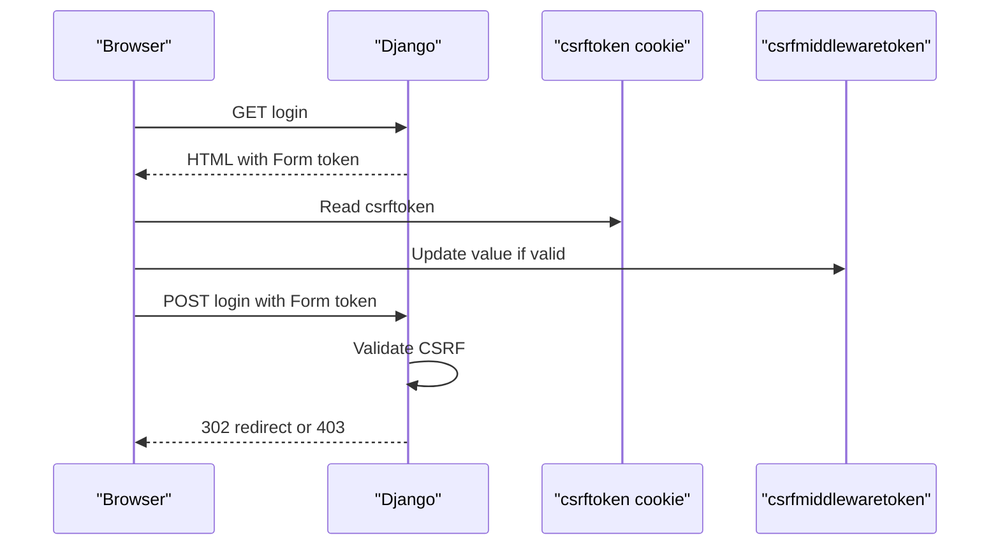
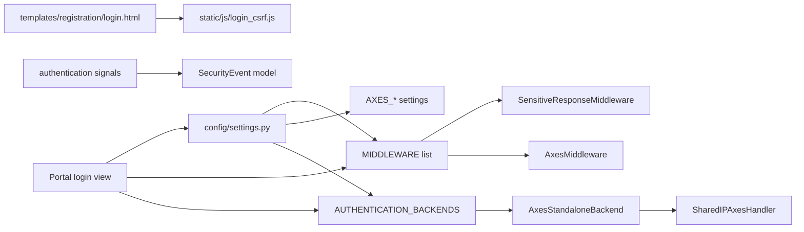

# Authentication System

<cite>
**Referenced Files in This Document**
- [settings.py](file://src/config/settings.py)
- [middleware.py](file://src/apps/security/middleware.py)
- [login_handler.py](file://src/apps/security/login_handler.py)
- [models.py](file://src/apps/security/models.py)
- [signals.py](file://src/apps/security/signals.py)
- [logging.py](file://src/apps/security/logging.py)
- [login.html](file://src/templates/registration/login.html)
- [login_csrf.js](file://src/static/js/login_csrf.js)
- [test_login_csrf.py](file://src/apps/security/test_login_csrf.py)
</cite>

## Table of Contents
1. [Introduction](#introduction)
2. [Project Structure](#project-structure)
3. [Core Components](#core-components)
4. [Architecture Overview](#architecture-overview)
5. [Detailed Component Analysis](#detailed-component-analysis)
6. [Dependency Analysis](#dependency-analysis)
7. [Performance Considerations](#performance-considerations)
8. [Troubleshooting Guide](#troubleshooting-guide)
9. [Conclusion](#conclusion)

## Introduction
This document explains the IHRMS authentication system, focusing on login flow, session management, security middleware, CSRF protection, password security, and django-axes integration for brute-force protection. It also provides configuration examples and operational guidance suitable for both developers and operators.

## Project Structure
The authentication surface spans Django settings, a dedicated security app, templates, and client-side JavaScript:

**Diagram sources**
- [settings.py:145-169](file://src/config/settings.py#L145-L169)
- [login.html:26-45](file://src/templates/registration/login.html#L26-L45)
- [login_csrf.js:1-19](file://src/static/js/login_csrf.js#L1-L19)
- [login_handler.py:9-24](file://src/apps/security/login_handler.py#L9-L24)
- [signals.py:7-15](file://src/apps/security/signals.py#L7-L15)

**Section sources**
- [settings.py:111-169](file://src/config/settings.py#L111-L169)
- [login.html:1-47](file://src/templates/registration/login.html#L1-L47)
- [login_csrf.js:1-20](file://src/static/js/login_csrf.js#L1-L20)

## Core Components
- Authentication backends: django-axes standalone backend plus Django’s model backend.
- Brute-force protection: django-axes with custom shared-IP handler and separate username/IP thresholds.
- Session management: secure cookie flags, idle timeout enforcement, browser-close expiration.
- CSRF protection: standard Django CSRF with token rotation support for multi-tab login.
- Security middleware: sensitive response headers, cache control, idle logout, permissions policy.
- Auditing: login/logout events recorded as metadata-only security events.
- Password security: built-in validators enforcing complexity rules.

**Section sources**
- [settings.py:158-169](file://src/config/settings.py#L158-L169)
- [settings.py:228-244](file://src/config/settings.py#L228-L244)
- [settings.py:91-100](file://src/config/settings.py#L91-L100)
- [middleware.py:7-28](file://src/apps/security/middleware.py#L7-L28)
- [signals.py:7-15](file://src/apps/security/signals.py#L7-L15)

## Architecture Overview
The request lifecycle for login and protected pages passes through a strict middleware pipeline that enforces HTTPS (when enabled), CSRF validation, authentication, sensitive response policies, and axes-based lockout checks.

**Diagram sources**
- [settings.py:145-169](file://src/config/settings.py#L145-L169)
- [login.html:26-45](file://src/templates/registration/login.html#L26-L45)
- [login_csrf.js:1-19](file://src/static/js/login_csrf.js#L1-L19)
- [login_handler.py:9-24](file://src/apps/security/login_handler.py#L9-L24)

## Detailed Component Analysis

### Login Flow
- The login page is rendered by the portal login view using the registration template.
- The form includes a server-rendered CSRF token and a hidden next field.
- A small client script synchronizes the form token with the current csrftoken cookie when another tab rotates it, preventing 403 errors without weakening server-side checks.
- On successful authentication, Django sets a secure session cookie and redirects to the dashboard.

**Diagram sources**
- [login.html:26-45](file://src/templates/registration/login.html#L26-L45)
- [login_csrf.js:1-19](file://src/static/js/login_csrf.js#L1-L19)

**Section sources**
- [login.html:1-47](file://src/templates/registration/login.html#L1-L47)
- [login_csrf.js:1-20](file://src/static/js/login_csrf.js#L1-L20)
- [test_login_csrf.py:10-28](file://src/apps/security/test_login_csrf.py#L10-L28)

### Session Management and Idle Timeout
- Sessions expire at browser close and after a configurable idle timeout.
- SensitiveResponseMiddleware logs out authenticated users who exceed the idle threshold and marks responses as private with no-store/no-cache.
- Secure cookie flags are enforced in production-like environments.

**Diagram sources**
- [middleware.py:7-28](file://src/apps/security/middleware.py#L7-L28)
- [settings.py:91-100](file://src/config/settings.py#L91-L100)

**Section sources**
- [middleware.py:7-28](file://src/apps/security/middleware.py#L7-L28)
- [settings.py:91-100](file://src/config/settings.py#L91-L100)

### django-axes Integration and Shared-IP Lockout
- Axes uses a persistent database handler with two lockout dimensions: username and IP address.
- A custom handler computes a combined score so that the IP limit can be configured independently from the per-username limit.
- Successful login resets only the matching username counter, preserving shared-IP risk signals.

**Diagram sources**
- [login_handler.py:9-24](file://src/apps/security/login_handler.py#L9-L24)

Configuration highlights:
- AUTHENTICATION_BACKENDS include AxesStandaloneBackend before ModelBackend.
- AXES_LOCKOUT_PARAMETERS set to ["username", "ip_address"].
- AXES_FAILURE_LIMIT controls per-username threshold; AXES_IP_FAILURE_LIMIT controls shared-IP threshold.
- AXES_COOLOFF_TIME defines lockout duration.
- AXES_SENSITIVE_PARAMETERS excludes secrets from logs.

**Section sources**
- [settings.py:158-169](file://src/config/settings.py#L158-L169)
- [login_handler.py:1-24](file://src/apps/security/login_handler.py#L1-L24)

### CSRF Protection Mechanisms
- Standard Django CSRF protection is enforced.
- The login template includes the CSRF token and loads a scoped script to keep the token synchronized across tabs if the cookie rotates.
- Tests verify that old tokens are rejected after rotation while the current cookie value is accepted, and missing/forged tokens remain blocked.

**Diagram sources**
- [login.html:26-45](file://src/templates/registration/login.html#L26-L45)
- [login_csrf.js:1-19](file://src/static/js/login_csrf.js#L1-L19)
- [test_login_csrf.py:30-43](file://src/apps/security/test_login_csrf.py#L30-L43)

**Section sources**
- [login.html:26-45](file://src/templates/registration/login.html#L26-L45)
- [login_csrf.js:1-20](file://src/static/js/login_csrf.js#L1-L20)
- [test_login_csrf.py:10-43](file://src/apps/security/test_login_csrf.py#L10-L43)

### Secure Cookie Handling and Response Hardening
- In HTTPS-enforced environments, session and CSRF cookies are marked secure; HSTS may be enabled via environment variables.
- SensitiveResponseMiddleware adds privacy and caching headers to authenticated responses and sensitive endpoints.
- X-Frame-Options and Content-Type sniffing protections are enabled globally.

Key behaviors:
- SESSION_COOKIE_SECURE and CSRF_COOKIE_SECURE are enabled when ENABLE_HTTPS_ENFORCEMENT is true.
- SECURE_PROXY_SSL_HEADER supports reverse proxies like IIS.
- Response headers include Private, No-Store, No-Cache, Must-Revalidate, Pragma, Expires, Referrer-Policy, and Permissions-Policy.

**Section sources**
- [settings.py:56-89](file://src/config/settings.py#L56-L89)
- [settings.py:91-100](file://src/config/settings.py#L91-L100)
- [middleware.py:22-28](file://src/apps/security/middleware.py#L22-L28)

### Password Security Measures
- Built-in validators enforce similarity to user attributes, minimum length, common passwords, and numeric-only passwords.
- These apply to user creation and password changes.

**Section sources**
- [settings.py:228-244](file://src/config/settings.py#L228-L244)

### Authentication Metadata and Auditing
- Login and logout actions are recorded as SecurityEvent rows containing only non-sensitive metadata.
- Logging filters prevent exception payloads from being persisted in non-debug environments.

**Section sources**
- [signals.py:1-15](file://src/apps/security/signals.py#L1-L15)
- [models.py:35-46](file://src/apps/security/models.py#L35-L46)
- [logging.py:1-14](file://src/apps/security/logging.py#L1-L14)

## Dependency Analysis
The following diagram shows how core authentication components depend on each other:

**Diagram sources**
- [settings.py:145-169](file://src/config/settings.py#L145-L169)
- [login_handler.py:9-24](file://src/apps/security/login_handler.py#L9-L24)
- [login.html:26-45](file://src/templates/registration/login.html#L26-L45)
- [login_csrf.js:1-19](file://src/static/js/login_csrf.js#L1-L19)
- [signals.py:7-15](file://src/apps/security/signals.py#L7-L15)

**Section sources**
- [settings.py:145-169](file://src/config/settings.py#L145-L169)
- [login_handler.py:1-24](file://src/apps/security/login_handler.py#L1-L24)
- [login.html:1-47](file://src/templates/registration/login.html#L1-L47)
- [login_csrf.js:1-20](file://src/static/js/login_csrf.js#L1-L20)
- [signals.py:1-15](file://src/apps/security/signals.py#L1-L15)

## Performance Considerations
- Keep AXES_VERBOSE off in production to reduce overhead.
- Use a robust session backend (e.g., database or cache-backed sessions) for large-scale deployments.
- Ensure CSRF and session cookies are served over HTTPS to avoid unnecessary redirects and improve performance.
- Avoid excessive logging around authentication paths; rely on structured audit events instead of verbose logs.
- Tune SESSION_IDLE_TIMEOUT based on expected user behavior to balance security and convenience.

[No sources needed since this section provides general guidance]

## Troubleshooting Guide
Common issues and resolutions:

- 403 Forbidden on login after multiple tabs:
  - Cause: CSRF cookie rotated by another login; old token submitted.
  - Resolution: Ensure login_csrf.js is loaded and active; tests confirm current cookie token is accepted.

- Repeated lockouts due to shared IP:
  - Cause: Multiple coworkers behind NAT or proxy share an IP.
  - Resolution: Adjust AXES_IP_FAILURE_LIMIT appropriately; the custom handler scales IP failures against the per-username limit.

- Redirect loops under reverse proxy:
  - Cause: Missing SECURE_PROXY_SSL_HEADER when behind IIS or similar.
  - Resolution: Configure SECURE_PROXY_SSL_HEADER as documented when enabling HTTPS enforcement.

- Session expires unexpectedly:
  - Cause: Idle timeout exceeded or browser-close expiration.
  - Resolution: Review SESSION_IDLE_TIMEOUT and SESSION_EXPIRE_AT_BROWSER_CLOSE; ensure last activity updates occur on authenticated requests.

- CSRF token mismatch in automated flows:
  - Cause: Missing or invalid csrfmiddlewaretoken.
  - Resolution: Verify token presence and validity; tests cover missing, empty, and malformed tokens.

- Excessive exception details in logs:
  - Cause: Exception payloads may contain secrets.
  - Resolution: SafeExceptionFilter suppresses payloads in non-debug mode.

**Section sources**
- [test_login_csrf.py:30-43](file://src/apps/security/test_login_csrf.py#L30-L43)
- [login_handler.py:9-24](file://src/apps/security/login_handler.py#L9-L24)
- [settings.py:56-89](file://src/config/settings.py#L56-L89)
- [middleware.py:12-28](file://src/apps/security/middleware.py#L12-L28)
- [logging.py:6-13](file://src/apps/security/logging.py#L6-L13)

## Conclusion
IHRMS implements a layered authentication system combining Django’s built-in security features with django-axes for brute-force protection. The design emphasizes secure defaults, explicit configuration for production, and careful handling of shared-IP scenarios. Session and CSRF protections are reinforced by middleware and targeted client logic, while auditing captures minimal but useful metadata. Operators should configure HTTPS enforcement, appropriate lockout thresholds, and sensible idle timeouts to balance security and usability at scale.