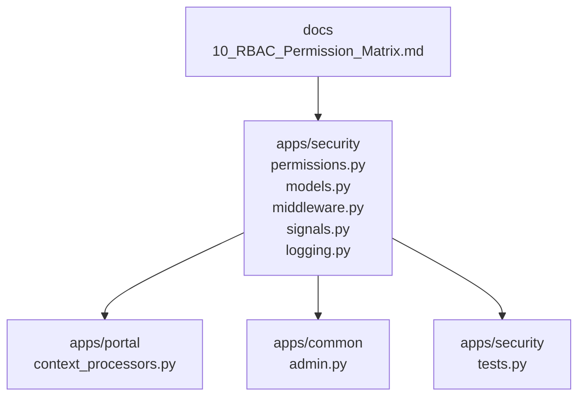
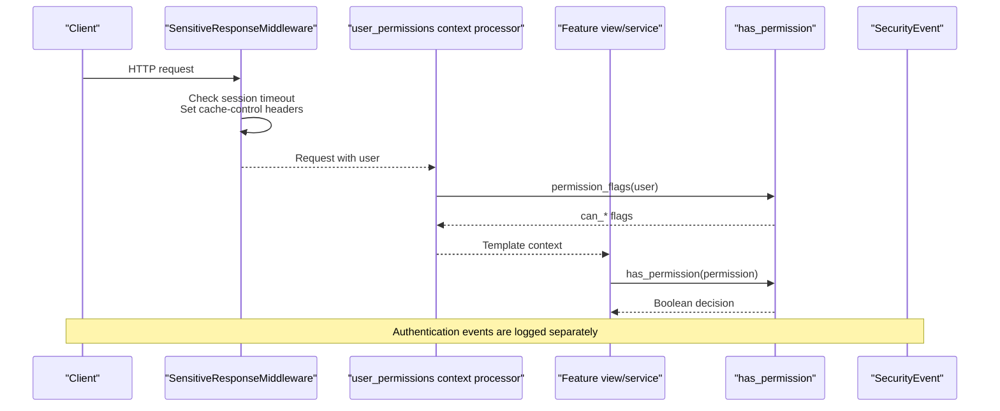
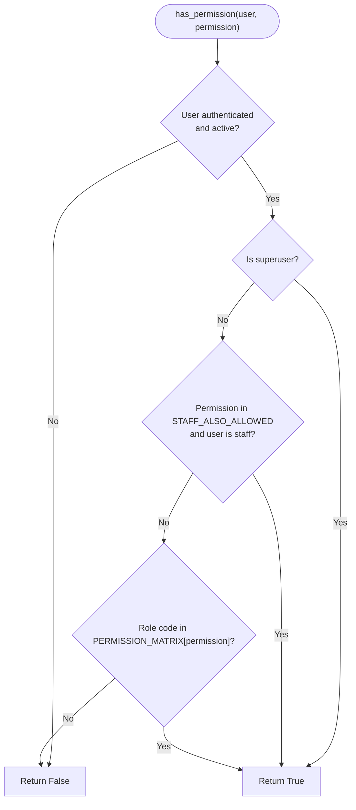
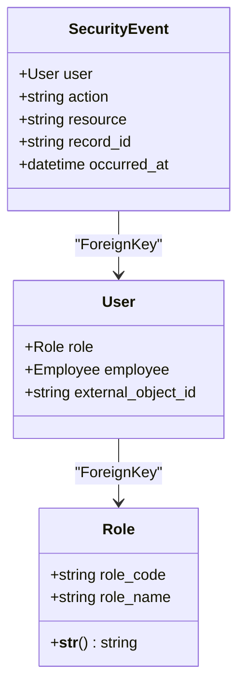
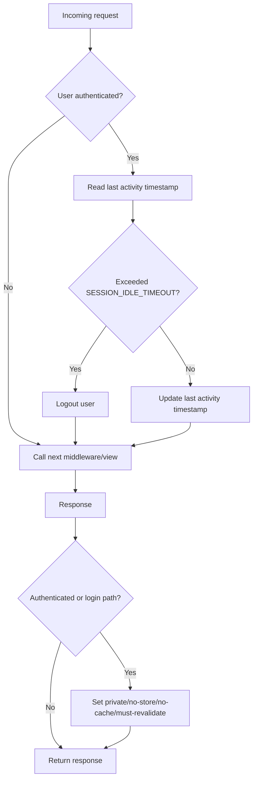
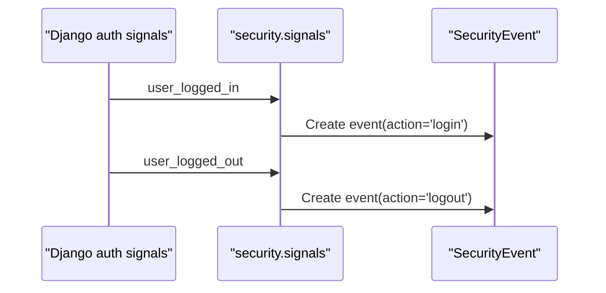
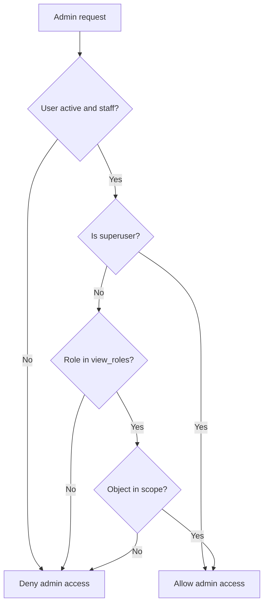
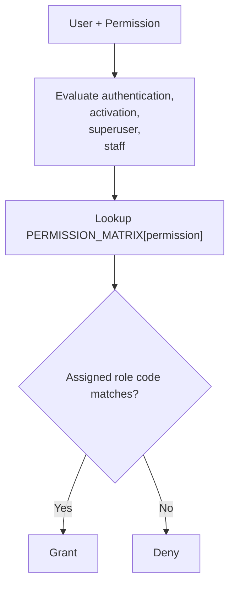
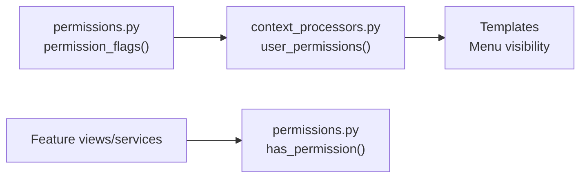

# Authorization & RBAC System

<cite>
**Referenced Files in This Document**   
- [permissions.py](file://src/apps/security/permissions.py)
- [models.py](file://src/apps/security/models.py)
- [middleware.py](file://src/apps/security/middleware.py)
- [logging.py](file://src/apps/security/logging.py)
- [signals.py](file://src/apps/security/signals.py)
- [context_processors.py](file://src/apps/portal/context_processors.py)
- [admin.py](file://src/apps/common/admin.py)
- [10_RBAC_Permission_Matrix.md](file://docs/10_RBAC_Permission_Matrix.md)
- [tests.py](file://src/apps/security/tests.py)
</cite>

## Table of Contents
1. [Introduction](#introduction)
2. [Project Structure](#project-structure)
3. [Core Components](#core-components)
4. [Architecture Overview](#architecture-overview)
5. [Detailed Component Analysis](#detailed-component-analysis)
6. [Permission Matrix and Domain Coverage](#permission-matrix-and-domain-coverage)
7. [Role Hierarchy, Inheritance, and Dynamic Evaluation](#role-hierarchy-inheritance-and-dynamic-evaluation)
8. [View-Level Access Controls and Menu Visibility](#view-level-access-controls-and-menu-visibility)
9. [Custom Permission Decorators and Middleware-Based Checks](#custom-permission-decorators-and-middleware-based-checks)
10. [Extending the Permission System](#extending-the-permission-system)
11. [Permission Auditing and Debugging](#permission-auditing-and-debugging)
12. [Performance Considerations](#performance-considerations)
13. [Troubleshooting Guide](#troubleshooting-guide)
14. [Conclusion](#conclusion)

## Introduction
This document explains the Role-Based Access Control system used across the application’s 24 domain applications. The system is centered on a single permission matrix that maps 11 predefined roles to explicit permissions. It also documents how roles are modeled, how authorization is evaluated at runtime, how menus and views use permission flags, and how security events are audited.

The goal is to help developers understand:
- Where permissions are defined.
- How roles map to permissions.
- How views, templates, services, and admin pages enforce access.
- How to extend the system safely without breaking existing behavior.
- How to audit and debug authorization decisions.

## Project Structure
The RBAC implementation lives primarily under the `security` application, with cross-cutting usage in portal context processors, common admin mixins, and many feature modules.

**Diagram sources**
- [permissions.py:1-152](file://src/apps/security/permissions.py#L1-L152)
- [models.py:1-46](file://src/apps/security/models.py#L1-L46)
- [middleware.py:1-29](file://src/apps/security/middleware.py#L1-L29)
- [signals.py:1-16](file://src/apps/security/signals.py#L1-L16)
- [logging.py:1-14](file://src/apps/security/logging.py#L1-L14)
- [context_processors.py:1-37](file://src/apps/portal/context_processors.py#L1-L37)
- [admin.py:1-56](file://src/apps/common/admin.py#L1-L56)
- [10_RBAC_Permission_Matrix.md:1-711](file://docs/10_RBAC_Permission_Matrix.md#L1-L711)
- [tests.py:41-167](file://src/apps/security/tests.py#L41-L167)

**Section sources**
- [permissions.py:1-152](file://src/apps/security/permissions.py#L1-L152)
- [models.py:1-46](file://src/apps/security/models.py#L1-L46)
- [context_processors.py:1-37](file://src/apps/portal/context_processors.py#L1-L37)
- [admin.py:1-56](file://src/apps/common/admin.py#L1-L56)
- [10_RBAC_Permission_Matrix.md:1-711](file://docs/10_RBAC_Permission_Matrix.md#L1-L711)

## Core Components
The RBAC system has five core components:

| Component | Responsibility | Key Implementation |
|---|---|---|
| Permission matrix | Central definition of allowed roles for each permission | `PERMISSION_MATRIX`, `STAFF_ALSO_ALLOWED` |
| Role model | Stores role codes and names | `Role` |
| User model | Links users to roles and employee records | `User` |
| Authorization helpers | Evaluates whether a user has a permission | `has_permission`, `get_role_code`, `permission_flags` |
| Audit and session controls | Logs authentication events and secures responses | `SecurityEvent`, `SensitiveResponseMiddleware`, `SafeExceptionFilter` |

**Section sources**
- [permissions.py:10-152](file://src/apps/security/permissions.py#L10-L152)
- [models.py:5-46](file://src/apps/security/models.py#L5-L46)
- [middleware.py:7-28](file://src/apps/security/middleware.py#L7-L28)
- [signals.py:7-15](file://src/apps/security/signals.py#L7-L15)
- [logging.py:6-13](file://src/apps/security/logging.py#L6-L13)

## Architecture Overview
At runtime, authorization flows through these layers:

1. **Request entry**: Django receives the request.
2. **Session and response hardening**: `SensitiveResponseMiddleware` enforces idle logout and prevents caching of authenticated responses.
3. **Context preparation**: `user_permissions` adds permission flags to template context.
4. **View/service logic**: Feature code calls `has_permission` or uses role-specific checks.
5. **Admin layer**: `RoleBasedAdminMixin` restricts Django Admin visibility and mutations by role.
6. **Audit logging**: Authentication signals write metadata-only security events.

**Diagram sources**
- [middleware.py:7-28](file://src/apps/security/middleware.py#L7-L28)
- [context_processors.py:7-35](file://src/apps/portal/context_processors.py#L7-L35)
- [permissions.py:138-151](file://src/apps/security/permissions.py#L138-L151)
- [signals.py:7-15](file://src/apps/security/signals.py#L7-L15)

## Detailed Component Analysis

### Permission Matrix and Role Constants
The permission matrix is the single source of truth for role-to-permission mapping. It defines:
- 11 role constants.
- A dictionary where each key is a permission name and each value is a tuple of allowed role codes.
- A small set of permissions that are additionally granted to staff accounts.
- Helper functions for reading role codes, role names, checking permissions, and generating template flags.

Key design points:
- Superusers always pass permission checks.
- Unauthenticated or inactive users never pass permission checks.
- Staff-only permissions are explicitly listed rather than inferred from `is_staff`.
- Template-friendly flags are generated automatically from the matrix.

**Diagram sources**
- [permissions.py:138-146](file://src/apps/security/permissions.py#L138-L146)

**Section sources**
- [permissions.py:10-152](file://src/apps/security/permissions.py#L10-L152)

### Role and User Models
The data model ties users to roles and employees:

| Model | Purpose | Important Fields |
|---|---|---|
| `Role` | Defines system roles | `role_code`, `role_name` |
| `User` | Extends Django’s user model | `role`, `employee`, `external_object_id` |
| `SecurityEvent` | Audits authentication activity | `user`, `action`, `resource`, `record_id`, `occurred_at` |

Important constraints:
- A user’s role is optional but protected when deleted.
- A user’s employee link is optional and set to null if the employee record is removed.
- Security events store only metadata, not sensitive values.

**Diagram sources**
- [models.py:5-46](file://src/apps/security/models.py#L5-L46)

**Section sources**
- [models.py:5-46](file://src/apps/security/models.py#L5-L46)

### Session and Response Hardening
`SensitiveResponseMiddleware` provides two important security behaviors:

1. **Idle session expiration**: If the last recorded activity exceeds the configured session timeout, the user is logged out.
2. **Cache protection**: Responses for authenticated requests are marked private, no-store, no-cache, must-revalidate, and include additional anti-caching headers.

It also sets safe referrer and permissions policies for sensitive responses.

**Diagram sources**
- [middleware.py:7-28](file://src/apps/security/middleware.py#L7-L28)

**Section sources**
- [middleware.py:7-28](file://src/apps/security/middleware.py#L7-L28)

### Authentication Audit Signals
Authentication signals log login and logout events into `SecurityEvent`. The logs intentionally avoid storing credentials, personal field values, exception payloads, query strings, or secrets.

**Diagram sources**
- [signals.py:7-15](file://src/apps/security/signals.py#L7-L15)
- [models.py:35-46](file://src/apps/security/models.py#L35-L46)

**Section sources**
- [signals.py:7-15](file://src/apps/security/signals.py#L7-L15)
- [logging.py:6-13](file://src/apps/security/logging.py#L6-L13)

### Admin Role-Based Access
The common admin mixin provides a reusable RBAC mechanism for Django Admin pages:

- `view_roles`: Roles allowed to see the module.
- `edit_roles`: Roles allowed to add or change objects.
- Object scoping: Subclasses can override `scope_queryset` to limit data by department, project, or ownership.
- Superuser bypass: Superusers retain full admin access.

**Diagram sources**
- [admin.py:7-56](file://src/apps/common/admin.py#L7-L56)

**Section sources**
- [admin.py:7-56](file://src/apps/common/admin.py#L7-L56)

## Permission Matrix and Domain Coverage
The permission matrix defines business permissions such as leave approval, timesheet approval, task assignment, activity management, KPI scoring, document approval, recruitment, calendar management, HR management, lifecycle case management, finance management, salary scale form usage, office management, outgoing document access, procurement, asset management, report center access, and admin menu visibility.

The documentation specifies policy rules for reading, viewing, approving, exporting, and scoping data across domains including organization, human resources, recruitment, attendance, leave, payroll, contract, document, task, KPI, asset, procurement, dashboard, administration, Microsoft 365 integration, and API authorization.

The matrix is intentionally centralized so that changing who can do what requires editing one place instead of scattered view or template logic.

**Section sources**
- [permissions.py:28-109](file://src/apps/security/permissions.py#L28-L109)
- [10_RBAC_Permission_Matrix.md:32-711](file://docs/10_RBAC_Permission_Matrix.md#L32-L711)

## Role Hierarchy, Inheritance, and Dynamic Evaluation
The current implementation does not define an explicit role hierarchy table. Instead, it uses direct role membership in the permission matrix. However, there are implicit hierarchy-like behaviors:

| Behavior | Meaning |
|---|---|
| Superuser bypass | A superuser passes every permission check. |
| Staff-allowed permissions | Some permissions are additionally available to staff accounts. |
| Role-specific tuples | Each permission lists exactly which roles may perform it. |
| No inherited role codes | There is no automatic inheritance such as “manager inherits employee permissions.” |

Dynamic evaluation means that permission decisions are computed at runtime based on:
- Authentication state.
- Account activation.
- Superuser status.
- Staff status.
- Assigned role code.
- Permission name.

**Diagram sources**
- [permissions.py:138-146](file://src/apps/security/permissions.py#L138-L146)

**Section sources**
- [permissions.py:121-151](file://src/apps/security/permissions.py#L121-L151)
- [10_RBAC_Permission_Matrix.md:54-195](file://docs/10_RBAC_Permission_Matrix.md#L54-L195)

## View-Level Access Controls and Menu Visibility
Views and services across the application call `has_permission` directly. Templates receive permission flags through the portal context processor.

Key integration points:
- `permission_flags` generates `can_<permission>` booleans for all matrix permissions.
- `get_role_name` returns a readable role label for UI display.
- `user_permissions` adds menu-related flags such as admin menu visibility and activity proposal approvals.
- Many feature modules import `has_permission` to gate functionality.

**Diagram sources**
- [permissions.py:149-151](file://src/apps/security/permissions.py#L149-L151)
- [context_processors.py:7-35](file://src/apps/portal/context_processors.py#L7-L35)

**Section sources**
- [context_processors.py:7-35](file://src/apps/portal/context_processors.py#L7-L35)
- [permissions.py:149-151](file://src/apps/security/permissions.py#L149-L151)

## Custom Permission Decorators and Middleware-Based Checks
The repository does not define a dedicated custom decorator file for permissions. Instead, authorization is implemented using:

- Direct `has_permission` calls in views and services.
- Template context flags for UI-level control.
- Admin mixin for Django Admin authorization.
- Middleware for session and response security.

If you need a decorator pattern, the recommended approach is to wrap `has_permission` around view functions or class methods. For example:

- A function decorator that raises a permission error when `has_permission(user, permission)` is false.
- A class method decorator that checks permissions before executing business logic.
- A view decorator that redirects unauthorized users or returns a forbidden response.

For middleware-based checks, the existing `SensitiveResponseMiddleware` focuses on session timeout and cache safety. A new authorization middleware could be added if you want global URL-to-permission routing, but the current design prefers explicit permission checks near the business logic.

**Section sources**
- [permissions.py:138-151](file://src/apps/security/permissions.py#L138-L151)
- [middleware.py:7-28](file://src/apps/security/middleware.py#L7-L28)
- [admin.py:7-56](file://src/apps/common/admin.py#L7-L56)

## Extending the Permission System
To extend the system safely:

### Adding a New Permission
1. Add the permission name to `PERMISSION_MATRIX` in `permissions.py`.
2. Assign it to the appropriate role tuples.
3. Add corresponding checks in views, services, selectors, choices, or prefill logic.
4. Add tests verifying expected allow/deny behavior.

### Creating a New Role
1. Add a new role constant in `permissions.py`.
2. Seed the role into the database with the matching `role_code`.
3. Assign the role to test users.
4. Update `PERMISSION_MATRIX` entries that should include the new role.
5. Verify menu visibility and view access.

### Implementing Custom Permissions
Use `has_permission` for backend checks and `permission_flags` for frontend visibility. For complex conditions, combine multiple permissions or add a helper function in `permissions.py`.

### Adding Data Scoping
Use the admin mixin’s `scope_queryset` pattern for admin pages. For views and services, filter queries by department, manager tree, project, or ownership after confirming the permission.

**Section sources**
- [permissions.py:28-151](file://src/apps/security/permissions.py#L28-L151)
- [admin.py:7-56](file://src/apps/common/admin.py#L7-L56)

## Permission Auditing and Debugging
### Auditing
- Authentication events are captured by signals and stored in `SecurityEvent`.
- Events contain user, action, resource, optional record identifier, and timestamp.
- Exception logging avoids exposing sensitive payloads in non-debug environments.

### Debugging Permission Issues
Common diagnostics:
- Confirm the user is authenticated and active.
- Confirm the user has a role assigned.
- Confirm the permission exists in `PERMISSION_MATRIX`.
- Confirm the role code is included in the permission’s allowed tuple.
- Check whether `STAFF_ALSO_ALLOWED` applies.
- Use `permission_flags` to inspect what the template sees.
- Use `get_role_code` and `get_role_name` to verify identity and display labels.
- Review `SecurityEvent` for login/logout timing and session behavior.

**Section sources**
- [signals.py:7-15](file://src/apps/security/signals.py#L7-L15)
- [models.py:35-46](file://src/apps/security/models.py#L35-L46)
- [logging.py:6-13](file://src/apps/security/logging.py#L6-L13)
- [permissions.py:121-151](file://src/apps/security/permissions.py#L121-L151)

## Performance Considerations
- Permission checks are lightweight dictionary lookups and attribute reads.
- `permission_flags` evaluates every permission in the matrix; generate it once per request context rather than repeatedly in tight loops.
- Avoid calling permission checks inside large nested loops without caching results when possible.
- Keep `PERMISSION_MATRIX` focused on business permissions to avoid unnecessary complexity.
- Use middleware for broad concerns like session timeout and cache headers, but keep fine-grained authorization close to the affected views and services.

## Troubleshooting Guide

### Symptom: User cannot see a menu item
**Likely causes:**
- Permission not present in `PERMISSION_MATRIX`.
- Role not included in the permission’s allowed roles.
- Template is checking a different permission flag.
- User is not authenticated or inactive.

**Checks:**
- Inspect `permission_flags` output for the user.
- Verify `has_permission` result for the relevant permission.
- Confirm the role code matches the database role.

### Symptom: Superuser still denied
**Likely causes:**
- Logic bypasses `has_permission` and checks role directly.
- Custom view uses a hardcoded role list.

**Fix:**
- Route through `has_permission` or explicitly handle superuser cases consistently.

### Symptom: Staff user gets unexpected access
**Likely causes:**
- Permission is in `STAFF_ALSO_ALLOWED`.
- Admin page uses `is_staff` instead of role-based checks.

**Fix:**
- Remove the permission from `STAFF_ALSO_ALLOWED` if it should be role-gated.
- Replace `is_staff` checks with role checks in business logic.

### Symptom: Session expires unexpectedly
**Likely causes:**
- Idle timeout exceeded.
- Missing or invalid `security_last_activity` session value.

**Checks:**
- Review `SESSION_IDLE_TIMEOUT`.
- Confirm `SensitiveResponseMiddleware` is active.

### Symptom: Audit logs missing
**Likely causes:**
- Signals not connected.
- Database write failure.
- Event creation guarded by incorrect conditions.

**Checks:**
- Verify `SecurityEvent` table exists.
- Confirm signals are registered.
- Check application logs for database errors.

**Section sources**
- [permissions.py:111-151](file://src/apps/security/permissions.py#L111-L151)
- [middleware.py:7-28](file://src/apps/security/middleware.py#L7-L28)
- [signals.py:7-15](file://src/apps/security/signals.py#L7-L15)
- [tests.py:41-167](file://src/apps/security/tests.py#L41-L167)

## Conclusion
The RBAC system is intentionally simple and centralized:
- One permission matrix defines who can do what.
- Eleven roles are represented by explicit role codes.
- Authorization is evaluated dynamically at runtime.
- Menus and views use permission flags and direct checks.
- Admin pages use a reusable role-based mixin.
- Authentication events are audited with minimal, safe metadata.

For maintainability, always update `PERMISSION_MATRIX` first, then align views, templates, admin pages, and tests. Avoid adding ad-hoc role checks outside the central permission model unless necessary, and prefer explicit permission names over implicit assumptions about role hierarchies.