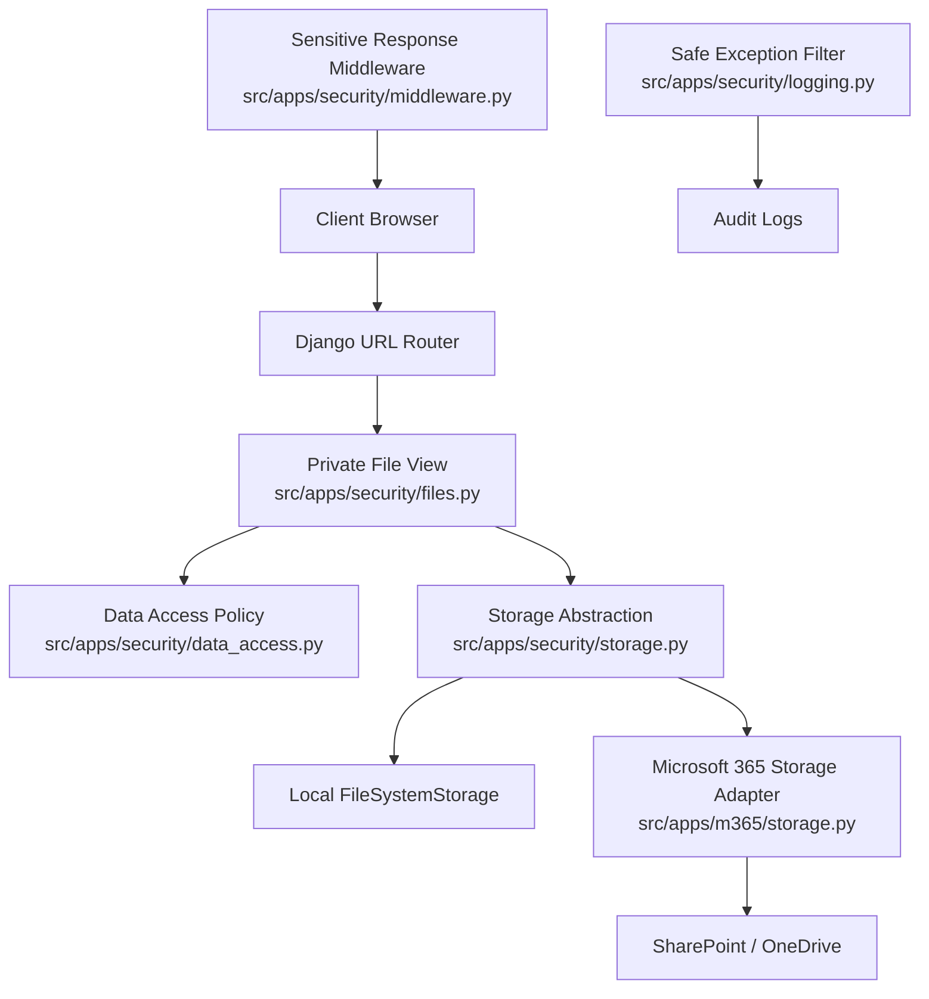
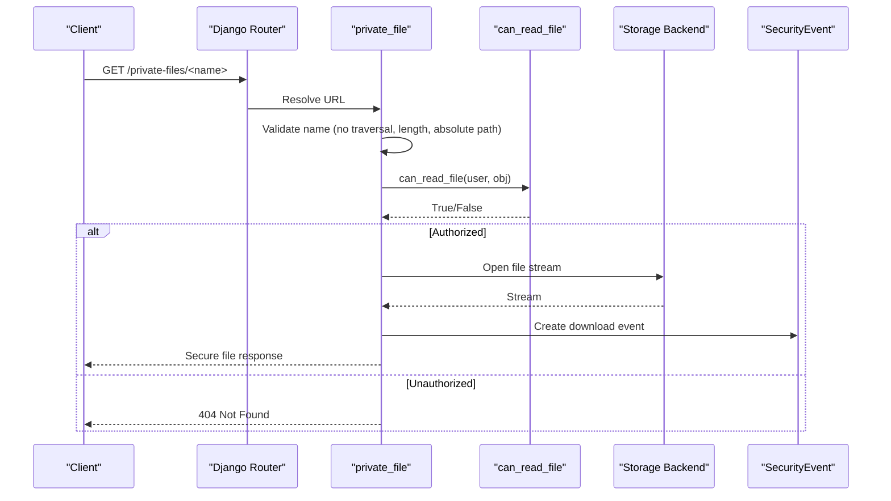
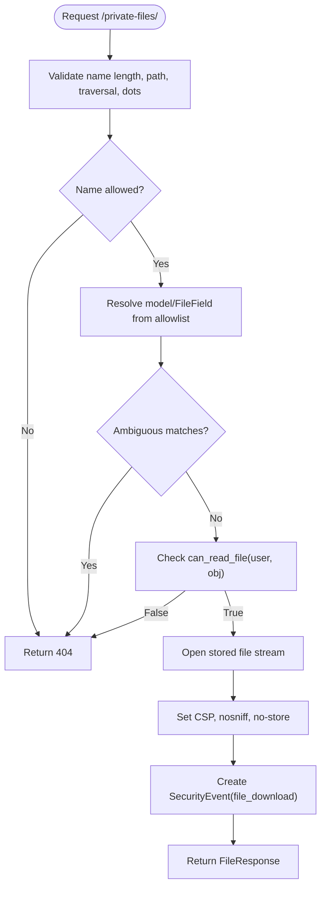
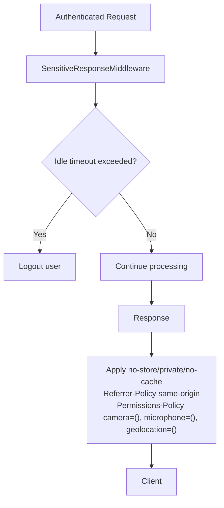
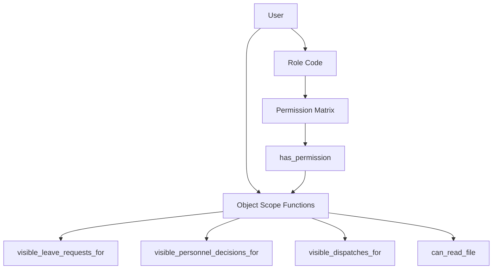
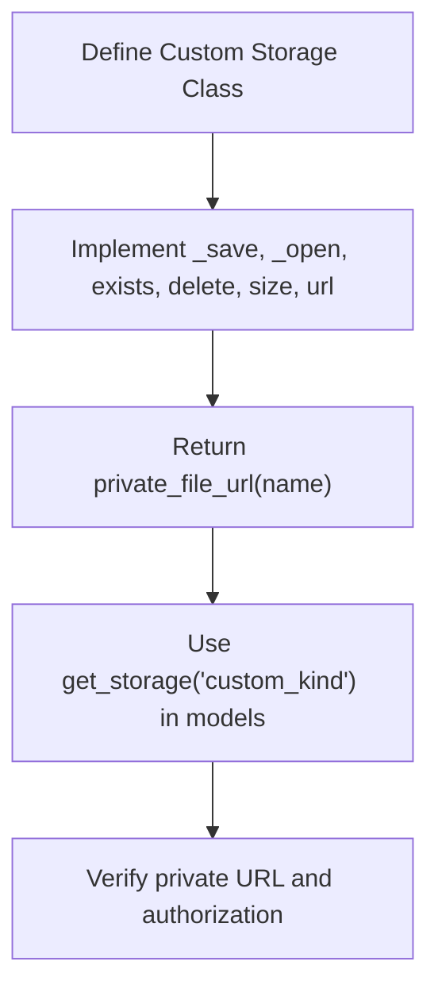
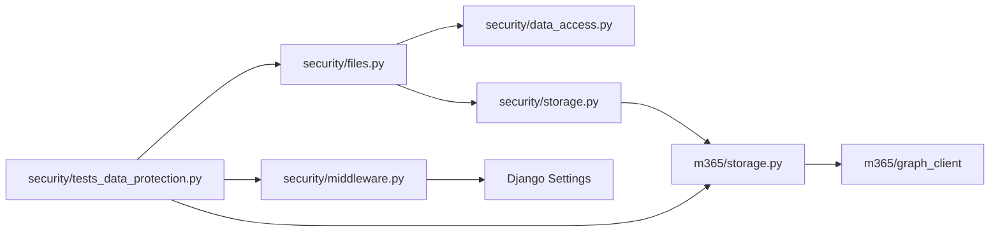

# Data Protection & File Security

<cite>
**Referenced Files in This Document**
- [files.py](file://src/apps/security/files.py)
- [storage.py](file://src/apps/security/storage.py)
- [data_access.py](file://src/apps/security/data_access.py)
- [middleware.py](file://src/apps/security/middleware.py)
- [permissions.py](file://src/apps/security/permissions.py)
- [logging.py](file://src/apps/security/logging.py)
- [tests_data_protection.py](file://src/apps/security/tests_data_protection.py)
- [m365_storage.py](file://src/apps/m365/storage.py)
- [04_Security_Design.md](file://docs/04_Security_Design.md)
- [03_Database_Design.md](file://docs/03_Database_Design.md)
- [PROJECT_WORK_LOG.md](file://docs/PROJECT_WORK_LOG.md)
</cite>

## Table of Contents
1. [Introduction](#introduction)
2. [Project Structure](#project-structure)
3. [Core Components](#core-components)
4. [Architecture Overview](#architecture-overview)
5. [Detailed Component Analysis](#detailed-component-analysis)
6. [Dependency Analysis](#dependency-analysis)
7. [Performance Considerations](#performance-considerations)
8. [Troubleshooting Guide](#troubleshooting-guide)
9. [Conclusion](#conclusion)
10. [Appendices](#appendices)

## Introduction
This document explains how the system protects sensitive data and secures file operations. It covers:
- File access control through an allowlisted, authorized download endpoint.
- A storage abstraction layer that routes file URLs through application authorization instead of exposing raw media paths.
- Sensitive data filtering and response hardening via middleware and logging filters.
- Data access patterns, field-level security, and sanitization for exports and links.
- File upload validation, path traversal prevention, and secure file serving.
- Examples for implementing custom storage backends, configuring protection rules, and securing API responses.
- Encryption strategies, data masking techniques, and compliance considerations.

The implementation is centered around the security app and integrates with Microsoft 365 storage while keeping SQL Server metadata-only.

## Project Structure
The data protection and file security features are primarily implemented under `src/apps/security`, with integration points in `src/apps/m365` and supporting design documents under `docs`.



**Diagram sources**
- [files.py:27-73](file://src/apps/security/files.py#L27-L73)
- [storage.py:6-12](file://src/apps/security/storage.py#L6-L12)
- [m365_storage.py:34-69](file://src/apps/m365/storage.py#L34-L69)
- [middleware.py:7-28](file://src/apps/security/middleware.py#L7-L28)
- [logging.py:6-13](file://src/apps/security/logging.py#L6-L13)

**Section sources**
- [files.py:1-74](file://src/apps/security/files.py#L1-L74)
- [storage.py:1-13](file://src/apps/security/storage.py#L1-L13)
- [m365_storage.py:1-169](file://src/apps/m365/storage.py#L1-L169)
- [middleware.py:1-29](file://src/apps/security/middleware.py#L1-L29)
- [logging.py:1-14](file://src/apps/security/logging.py#L1-L14)

## Core Components
- Allowlisted file download endpoint: validates request parameters, resolves model/FileField references, enforces per-object read permissions, and returns secure responses.
- Storage abstraction: ensures all file URLs go through a private route; supports local filesystem and SharePoint/OneDrive via Microsoft Graph.
- Data access policy: centralizes object-scoped visibility rules for files and related business entities.
- Permission matrix: single source of truth for role-based permissions used across the system.
- Response middleware: enforces idle session expiration and prevents caching of authenticated content.
- Safe exception logging: avoids persisting potentially sensitive exception payloads in production.

**Section sources**
- [files.py:12-73](file://src/apps/security/files.py#L12-L73)
- [storage.py:6-12](file://src/apps/security/storage.py#L6-L12)
- [data_access.py:121-163](file://src/apps/security/data_access.py#L121-L163)
- [permissions.py:28-109](file://src/apps/security/permissions.py#L28-L109)
- [middleware.py:7-28](file://src/apps/security/middleware.py#L7-L28)
- [logging.py:6-13](file://src/apps/security/logging.py#L6-L13)

## Architecture Overview
The system uses a layered approach to protect data:
- Authorization gate at the URL level: all file downloads pass through `/private-files/<name>`.
- Object-level permission checks: each file is tied to a model instance; access depends on roles, ownership, and scope.
- Storage backend independence: models store metadata; actual files live locally or in SharePoint/OneDrive.
- Response hardening: authenticated responses are marked no-store and include security headers.
- Auditability: file downloads and exports create metadata audit events.



**Diagram sources**
- [files.py:54-73](file://src/apps/security/files.py#L54-L73)
- [data_access.py:121-163](file://src/apps/security/data_access.py#L121-L163)

## Detailed Component Analysis

### File Access Control System
The file access control system enforces strict validation and authorization before any file is served:
- Name validation: rejects empty names, overly long names, absolute paths, backslashes, null bytes, parent directory traversal (`..`), and unsafe dot segments.
- Model/FileField allowlist: only predefined models and fields can be resolved by name.
- Ownership and scope checks: uses centralized data access policies to determine if the user may read the specific object.
- Secure response headers: sets sandbox CSP, nosniff, and private no-store cache controls.
- Audit logging: records file download events with user, resource label, and record ID.



**Diagram sources**
- [files.py:54-73](file://src/apps/security/files.py#L54-L73)
- [files.py:27-51](file://src/apps/security/files.py#L27-L51)

**Section sources**
- [files.py:12-73](file://src/apps/security/files.py#L12-L73)

### Storage Abstraction Layer
The storage abstraction ensures that file URLs never expose raw media paths:
- `PrivateFileStorage.url` redirects to the private file view.
- `ConfiguredStorage.url` and `SharePointStorage.url` also return private file URLs.
- `ConfiguredStorage.backend` selects local filesystem or SharePoint based on configuration.
- Remote name mapping preserves migration stability and folder routing for incoming/outgoing documents.

```mermaid
classDiagram
class PrivateFileStorage {
+url(name) string
}
class ConfiguredStorage {
+kind string
+backend Storage
+url(name) string
+_remote_name(name) string
+_save(name, content) string
+_open(name, mode) File
+delete(name) void
+exists(name) bool
+size(name) int
}
class SharePointStorage {
+library_name string
+url(name) string
+_save(name, content) string
+_open(name, mode) File
+delete(name) void
+exists(name) bool
+size(name) int
}
PrivateFileStorage --> "returns" : "/private-files/<name>"
ConfiguredStorage --> SharePointStorage : "when M365 enabled"
ConfiguredStorage --> FileSystemStorage : "fallback"
```

**Diagram sources**
- [storage.py:6-12](file://src/apps/security/storage.py#L6-L12)
- [m365_storage.py:34-69](file://src/apps/m365/storage.py#L34-L69)
- [m365_storage.py:84-151](file://src/apps/m365/storage.py#L84-L151)

**Section sources**
- [storage.py:1-13](file://src/apps/security/storage.py#L1-L13)
- [m365_storage.py:1-169](file://src/apps/m365/storage.py#L1-L169)

### Sensitive Data Filtering and Response Hardening
- Response middleware marks authenticated responses as private, no-store, and no-cache, and adds Referrer-Policy and Permissions-Policy headers.
- Idle session timeout logs out inactive users and clears authentication state.
- Safe exception filter suppresses exception payloads in production logs to avoid leaking secrets.



**Diagram sources**
- [middleware.py:7-28](file://src/apps/security/middleware.py#L7-L28)

**Section sources**
- [middleware.py:1-29](file://src/apps/security/middleware.py#L1-L29)
- [logging.py:1-14](file://src/apps/security/logging.py#L1-L14)

### Data Access Patterns and Field-Level Security
- Centralized permission matrix defines who can perform actions such as approving leave, managing HR, exporting employee data, and viewing assets.
- Data access functions enforce object scopes:
  - Leave requests visible to self and reporting line.
  - Personnel decisions scoped by permission and reporting hierarchy.
  - Official dispatches filtered by role, assignment, department, and security level.
  - File read permissions vary by model type and relationship to the user.
- Staff status does not grant business data access unless explicitly permitted.



**Diagram sources**
- [permissions.py:28-109](file://src/apps/security/permissions.py#L28-L109)
- [data_access.py:23-163](file://src/apps/security/data_access.py#L23-L163)

**Section sources**
- [permissions.py:1-152](file://src/apps/security/permissions.py#L1-L152)
- [data_access.py:1-164](file://src/apps/security/data_access.py#L1-L164)

### Data Sanitization Processes
- Exported Excel treats user-provided formulas as literal text to prevent formula injection.
- Document link validation rejects JavaScript URIs, data URIs, external paths, and raw media paths.
- Admin UI hides sensitive identifier fields for certain roles.

**Section sources**
- [tests_data_protection.py:151-158](file://src/apps/security/tests_data_protection.py#L151-L158)
- [tests_data_protection.py:265-269](file://src/apps/security/tests_data_protection.py#L265-L269)
- [tests_data_protection.py:122-128](file://src/apps/security/tests_data_protection.py#L122-L128)

### File Upload Validation, Path Traversal Prevention, and Secure Serving
- Input validation:
  - Rejects empty names, excessive length, absolute paths, backslashes, null bytes, parent directory traversal, and unsafe dot segments.
- Path resolution:
  - Only allowlisted models and fields are considered; ambiguous matches are rejected.
- Secure serving:
  - Sets Content-Security-Policy sandbox, X-Content-Type-Options nosniff, and Cache-Control private no-store.
  - Handles GraphAPIError with Retry-After and 503 when remote service is unavailable.

**Section sources**
- [files.py:54-73](file://src/apps/security/files.py#L54-L73)
- [files.py:27-51](file://src/apps/security/files.py#L27-L51)

### Custom Storage Backend Implementation Example
To implement a custom storage backend:
- Subclass Django’s `Storage` and implement required methods: `_save`, `_open`, `exists`, `delete`, `size`, `url`.
- Ensure `url` returns a private file URL via `private_file_url`.
- Optionally wrap with `ConfiguredStorage` to select backend dynamically based on settings.



**Diagram sources**
- [m365_storage.py:34-69](file://src/apps/m365/storage.py#L34-L69)
- [storage.py:6-12](file://src/apps/security/storage.py#L6-L12)

**Section sources**
- [m365_storage.py:1-169](file://src/apps/m365/storage.py#L1-L169)
- [storage.py:1-13](file://src/apps/security/storage.py#L1-L13)

### Configuring Data Protection Rules
- Configure role-based permissions in the permission matrix.
- Use data access functions to constrain object visibility.
- Enable Microsoft 365 storage via settings and map folders/upload prefixes.
- Enforce response security headers and idle session timeouts via middleware.

**Section sources**
- [permissions.py:28-109](file://src/apps/security/permissions.py#L28-L109)
- [data_access.py:23-163](file://src/apps/security/data_access.py#L23-L163)
- [m365_storage.py:75-127](file://src/apps/m365/storage.py#L75-L127)
- [middleware.py:7-28](file://src/apps/security/middleware.py#L7-L28)

### Securing API Responses
- Mark authenticated responses as private, no-store, and no-cache.
- Add Referrer-Policy and Permissions-Policy headers.
- Avoid exposing sensitive payloads in logs during production errors.

**Section sources**
- [middleware.py:7-28](file://src/apps/security/middleware.py#L7-L28)
- [logging.py:6-13](file://src/apps/security/logging.py#L6-L13)

### Encryption Strategies and Data Masking Techniques
- Design guidance recommends application-level encryption or database encryption for sensitive fields such as national ID, tax code, bank account, and social insurance number.
- Audit logs should mask sensitive values rather than storing plaintext.
- Current implementation focuses on access control and response hardening; field-level encryption requires approved schema migrations and key management.

**Section sources**
- [03_Database_Design.md:1978-1993](file://docs/03_Database_Design.md#L1978-L1993)
- [04_Security_Design.md:763-775](file://docs/04_Security_Design.md#L763-L775)

### Compliance with Data Protection Regulations
- The security design outlines objectives, principles, architecture, authentication, authorization, sensitive data classification, payroll/document security, audit logging, session security, API security, input validation, database security, backup/restore security, export security, notification security, retention policy, incident response, monitoring, and compliance requirements.
- Implementation notes highlight gaps such as field-level encryption, TLS/TDE verification, key rotation, MFA/SSO, immutable audit logs, and pentesting.

**Section sources**
- [04_Security_Design.md:19-83](file://docs/04_Security_Design.md#L19-L83)
- [04_Security_Design.md:375-483](file://docs/04_Security_Design.md#L375-L483)
- [04_Security_Design.md:567-589](file://docs/04_Security_Design.md#L567-L589)
- [04_Security_Design.md:621-667](file://docs/04_Security_Design.md#L621-L667)
- [04_Security_Design.md:687-775](file://docs/04_Security_Design.md#L687-L775)
- [04_Security_Design.md:817-866](file://docs/04_Security_Design.md#L817-L866)
- [04_Security_Design.md:873-901](file://docs/04_Security_Design.md#L873-L901)
- [04_Security_Design.md:927-995](file://docs/04_Security_Design.md#L927-L995)
- [04_Security_Design.md:1078-1082](file://docs/04_Security_Design.md#L1078-L1082)

## Dependency Analysis
Key dependencies and relationships:
- File views depend on data access policies and storage abstractions.
- Storage adapters depend on Microsoft Graph client and settings.
- Middleware depends on session state and settings.
- Tests validate authorization, caching behavior, throttling, and sanitization.



**Diagram sources**
- [files.py:1-74](file://src/apps/security/files.py#L1-L74)
- [data_access.py:1-164](file://src/apps/security/data_access.py#L1-L164)
- [storage.py:1-13](file://src/apps/security/storage.py#L1-L13)
- [m365_storage.py:1-169](file://src/apps/m365/storage.py#L1-L169)
- [middleware.py:1-29](file://src/apps/security/middleware.py#L1-L29)
- [tests_data_protection.py:1-279](file://src/apps/security/tests_data_protection.py#L1-L279)

**Section sources**
- [files.py:1-74](file://src/apps/security/files.py#L1-L74)
- [data_access.py:1-164](file://src/apps/security/data_access.py#L1-L164)
- [storage.py:1-13](file://src/apps/security/storage.py#L1-L13)
- [m365_storage.py:1-169](file://src/apps/m365/storage.py#L1-L169)
- [middleware.py:1-29](file://src/apps/security/middleware.py#L1-L29)
- [tests_data_protection.py:1-279](file://src/apps/security/tests_data_protection.py#L1-L279)

## Performance Considerations
- File streaming: use `FileResponse` to stream large files without loading them fully into memory.
- Query scoping: restrict database queries to minimal necessary rows using scope functions.
- Caching avoidance: mark authenticated responses as no-store to prevent shared caches from storing sensitive content.
- Remote storage latency: handle GraphAPIError gracefully with retry headers and 503 responses.

[No sources needed since this section provides general guidance]

## Troubleshooting Guide
Common issues and resolutions:
- 404 on file download: verify name validation, allowlist membership, and `can_read_file` result.
- 503 with Retry-After: indicates temporary unavailability of remote storage; respect retry header and retry later.
- Authenticated pages cached: ensure middleware is active and response headers include no-store/private/no-cache.
- Brute-force login attempts: check throttle configuration and axes integration; tests validate lockout after five failures.
- Sensitive data in logs: confirm SafeExceptionFilter is applied in production to omit exception payloads.

**Section sources**
- [files.py:27-51](file://src/apps/security/files.py#L27-L51)
- [tests_data_protection.py:84-111](file://src/apps/security/tests_data_protection.py#L84-L111)
- [tests_data_protection.py:138-149](file://src/apps/security/tests_data_protection.py#L138-L149)
- [logging.py:6-13](file://src/apps/security/logging.py#L6-L13)

## Conclusion
The system implements robust data protection and file security through:
- Strict file access control with allowlisted models and field-level authorization.
- A storage abstraction layer that routes all file URLs through a secure endpoint.
- Centralized permission and data access policies enforcing least privilege and need-to-know.
- Response hardening and safe logging to prevent accidental data leakage.
- Comprehensive design documentation outlining encryption, masking, and compliance requirements.

For production readiness, verify TLS, database encryption, key management, MFA/SSO, immutable audit logs, and conduct penetration testing as outlined in the security design.

[No sources needed since this section summarizes without analyzing specific files]

## Appendices

### Example: Implementing Custom File Storage Backends
- Subclass `Storage` and implement required methods.
- Return private file URLs via `private_file_url`.
- Integrate with `get_storage(kind)` for dynamic backend selection.

**Section sources**
- [m365_storage.py:34-69](file://src/apps/m365/storage.py#L34-L69)
- [storage.py:6-12](file://src/apps/security/storage.py#L6-L12)

### Example: Configuring Data Protection Rules
- Update `PERMISSION_MATRIX` to adjust role-based permissions.
- Use `can_read_file` and scope functions to constrain data visibility.
- Enable Microsoft 365 storage and configure folder mappings.

**Section sources**
- [permissions.py:28-109](file://src/apps/security/permissions.py#L28-L109)
- [data_access.py:121-163](file://src/apps/security/data_access.py#L121-L163)
- [m365_storage.py:75-127](file://src/apps/m365/storage.py#L75-L127)

### Example: Securing API Responses
- Apply `SensitiveResponseMiddleware` to enforce no-store/private/no-cache headers.
- Add Referrer-Policy and Permissions-Policy headers.
- Suppress sensitive exception payloads in production logs.

**Section sources**
- [middleware.py:7-28](file://src/apps/security/middleware.py#L7-L28)
- [logging.py:6-13](file://src/apps/security/logging.py#L6-L13)

### Historical Context and Recent Hardening
Recent hardening efforts included adding private downloads with allowlists, blocking raw media, limiting administrative bypasses, hiding sensitive identifiers in admin, separating export permissions, applying scope and confidentiality to exports, throttling logins, enforcing idle timeouts, guarding production configurations, and auditing metadata for login/logout/download/export.

**Section sources**
- [PROJECT_WORK_LOG.md:3367-3412](file://docs/PROJECT_WORK_LOG.md#L3367-L3412)