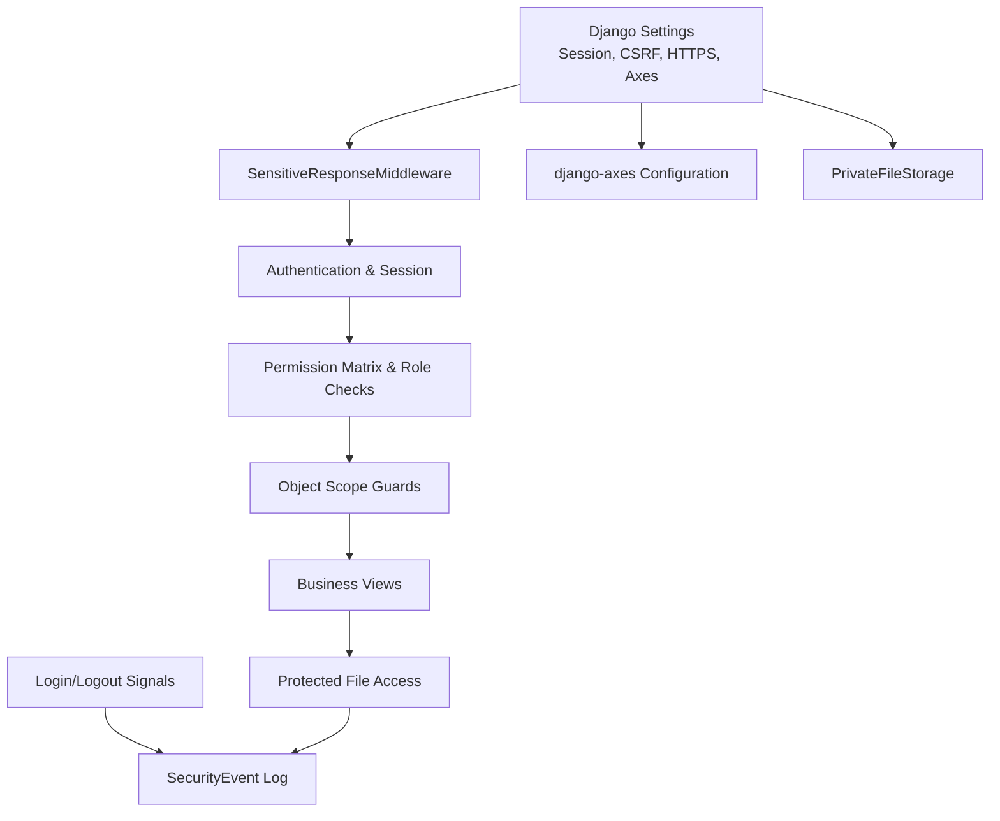
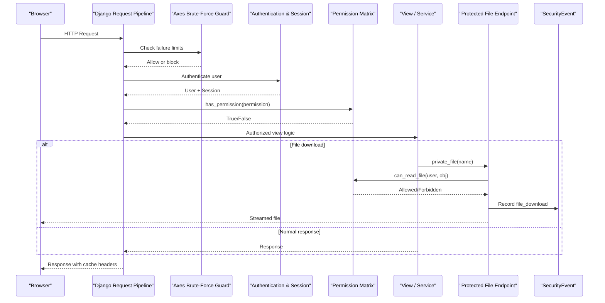
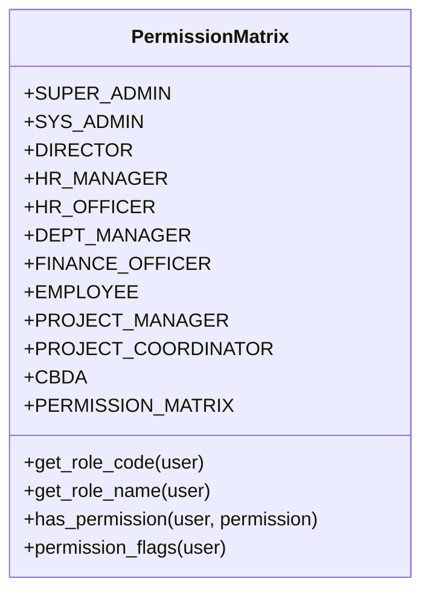
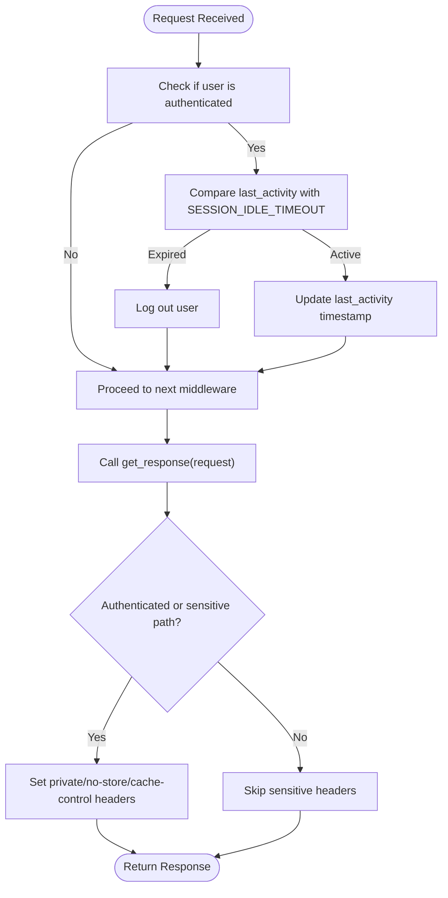
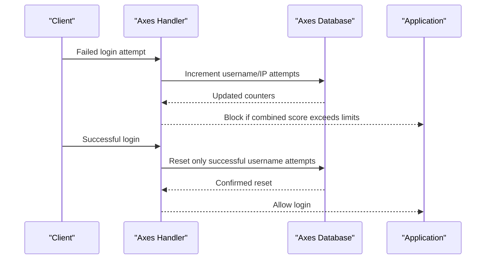
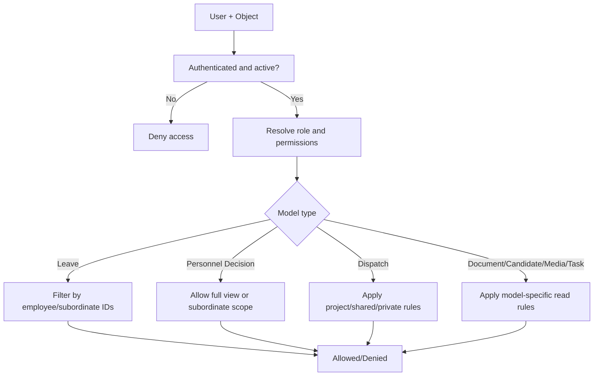
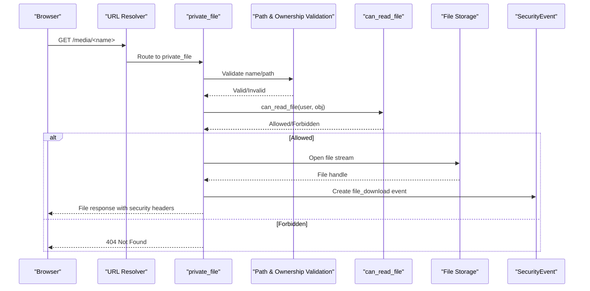
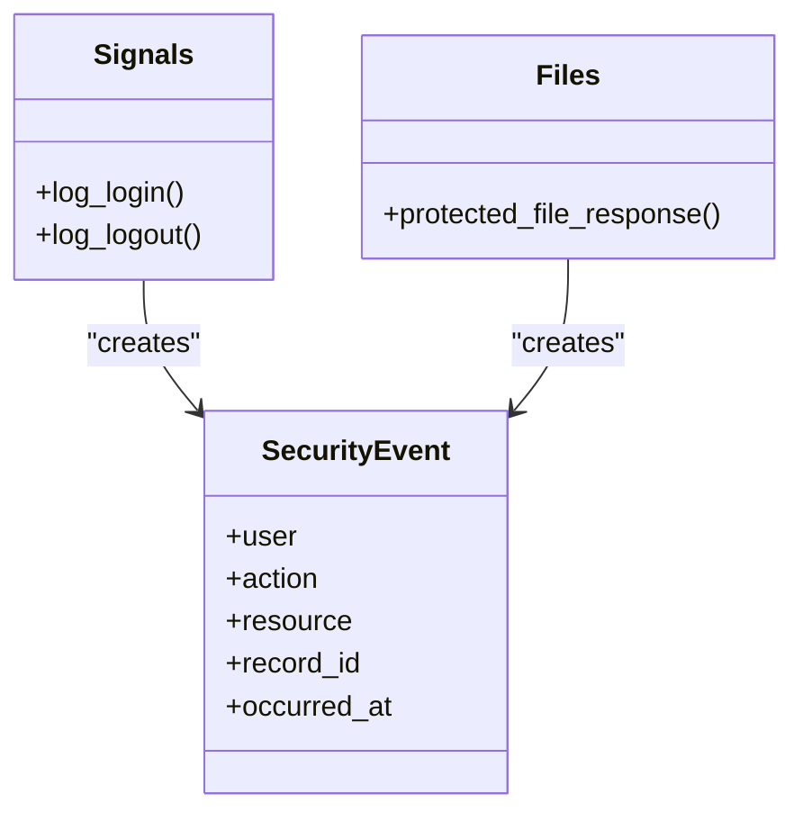
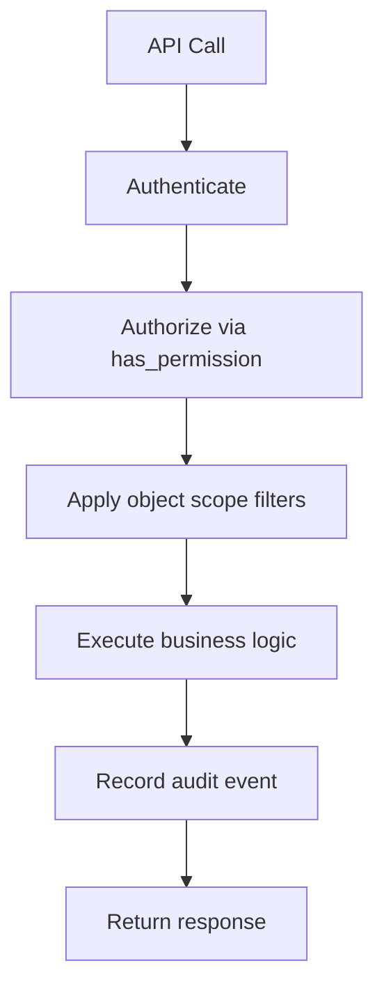
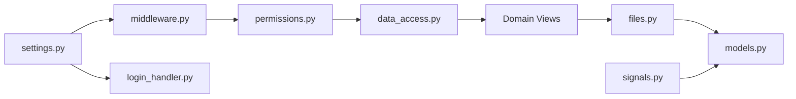

# Security Architecture

<cite>
**Referenced Files in This Document**
- [settings.py](file://src/config/settings.py)
- [permissions.py](file://src/apps/security/permissions.py)
- [middleware.py](file://src/apps/security/middleware.py)
- [login_handler.py](file://src/apps/security/login_handler.py)
- [logging.py](file://src/apps/security/logging.py)
- [models.py](file://src/apps/security/models.py)
- [data_access.py](file://src/apps/security/data_access.py)
- [files.py](file://src/apps/security/files.py)
- [storage.py](file://src/apps/security/storage.py)
- [signals.py](file://src/apps/security/signals.py)
- [10_RBAC_Permission_Matrix.md](file://docs/10_RBAC_Permission_Matrix.md)
</cite>

## Table of Contents
1. [Introduction](#introduction)
2. [Project Structure](#project-structure)
3. [Core Components](#core-components)
4. [Architecture Overview](#architecture-overview)
5. [Detailed Component Analysis](#detailed-component-analysis)
6. [Dependency Analysis](#dependency-analysis)
7. [Performance Considerations](#performance-considerations)
8. [Troubleshooting Guide](#troubleshooting-guide)
9. [Conclusion](#conclusion)

## Introduction
This document describes the security architecture of IHRMS with a focus on its role-based access control system, authentication and authorization middleware, login hardening, audit logging, data protection, file access controls, and API security posture. The RBAC design is centered around 11 predefined roles and a single permission matrix that drives menu visibility, view-level checks, object-scoped queries, and export/file access decisions. Authentication uses Django’s session framework with django-axes for brute-force protection, while sensitive responses are explicitly protected from caching. Audit events record authentication lifecycle actions and selected business operations without storing secrets or sensitive payloads.

## Project Structure
The security implementation is primarily located under `src/apps/security`, with configuration in `src/config/settings.py` and policy documentation in `docs/10_RBAC_Permission_Matrix.md`.

**Diagram sources**
- [settings.py:145-168](file://src/config/settings.py#L145-L168)
- [middleware.py:7-28](file://src/apps/security/middleware.py#L7-L28)
- [permissions.py:13-151](file://src/apps/security/permissions.py#L13-L151)
- [data_access.py:1-164](file://src/apps/security/data_access.py#L1-L164)
- [files.py:1-74](file://src/apps/security/files.py#L1-L74)
- [storage.py:1-13](file://src/apps/security/storage.py#L1-L13)
- [signals.py:1-15](file://src/apps/security/signals.py#L1-L15)
- [models.py:35-45](file://src/apps/security/models.py#L35-L45)

**Section sources**
- [settings.py:145-168](file://src/config/settings.py#L145-L168)
- [10_RBAC_Permission_Matrix.md:54-195](file://docs/10_RBAC_Permission_Matrix.md#L54-L195)

## Core Components
- **Role-Based Access Control**: A central permission matrix defines which of the 11 roles may perform each permission. Superusers bypass checks; staff-only permissions are explicitly enumerated.
- **Authorization Middleware**: Sensitive response middleware enforces idle session logout and prevents caching of authenticated content.
- **Brute-Force Protection**: django-axes tracks failures per username and IP with a custom handler that scales shared-IP scores against configured thresholds.
- **Data Access Guards**: Centralized query filters enforce department scope, reporting-line scope, leave request scope, personnel decision scope, and dispatch document scope.
- **File Access Controls**: All file URLs route through an application endpoint that validates ownership, role permissions, and resource type before streaming files.
- **Audit Logging**: Security events capture login/logout and selected file downloads; exception logs omit sensitive payloads outside debug mode.

**Section sources**
- [permissions.py:13-151](file://src/apps/security/permissions.py#L13-L151)
- [middleware.py:7-28](file://src/apps/security/middleware.py#L7-L28)
- [login_handler.py:9-24](file://src/apps/security/login_handler.py#L9-L24)
- [data_access.py:23-164](file://src/apps/security/data_access.py#L23-L164)
- [files.py:12-74](file://src/apps/security/files.py#L12-L74)
- [logging.py:6-13](file://src/apps/security/logging.py#L6-L13)
- [signals.py:7-15](file://src/apps/security/signals.py#L7-L15)

## Architecture Overview
IHRMS applies layered security:
- Transport and browser protections are configured centrally (HTTPS enforcement, cookie flags, clickjacking, content sniffing).
- Authentication and session handling are enforced by Django middleware, extended by SensitiveResponseMiddleware.
- Authorization is centralized in the permission matrix and applied via helper functions and explicit object-scoped query builders.
- File access is restricted to a private URL endpoint that performs both permission and path validation.
- Audit events are recorded at authentication boundaries and at controlled data export/file download points.

**Diagram sources**
- [settings.py:145-168](file://src/config/settings.py#L145-L168)
- [middleware.py:12-28](file://src/apps/security/middleware.py#L12-L28)
- [permissions.py:138-151](file://src/apps/security/permissions.py#L138-L151)
- [files.py:54-74](file://src/apps/security/files.py#L54-L74)
- [signals.py:7-15](file://src/apps/security/signals.py#L7-L15)

## Detailed Component Analysis

### RBAC Permission Matrix and Roles
The system defines 11 role constants and a single `PERMISSION_MATRIX` mapping permission names to allowed roles. Helper functions provide:
- Role code extraction from the user model.
- Role name resolution with fallbacks for superuser/staff.
- Permission checks that allow superusers and optionally staff for specific permissions.
- Template-friendly permission flags.

The documented RBAC matrix covers 8 core roles plus project-specific roles (`PROJECT_MANAGER`, `PROJECT_COORDINATOR`, `CBDA`) used across activity, recruitment, asset, and document scopes.

**Diagram sources**
- [permissions.py:13-151](file://src/apps/security/permissions.py#L13-L151)

**Section sources**
- [permissions.py:13-151](file://src/apps/security/permissions.py#L13-L151)
- [10_RBAC_Permission_Matrix.md:54-195](file://docs/10_RBAC_Permission_Matrix.md#L54-L195)

### Security Middleware and Session Handling
`SensitiveResponseMiddleware`:
- Logs out users whose idle time exceeds `SESSION_IDLE_TIMEOUT`.
- Marks authenticated responses as private and non-cacheable.
- Adds security headers including referrer policy and permissions policy.

Session settings:
- Fixed session age and browser-close expiration.
- HttpOnly and SameSite cookies.
- Optional HTTPS enforcement with secure proxy header support.

**Diagram sources**
- [middleware.py:7-28](file://src/apps/security/middleware.py#L7-L28)
- [settings.py:87-100](file://src/config/settings.py#L87-L100)

**Section sources**
- [middleware.py:7-28](file://src/apps/security/middleware.py#L7-L28)
- [settings.py:87-100](file://src/config/settings.py#L87-L100)

### Login Security and Brute-Force Protection
django-axes is configured with:
- Persistent database handler.
- Separate failure limits for username and IP address.
- Custom `SharedIPAxesHandler` that scales shared-IP failure counts so the IP threshold reaches the configured limit rather than defaulting to the username limit.
- Cool-off period and success reset behavior.

**Diagram sources**
- [login_handler.py:9-24](file://src/apps/security/login_handler.py#L9-L24)
- [settings.py:158-168](file://src/config/settings.py#L158-L168)

**Section sources**
- [login_handler.py:9-24](file://src/apps/security/login_handler.py#L9-L24)
- [settings.py:158-168](file://src/config/settings.py#L158-L168)

### Data Protection and Object Scopes
Centralized data access helpers enforce:
- Department scoping for write workflows.
- Employee visibility based on reporting hierarchy.
- Leave request visibility limited to self and subordinates.
- Personnel decision visibility based on role permissions and reporting lines.
- Dispatch document visibility with special rules for project roles and security levels.
- Per-model read checks for documents, candidates, leave requests, company media, activities, and tasks.

**Diagram sources**
- [data_access.py:23-164](file://src/apps/security/data_access.py#L23-L164)
- [permissions.py:138-151](file://src/apps/security/permissions.py#L138-L151)

**Section sources**
- [data_access.py:23-164](file://src/apps/security/data_access.py#L23-L164)

### File Access Controls and Private Storage
All file URLs are routed through `private_file`, which:
- Validates input path components against traversal and injection patterns.
- Resolves the file to a concrete model instance and field.
- Enforces `can_read_file` for the requesting user.
- Streams the file with restrictive security headers.
- Records a `file_download` security event.

Local storage returns a private URL instead of direct media paths.

**Diagram sources**
- [files.py:12-74](file://src/apps/security/files.py#L12-L74)
- [storage.py:6-12](file://src/apps/security/storage.py#L6-L12)
- [data_access.py:121-164](file://src/apps/security/data_access.py#L121-L164)

**Section sources**
- [files.py:12-74](file://src/apps/security/files.py#L12-L74)
- [storage.py:6-12](file://src/apps/security/storage.py#L6-L12)

### Audit Logging and Security Events
- Authentication lifecycle events are captured via Django signals for login and logout.
- File downloads log action, resource label, and record ID.
- Exception logging omits exception payloads in non-debug environments to avoid leaking SQL or secrets.

**Diagram sources**
- [signals.py:7-15](file://src/apps/security/signals.py#L7-L15)
- [files.py:27-51](file://src/apps/security/files.py#L27-L51)
- [models.py:35-45](file://src/apps/security/models.py#L35-L45)
- [logging.py:6-13](file://src/apps/security/logging.py#L6-L13)

**Section sources**
- [signals.py:7-15](file://src/apps/security/signals.py#L7-L15)
- [files.py:27-51](file://src/apps/security/files.py#L27-L51)
- [models.py:35-45](file://src/apps/security/models.py#L35-L45)
- [logging.py:6-13](file://src/apps/security/logging.py#L6-L13)

### API Security Measures
- Every API must authenticate, authorize, validate role, validate data scope, and log activity according to the RBAC policy document.
- In this codebase, views and services use `has_permission` and scoped query builders to enforce authorization server-side.
- Export endpoints create audit events for exported resources.

**Diagram sources**
- [10_RBAC_Permission_Matrix.md:602-615](file://docs/10_RBAC_Permission_Matrix.md#L602-L615)
- [permissions.py:138-151](file://src/apps/security/permissions.py#L138-L151)
- [data_access.py:23-164](file://src/apps/security/data_access.py#L23-L164)

**Section sources**
- [10_RBAC_Permission_Matrix.md:602-615](file://docs/10_RBAC_Permission_Matrix.md#L602-L615)

## Dependency Analysis
The security layer depends on Django core, django-axes, and domain apps for models and services.

**Diagram sources**
- [settings.py:145-168](file://src/config/settings.py#L145-L168)
- [middleware.py:7-28](file://src/apps/security/middleware.py#L7-L28)
- [login_handler.py:9-24](file://src/apps/security/login_handler.py#L9-L24)
- [permissions.py:13-151](file://src/apps/security/permissions.py#L13-L151)
- [data_access.py:1-164](file://src/apps/security/data_access.py#L1-L164)
- [files.py:1-74](file://src/apps/security/files.py#L1-L74)
- [signals.py:1-15](file://src/apps/security/signals.py#L1-L15)
- [models.py:1-45](file://src/apps/security/models.py#L1-L45)

**Section sources**
- [settings.py:145-168](file://src/config/settings.py#L145-L168)
- [permissions.py:13-151](file://src/apps/security/permissions.py#L13-L151)

## Performance Considerations
- Idle session logout adds minimal overhead but improves security by invalidating stale sessions.
- Permission checks are constant-time dictionary lookups over role codes.
- Object-scoped queries use efficient filtering and should be preferred over in-memory filtering.
- File streaming avoids loading entire files into memory and sets restrictive cache headers.
- Axes database counters add small write overhead during failed logins; cool-off reduces repeated lockout checks.

[No sources needed since this section provides general guidance]

## Troubleshooting Guide
Common issues and mitigations:
- **Unexpected logout**: Verify `SESSION_IDLE_TIMEOUT` and ensure clients send periodic requests to refresh `security_last_activity`.
- **Cache leakage**: Confirm `SensitiveResponseMiddleware` is enabled and responses include private/no-store headers.
- **Brute-force lockouts**: Check username and IP failure limits; shared IPs may trigger lockouts earlier due to scaled scoring.
- **File 404 errors**: Ensure the requested filename resolves to exactly one model/field and that `can_read_file` allows the current user.
- **Missing audit events**: Verify signals are connected and that exports/downloads call the appropriate logging points.
- **Secret exposure in logs**: Ensure non-debug environments use the safe exception filter.

**Section sources**
- [middleware.py:12-28](file://src/apps/security/middleware.py#L12-L28)
- [login_handler.py:9-24](file://src/apps/security/login_handler.py#L9-L24)
- [files.py:54-74](file://src/apps/security/files.py#L54-L74)
- [signals.py:7-15](file://src/apps/security/signals.py#L7-L15)
- [logging.py:6-13](file://src/apps/security/logging.py#L6-L13)

## Conclusion
IHRMS implements a comprehensive security architecture built around a centralized RBAC permission matrix, strict session and response handling, robust brute-force protection, explicit object-scoped data access, and controlled file downloads. Audit logging captures authentication and selected high-value actions without exposing sensitive payloads. For continued security, maintain the single source of truth for permissions, apply object-scoped queries consistently, and review new endpoints against the documented API authorization requirements.

[No sources needed since this section summarizes without analyzing specific files]