# System Architecture

<cite>
**Referenced Files in This Document**
- [README.md](file://README.md)
- [requirements.txt](file://requirements.txt)
- [02_Solution_Architecture.md](file://docs/02_Solution_Architecture.md)
- [04_Security_Design.md](file://docs/04_Security_Design.md)
- [08_Deployment_Standards.md](file://docs/08_Deployment_Standards.md)
- [settings.py](file://src/config/settings.py)
- [urls.py](file://src/config/urls.py)
- [middleware.py (security)](file://src/apps/security/middleware.py)
- [models.py (security)](file://src/apps/security/models.py)
- [permissions.py](file://src/apps/security/permissions.py)
- [storage.py (security)](file://src/apps/security/storage.py)
- [middleware.py (common)](file://src/apps/common/middleware.py)
- [graph_client.py](file://src/apps/m365/graph_client.py)
</cite>

## Table of Contents
1. [Introduction](#introduction)
2. [Project Structure](#project-structure)
3. [Core Components](#core-components)
4. [Architecture Overview](#architecture-overview)
5. [Detailed Component Analysis](#detailed-component-analysis)
6. [Dependency Analysis](#dependency-analysis)
7. [Performance Considerations](#performance-considerations)
8. [Troubleshooting Guide](#troubleshooting-guide)
9. [Conclusion](#conclusion)
10. [Appendices](#appendices)

## Introduction
IHRMS is an internal Administration and Human Resource Management System built as a modular Django monolith. The system centers on 24 domain applications under `src/apps/`, a centralized security module, and a portal orchestration layer that acts as the user-facing facade. It targets NGO organizations with 30 to 200 employees, runs on Windows Server, uses SQL Server for data persistence, and integrates with Microsoft 365 through Graph API for document storage and search.

Key architectural decisions include:
- Django 5.2 as the web framework.
- Modular monolith architecture with clear domain boundaries.
- Centralized RBAC and auditability via the security application.
- Microsoft 365 integration using app-only credentials for SharePoint and OneDrive.
- Waitress WSGI server behind a reverse proxy such as IIS or another TLS-terminating proxy.

The design emphasizes maintainability, security, auditability, and scalability within the constraints of an on-premise environment.

**Section sources**
- [README.md:1-47](file://README.md#L1-L47)
- [02_Solution_Architecture.md:19-90](file://docs/02_Solution_Architecture.md#L19-L90)

## Project Structure
The repository follows a conventional Django layout:
- `src/` contains the Django project and applications.
- `src/apps/` contains domain applications such as HRM, attendance, leave, payroll, recruitment, documents, tasks, reporting, office, planning, activity, lifecycle, assistant, m365, notification, organization, kpi, asset, procurement, project, portal, common, and security.
- `src/config/` holds Django settings, URL routing, WSGI/ASGI entry points, and environment loading.
- `docs/` contains approved solution, security, deployment, UI/UX, and RBAC documentation.
- `ops/` contains operational scripts, tests, backups, and scheduler helpers.
- `design-system/` and `src/static/` contain frontend assets and design references.

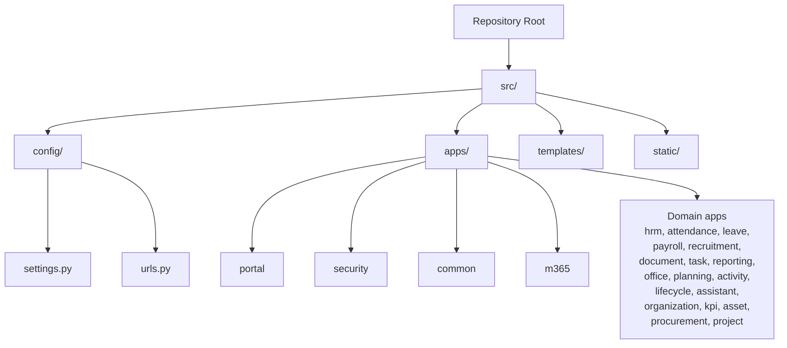

**Diagram sources**
- [settings.py:103-143](file://src/config/settings.py#L103-L143)
- [urls.py:12-20](file://src/config/urls.py#L12-L20)

**Section sources**
- [README.md:1-47](file://README.md#L1-L47)
- [settings.py:103-143](file://src/config/settings.py#L103-L143)
- [urls.py:12-20](file://src/config/urls.py#L12-L20)

## Core Components
The core components are:
- **Portal orchestration layer**: Routes requests to domain features and renders dashboards, reports, and shared UI.
- **Security module**: Provides authentication middleware, RBAC permissions, session handling, private file access, and security event models.
- **Domain applications**: Encapsulate business logic for HR, finance, operations, and administration.
- **Microsoft 365 integration**: Handles Graph API authentication, token caching, file upload/download, folder traversal, and site-scoped search.
- **Configuration and deployment**: Defines database connectivity, HTTPS enforcement, logging, admin interface, and storage backends.

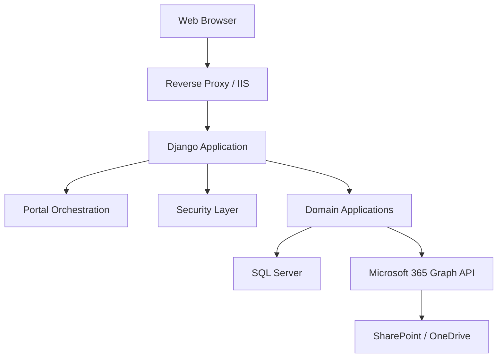

**Diagram sources**
- [02_Solution_Architecture.md:93-147](file://docs/02_Solution_Architecture.md#L93-L147)
- [settings.py:145-169](file://src/config/settings.py#L145-L169)
- [urls.py:12-20](file://src/config/urls.py#L12-L20)
- [graph_client.py:57-120](file://src/apps/m365/graph_client.py#L57-L120)

**Section sources**
- [02_Solution_Architecture.md:247-388](file://docs/02_Solution_Architecture.md#L247-L388)
- [settings.py:103-143](file://src/config/settings.py#L103-L143)
- [urls.py:12-20](file://src/config/urls.py#L12-L20)

## Architecture Overview
The system follows a layered modular monolith pattern:
- Presentation layer: Django templates and portal views.
- API layer: URL routes and view controllers.
- Service layer: Business logic inside domain applications.
- Repository/data access layer: Django ORM and domain models.
- Data layer: SQL Server and optional Microsoft 365 storage.

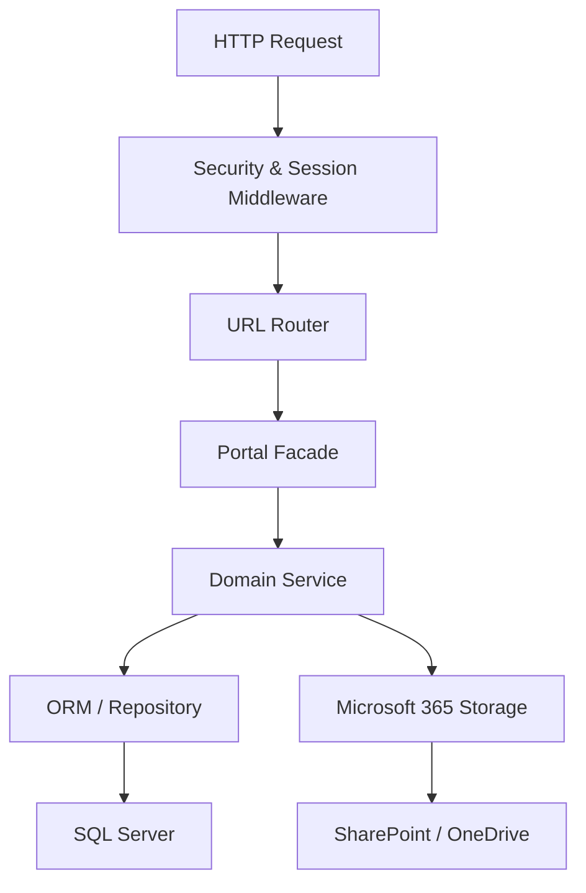

**Diagram sources**
- [02_Solution_Architecture.md:247-273](file://docs/02_Solution_Architecture.md#L247-L273)
- [settings.py:145-169](file://src/config/settings.py#L145-L169)
- [urls.py:12-20](file://src/config/urls.py#L12-L20)
- [graph_client.py:216-260](file://src/apps/m365/graph_client.py#L216-L260)

**Section sources**
- [02_Solution_Architecture.md:247-388](file://docs/02_Solution_Architecture.md#L247-L388)

## Detailed Component Analysis

### Portal Orchestration Layer
The portal acts as a facade router:
- URL routing exposes `/portal/`, `/reports/`, and `/assistant/`.
- Context processors inject permission flags into templates.
- Dashboard and reporting modules aggregate domain data for presentation.

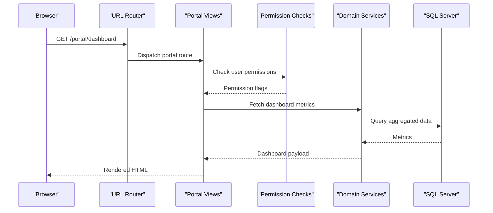

**Diagram sources**
- [urls.py:12-20](file://src/config/urls.py#L12-L20)
- [settings.py:172-188](file://src/config/settings.py#L172-L188)
- [permissions.py:138-151](file://src/apps/security/permissions.py#L138-L151)

**Section sources**
- [urls.py:12-20](file://src/config/urls.py#L12-L20)
- [settings.py:172-188](file://src/config/settings.py#L172-L188)

### Security Middleware and Authentication Flow
Security middleware enforces idle session expiration, prevents caching of authenticated responses, and adds security headers. Authentication also uses django-axes for login attempt limiting and lockout behavior.

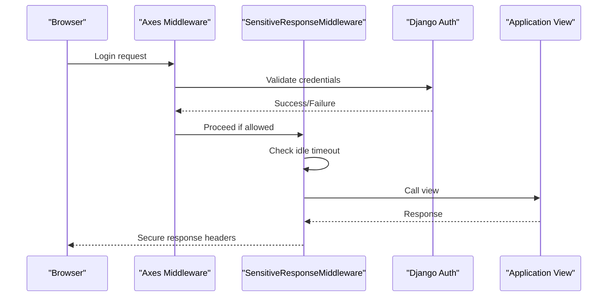

**Diagram sources**
- [settings.py:145-169](file://src/config/settings.py#L145-L169)
- [middleware.py (security):7-28](file://src/apps/security/middleware.py#L7-L28)

**Section sources**
- [settings.py:145-169](file://src/config/settings.py#L145-L169)
- [middleware.py (security):7-28](file://src/apps/security/middleware.py#L7-L28)
- [04_Security_Design.md:147-179](file://docs/04_Security_Design.md#L147-L179)

### RBAC and Permission Matrix
RBAC is centralized in the security module:
- Roles are modeled as `Role` and linked to `User`.
- Permissions are declared in a single matrix.
- Helper functions check role-based access and generate template flags.

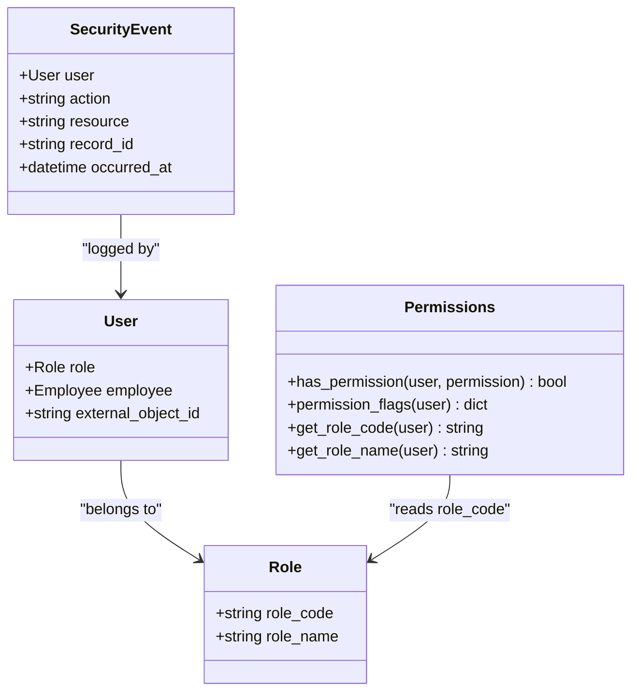

**Diagram sources**
- [models.py (security):5-45](file://src/apps/security/models.py#L5-L45)
- [permissions.py:11-151](file://src/apps/security/permissions.py#L11-L151)

**Section sources**
- [models.py (security):5-45](file://src/apps/security/models.py#L5-L45)
- [permissions.py:11-151](file://src/apps/security/permissions.py#L11-L151)
- [04_Security_Design.md:315-367](file://docs/04_Security_Design.md#L315-L367)

### File Storage Strategy: Local vs SharePoint
File metadata is stored in SQL Server; content is stored either locally under `MEDIA_ROOT` or in Microsoft 365 via Graph API. Local media URLs are routed through a private endpoint to enforce authorization.

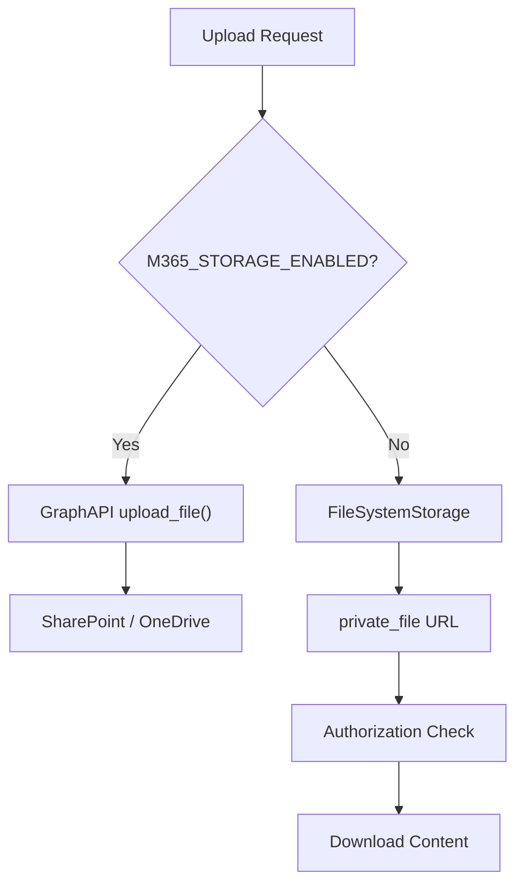

**Diagram sources**
- [settings.py:274-332](file://src/config/settings.py#L274-L332)
- [storage.py (security):6-12](file://src/apps/security/storage.py#L6-L12)
- [urls.py:12-14](file://src/config/urls.py#L12-L14)
- [graph_client.py:216-260](file://src/apps/m365/graph_client.py#L216-L260)

**Section sources**
- [settings.py:274-332](file://src/config/settings.py#L274-L332)
- [storage.py (security):6-12](file://src/apps/security/storage.py#L6-L12)
- [urls.py:12-14](file://src/config/urls.py#L12-L14)
- [02_Solution_Architecture.md:592-633](file://docs/02_Solution_Architecture.md#L592-L633)

### Microsoft 365 Integration Strategy
The Microsoft 365 client uses app-only credentials to call Graph API:
- Tenant ID, client ID, and client secret are required.
- Token acquisition is cached per process.
- Uploads use simple PUT for small files and chunked sessions for larger files.
- Site-scoped search and folder listing validate boundaries to prevent cross-site exposure.

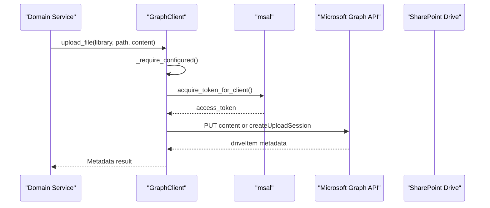

**Diagram sources**
- [graph_client.py:57-120](file://src/apps/m365/graph_client.py#L57-L120)
- [graph_client.py:216-260](file://src/apps/m365/graph_client.py#L216-L260)
- [graph_client.py:329-340](file://src/apps/m365/graph_client.py#L329-L340)

**Section sources**
- [graph_client.py:57-120](file://src/apps/m365/graph_client.py#L57-L120)
- [graph_client.py:216-260](file://src/apps/m365/graph_client.py#L216-L260)
- [graph_client.py:329-340](file://src/apps/m365/graph_client.py#L329-L340)
- [02_Solution_Architecture.md:636-683](file://docs/02_Solution_Architecture.md#L636-L683)

### Cross-Cutting Concerns

#### Audit Logging
Audit scope includes sensitive domains such as employee records, payroll, contracts, documents, tasks, KPI, assets, and procurement. Events cover create, update, delete, approve, reject, cancel, login, logout, and export.

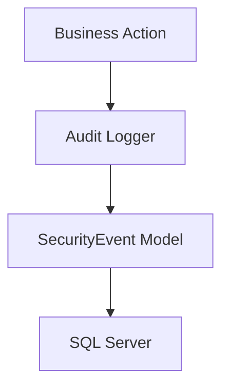

**Diagram sources**
- [models.py (security):35-45](file://src/apps/security/models.py#L35-L45)
- [04_Security_Design.md:591-641](file://docs/04_Security_Design.md#L591-L641)

**Section sources**
- [models.py (security):35-45](file://src/apps/security/models.py#L35-L45)
- [04_Security_Design.md:591-641](file://docs/04_Security_Design.md#L591-L641)

#### Email Workflows
Email workflows currently rely on users composing approval emails in Outlook rather than automated server-side sending. Notifications may integrate with Teams and Outlook in future phases.

**Section sources**
- [README.md:34-35](file://README.md#L34-L35)
- [02_Solution_Architecture.md:636-655](file://docs/02_Solution_Architecture.md#L636-L655)

#### Session Management
Sessions are configured with:
- 8-hour cookie age.
- Expiration at browser close.
- Idle timeout enforced by middleware.
- HTTP-only cookies and SameSite policies.
- Optional HTTPS enforcement behind a reverse proxy.

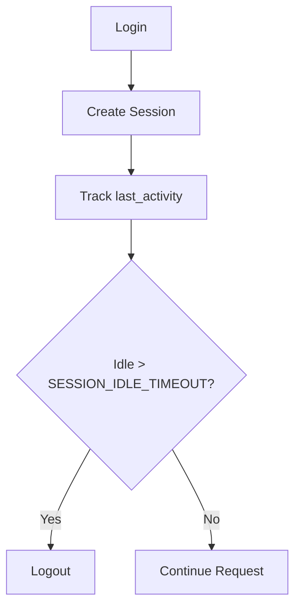

**Diagram sources**
- [settings.py:91-100](file://src/config/settings.py#L91-L100)
- [middleware.py (security):7-28](file://src/apps/security/middleware.py#L7-L28)

**Section sources**
- [settings.py:91-100](file://src/config/settings.py#L91-L100)
- [middleware.py (security):7-28](file://src/apps/security/middleware.py#L7-L28)
- [04_Security_Design.md:671-685](file://docs/04_Security_Design.md#L671-L685)

### Scheduled Operations
A common middleware applies scheduled HR changes once per process per local day for authenticated traffic. Database errors during this operation are swallowed to avoid breaking unrelated portal pages.

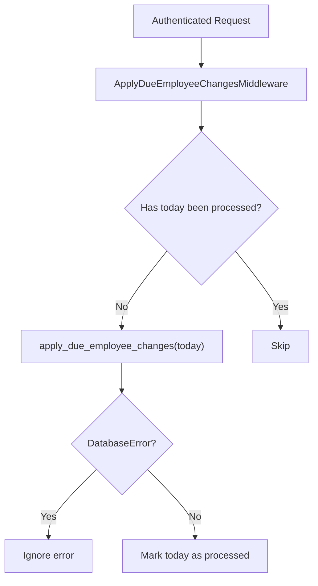

**Diagram sources**
- [middleware.py (common):7-28](file://src/apps/common/middleware.py#L7-L28)

**Section sources**
- [middleware.py (common):7-28](file://src/apps/common/middleware.py#L7-L28)

## Dependency Analysis
Third-party dependencies and their roles:
- Django 5.2.17: Web framework.
- python-dotenv: Environment variable loading.
- django-jazzmin: Admin interface customization.
- openpyxl: Excel report generation.
- python-docx: Word document generation.
- python-pptx: PowerPoint generation.
- reportlab: PDF generation.
- mssql-django and pyodbc: SQL Server connectivity.
- msal: Microsoft authentication library for Graph API.
- requests: HTTP client for Graph API calls.
- chardet: Character encoding detection.
- waitress: WSGI server for Windows SIT behind reverse proxy.
- django-axes: Brute-force protection and login lockout.
- cryptography: Cryptographic primitives.

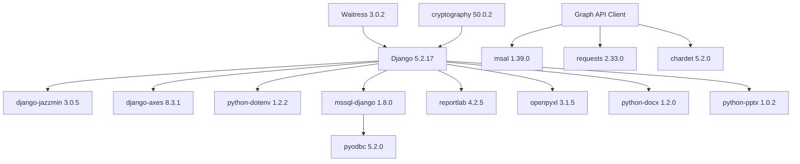

**Diagram sources**
- [requirements.txt:1-21](file://requirements.txt#L1-L21)
- [graph_client.py:100-120](file://src/apps/m365/graph_client.py#L100-L120)

**Section sources**
- [requirements.txt:1-21](file://requirements.txt#L1-L21)
- [graph_client.py:100-120](file://src/apps/m365/graph_client.py#L100-L120)

## Performance Considerations
Performance targets include page responses under three seconds and dashboard rendering under five seconds, with support for approximately 50 concurrent users and future capacity up to 200 users. For NGO organizations:
- Prefer lightweight queries and pagination for large datasets.
- Cache static assets and dashboard aggregates where appropriate.
- Use Graph API chunked uploads for large files to reduce memory pressure.
- Avoid synchronous blocking calls in request paths; consider background tasks for heavy exports.
- Monitor SQL Server slow queries and deadlocks.
- Keep session and CSRF protections enabled without overloading middleware.

[No sources needed since this section provides general guidance]

## Troubleshooting Guide
Common issues and resolutions:
- Missing `.env` variables: Ensure `SECRET_KEY`, database credentials, and M365 configuration are present.
- HTTPS redirect loops: Configure `ENABLE_HTTPS_ENFORCEMENT` only after reverse proxy TLS termination and set `SECURE_PROXY_SSL_HEADER`.
- Login lockouts: django-axes limits failures; adjust `AXES_IP_FAILURE_LIMIT` and review shared IP scenarios.
- Graph API errors: Verify tenant ID, client ID, client secret, site hostname, and site path; check admin consent for app permissions.
- Local file access: Use the private file endpoint instead of direct media URLs to enforce authorization.
- Scheduled HR changes failing: Database transient errors are ignored; investigate connection stability and retry strategy.

**Section sources**
- [settings.py:28-86](file://src/config/settings.py#L28-L86)
- [settings.py:145-169](file://src/config/settings.py#L145-L169)
- [graph_client.py:84-92](file://src/apps/m365/graph_client.py#L84-L92)
- [graph_client.py:147-175](file://src/apps/m365/graph_client.py#L147-L175)
- [storage.py (security):6-12](file://src/apps/security/storage.py#L6-L12)
- [middleware.py (common):15-28](file://src/apps/common/middleware.py#L15-L28)

## Conclusion
IHRMS is a secure, modular Django monolith designed for NGO administrative and human resource management. Its portal facade, centralized security layer, and domain applications provide clear separation of concerns. SQL Server persists structured data while Microsoft 365 stores documents and supports search. The deployment model targets Windows Server with Waitress behind a reverse proxy, aligning with corporate infrastructure. With RBAC, auditability, and careful session and file storage controls, the system balances usability, security, and maintainability for current and future organizational needs.

[No sources needed since this section summarizes without analyzing specific files]

## Appendices

### Infrastructure Requirements
- Python 3.12.
- Django 5.2.17.
- SQL Server with ODBC Driver 17.
- Windows Server target platform.
- Reverse proxy with TLS termination.
- Waitress WSGI server for Windows SIT.
- Microsoft 365 tenant with Graph API app registration and admin consent.

**Section sources**
- [README.md:38-47](file://README.md#L38-L47)
- [08_Deployment_Standards.md:157-183](file://docs/08_Deployment_Standards.md#L157-L183)
- [08_Deployment_Standards.md:265-285](file://docs/08_Deployment_Standards.md#L265-L285)

### Deployment Topology
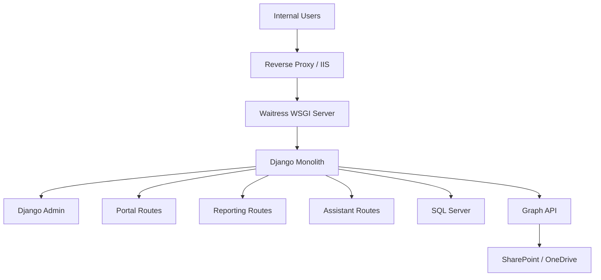

**Diagram sources**
- [02_Solution_Architecture.md:129-147](file://docs/02_Solution_Architecture.md#L129-L147)
- [urls.py:12-20](file://src/config/urls.py#L12-L20)
- [graph_client.py:57-120](file://src/apps/m365/graph_client.py#L57-L120)