# Testing Strategy

<cite>
**Referenced Files in This Document**
- [README.md](file://README.md)
- [07_Testing_Standards.md](file://docs/07_Testing_Standards.md)
- [DESIGN.md](file://DESIGN.md)
- [Run-Tests.ps1](file://ops/Run-Tests.ps1)
- [run_tests.py](file://ops/run_tests.py)
- [permissions.py](file://src/apps/security/permissions.py)
- [tests_mobile.py](file://src/apps/portal/tests_mobile.py)
- [tests.py](file://src/apps/activity/tests.py)
- [run_browser_uat.py](file://ops/run_browser_uat.py)
- [capture_ui_screenshots.py](file://ops/capture_ui_screenshots.py)
- [check_ui_contrast.py](file://ops/check_ui_contrast.py)
- [test_contrast_gate.py](file://src/apps/portal/test_contrast_gate.py)
- [ui_tokens.css](file://src/static/css/ui_tokens.css)
- [run_dashboard_layout_uat.py](file://ops/run_dashboard_layout_uat.py)
- [run_layout_alignment_audit.py](file://ops/run_layout_alignment_audit.py)
- [run_project_forms_uat.py](file://ops/run_project_forms_uat.py)
- [test_home_dashboard_layout.py](file://src/apps/portal/test_home_dashboard_layout.py)
- [PROJECT_WORK_LOG.md](file://docs/PROJECT_WORK_LOG.md)
</cite>

## Update Summary
**Changes Made**
- Enhanced contrast checking infrastructure now supports multi-palette color systems (viethealth, chamdong, thanam) with OS fallback validation
- Added comprehensive test coverage for contrast gate tool through src/apps/portal/test_contrast_gate.py
- Updated accessibility testing framework to document multi-palette parsing, fallback mismatch detection, and enhanced measurement generation
- Refactored contrast gate tool with new helper functions (_block(), palette_blocks(), fallback_mismatches()) for improved maintainability
- Expanded documentation to cover advanced contrast validation scenarios including palette-specific CSS selectors and theme combinations

## Table of Contents
1. [Introduction](#introduction)
2. [Project Structure](#project-structure)
3. [Core Components](#core-components)
4. [Architecture Overview](#architecture-overview)
5. [Detailed Component Analysis](#detailed-component-analysis)
6. [Accessibility Testing Framework](#accessibility-testing-framework)
7. [Dashboard Layout Validation](#dashboard-layout-validation)
8. [Visual Regression Testing Infrastructure](#visual-regression-testing-infrastructure)
9. [Dependency Analysis](#dependency-analysis)
10. [Performance Considerations](#performance-considerations)
11. [Troubleshooting Guide](#troubleshooting-guide)
12. [Conclusion](#conclusion)
13. [Appendices](#appendices)

## Introduction
This document defines the comprehensive testing strategy for IHRMS, covering unit testing, integration testing, browser-based user acceptance testing, accessibility validation, dashboard layout verification, and visual regression testing. It explains how tests are discovered and executed through PowerShell and Python helpers, how Django's test framework is used, and how automated checks validate UI consistency, form behavior, navigation flows, responsive design, accessibility compliance, and visual regression across multiple screen sizes and themes.

IHRMS is a Django application with a portal, admin interface, and business modules. The repository includes structured test suites under `src/apps`, operational scripts under `ops`, and project documentation under `docs`. The testing approach now encompasses WCAG 2.1 AA compliance, multi-viewport dashboard validation, automated visual regression evidence collection, and sophisticated multi-palette color system validation with OS fallback support.

**Section sources**
- [README.md:1-90](file://README.md#L1-L90)

## Project Structure
The testing surface spans multiple layers with enhanced accessibility and visual regression capabilities:

- **Unit and integration tests**: Django `TestCase` and `TransactionTestCase` classes live next to their modules under `src/apps/*/tests*.py`. They assert model validation, service logic, view rendering, permissions, notifications, file uploads, and workflow state transitions.
- **Operational test runners**: `ops/Run-Tests.ps1` and `ops/run_tests.py` provide a consistent entry point for running all discovered tests against SQLite or SQL Server with isolated databases and disabled external storage/email.
- **Browser-based UAT**: `ops/run_browser_uat.py` and related scripts use Playwright with Microsoft Edge to automate login, navigation, form submission, screenshot capture, and assertion across multiple roles, themes, and viewport widths.
- **Accessibility testing**: Automated contrast ratio validation using multi-palette color systems (viethealth, chamdong, thanam), keyboard navigation checks, and WCAG 2.1 AA compliance verification with OS fallback validation.
- **Dashboard layout validation**: Multi-screen size testing across desktop (1756px, 1440px), tablet (1024px, 768px), and mobile (390px) viewports with theme switching and layout geometry measurement.
- **Visual regression testing**: Before/after screenshot capture, automated evidence generation, and comparative analysis for UI consistency validation.

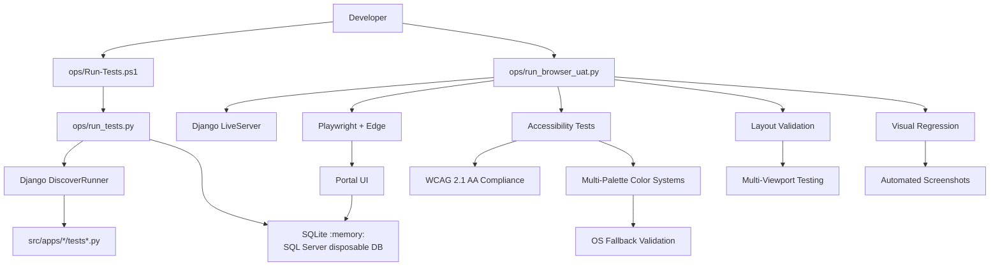

**Diagram sources**
- [Run-Tests.ps1:1-68](file://ops/Run-Tests.ps1#L1-L68)
- [run_tests.py:1-80](file://ops/run_tests.py#L1-L80)
- [run_browser_uat.py:1-34](file://ops/run_browser_uat.py#L1-L34)
- [capture_ui_screenshots.py:1-196](file://ops/capture_ui_screenshots.py#L1-L196)
- [check_ui_contrast.py:1-181](file://ops/check_ui_contrast.py#L1-L181)
- [test_contrast_gate.py:1-109](file://src/apps/portal/test_contrast_gate.py#L1-L109)

**Section sources**
- [README.md:71-87](file://README.md#L71-L87)
- [07_Testing_Standards.md:107-149](file://docs/07_Testting_Standards.md#L107-L149)

## Core Components
This section summarizes the primary testing components and their responsibilities, including enhanced accessibility and visual regression capabilities.

| Component | Responsibility | Key Behaviors |
|---|---|---|
| `ops/Run-Tests.ps1` | PowerShell wrapper for test execution | Validates environment, selects Python executable, invokes `ops/run_tests.py`, parses discovered-test count, fails if zero tests are found. |
| `ops/run_tests.py` | Test runner configuration | Sets Django settings for tests, configures SQLite in-memory or SQL Server disposable database, disables M365 storage and real email, runs `DiscoverRunner`, enforces non-empty test suite. |
| `src/apps/activity/tests.py` | Workflow, validation, notification, and permission tests | Uses `TestCase` and `TransactionTestCase`, asserts model validation errors, verifies task creation, reminder scheduling, file upload handling, role-scoped views, and concurrency safety on SQL Server. |
| `src/apps/portal/tests_mobile.py` | Mobile and PWA baseline checks | Verifies responsive table wrappers, base template assets, print templates, theme ordering, service worker scoping, manifest metadata, and asset hashing. |
| `src/apps/security/permissions.py` | Centralized permission matrix | Defines roles, permission names, staff exceptions, and helper functions used by views and tests to enforce access control. |
| `ops/run_browser_uat.py` | Browser automation runner | Creates synthetic data, launches Edge via Playwright, logs in multiple roles, navigates routes, captures screenshots, reports checks and errors, and destroys the disposable database. |
| `ops/capture_ui_screenshots.py` | Automated screenshot capture | Captures 36 sample screenshots across 6 pages × 3 viewports × 2 themes for visual regression baseline. |
| `ops/check_ui_contrast.py` | WCAG contrast validation | Measures token pairings using sRGB luminance, validates light/dark theme contrast ratios, supports multi-palette color systems (viethealth, chamdong, thanam), and generates documentation. |
| `src/apps/portal/test_contrast_gate.py` | Contrast gate tool testing | Comprehensive test coverage for multi-palette parsing, fallback mismatch detection, and enhanced measurement generation. |
| `ops/run_dashboard_layout_uat.py` | Dashboard layout validation | Tests dashboard geometry across multiple screen sizes, validates grid alignment, measures card heights, and ensures responsive behavior. |
| `ops/run_layout_alignment_audit.py` | Comprehensive layout auditing | Measures screen alignment, form field positioning, button sizing, and accessibility violations across all routes and viewports. |

**Section sources**
- [Run-Tests.ps1:1-68](file://ops/Run-Tests.ps1#L1-L68)
- [run_tests.py:1-80](file://ops/run_tests.py#L1-L80)
- [tests.py:1-800](file://src/apps/activity/tests.py#L1-L800)
- [tests_mobile.py:1-182](file://src/apps/portal/tests_mobile.py#L1-L182)
- [permissions.py:1-152](file://src/apps/security/permissions.py#L1-L152)
- [run_browser_uat.py:1-34](file://ops/run_browser_uat.py#L1-L34)
- [capture_ui_screenshots.py:1-196](file://ops/capture_ui_screenshots.py#L1-L196)
- [check_ui_contrast.py:1-181](file://ops/check_ui_contrast.py#L1-L181)
- [test_contrast_gate.py:1-109](file://src/apps/portal/test_contrast_gate.py#L1-L109)
- [run_dashboard_layout_uat.py:1-177](file://ops/run_dashboard_layout_uat.py#L1-L177)
- [run_layout_alignment_audit.py:1-304](file://ops/run_layout_alignment_audit.py#L1-L304)

## Architecture Overview
The end-to-end testing architecture combines deterministic backend tests with realistic browser interactions, enhanced accessibility validation with multi-palette support, and comprehensive visual regression testing.

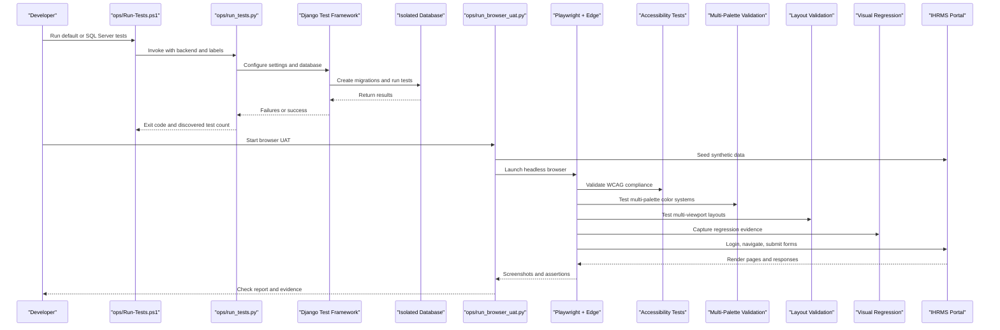

**Diagram sources**
- [Run-Tests.ps1:27-67](file://ops/Run-Tests.ps1#L27-L67)
- [run_tests.py:24-74](file://ops/run_tests.py#L24-L74)
- [run_browser_uat.py:20-34](file://ops/run_browser_uat.py#L20-L34)
- [capture_ui_screenshots.py:148-191](file://ops/capture_ui_screenshots.py#L148-L191)
- [check_ui_contrast.py:96-131](file://ops/check_ui_contrast.py#L96-L131)
- [test_contrast_gate.py:48-109](file://src/apps/portal/test_contrast_gate.py#L48-L109)

## Detailed Component Analysis

### Automated Test Execution Pipeline
The pipeline ensures that tests are always run from the correct working directory, with a known Python interpreter, UTF-8 encoding, and an isolated database.

**Diagram sources**
- [Run-Tests.ps1:13-67](file://ops/Run-Tests.ps1#L13-L67)

Key behaviors:
- Fails early if `manage.py` is missing.
- Prefers `venv\Scripts\python.exe` when available.
- Forces UTF-8 output encoding.
- Treats missing discovery output or zero discovered tests as failure.

**Section sources**
- [Run-Tests.ps1:1-68](file://ops/Run-Tests.ps1#L1-L68)

### Test Backend Configuration
`ops/run_tests.py` prepares a safe test environment before importing Django settings.

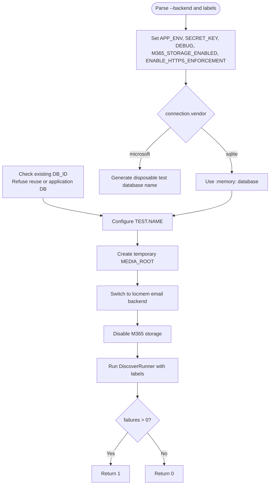

**Diagram sources**
- [run_tests.py:11-74](file://ops/run_tests.py#L11-L74)

Important guarantees:
- Production-like guards are disabled for tests (`APP_ENV=test`, HTTPS enforcement off).
- SQLite uses an in-memory database.
- SQL Server uses a generated disposable database name and refuses to reuse the configured application database.
- Real file storage and email are disabled; media files go to a temporary directory.
- A custom runner rejects empty test suites.

**Section sources**
- [run_tests.py:1-80](file://ops/run_tests.py#L1-L80)

### Unit and Integration Test Patterns
The activity module demonstrates representative patterns for model validation, service-layer logic, view rendering, notifications, file uploads, and permission scoping.

**Diagram sources**
- [tests.py:32-77](file://src/apps/activity/tests.py#L32-L77)
- [tests.py:78-296](file://src/apps/activity/tests.py#L78-L296)
- [tests.py:299-515](file://src/apps/activity/tests.py#L299-L515)
- [tests.py:516-580](file://src/apps/activity/tests.py#L516-L580)
- [tests.py:582-800](file://src/apps/activity/tests.py#L582-L800)

Patterns illustrated:
- **Model validation**: Assertions expect `ValidationError` for invalid states such as completing a task without a report file or before the activity ends.
- **Service-layer logic**: Tests call services like schedule conflict detection, workday calculation, and reminder sending, asserting resulting counts and dates.
- **View rendering and CSRF**: Tests log in users, POST to portal URLs, assert redirects, status codes, template usage, and rendered content.
- **File upload testing**: Tests create `SimpleUploadedFile` objects and verify required PDFs, download endpoints, and validation messages.
- **Notification simulation**: Tests assert created notifications for reminders, submissions, changes requested, and approvals.
- **Concurrency testing**: A `TransactionTestCase` simulates concurrent decision requests and expects only one successful save on SQL Server.
- **Permission scoping**: Tests verify role-based visibility for dashboards, task lists, filters, calendars, and approval inboxes.

**Section sources**
- [tests.py:1-800](file://src/apps/activity/tests.py#L1-L800)

### Permission Model and Permission Checks
Permissions are centralized in a single matrix rather than scattered across views and context processors. Tests should assert both positive and negative cases for each relevant role.

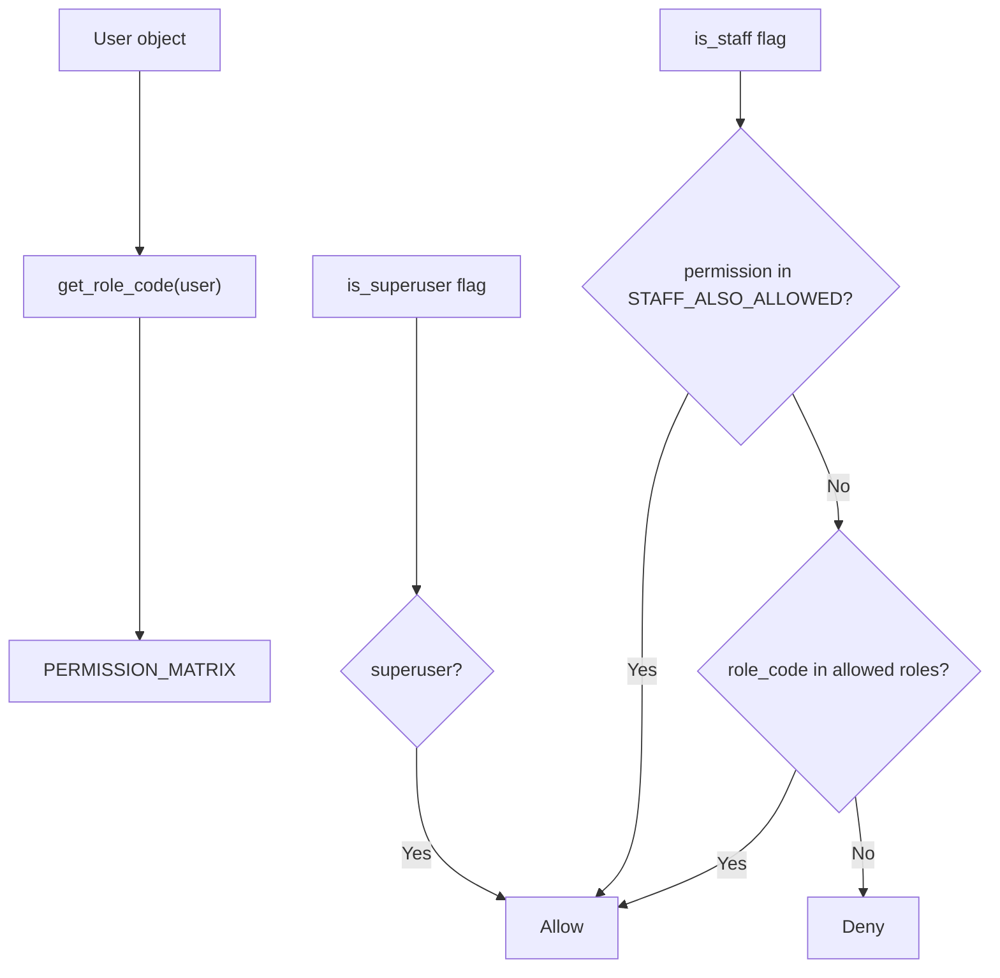

**Diagram sources**
- [permissions.py:121-151](file://src/apps/security/permissions.py#L121-L151)

Guidelines:
- Add new permissions only in `PERMISSION_MATRIX`.
- Use `has_permission(user, permission)` for programmatic checks.
- Use `permission_flags(user)` for template-level `can_*` variables.
- Keep `STAFF_ALSO_ALLOWED` minimal and explicit.
- Write tests for every role that can or cannot perform the action.

**Section sources**
- [permissions.py:1-152](file://src/apps/security/permissions.py#L1-L152)

### Browser-Based UAT Automation
The browser UAT runner automates realistic user journeys against a live Django server with synthetic data.

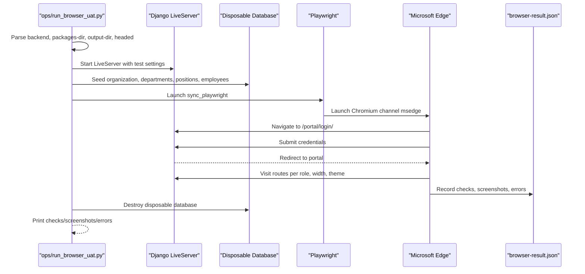

**Diagram sources**
- [run_browser_uat.py:1-34](file://ops/run_browser_uat.py#L1-L34)
- [run_browser_uat.py:96-119](file://ops/run_browser_uat.py#L96-L119)
- [PROJECT_WORK_LOG.md:2079-2087](file://docs/PROJECT_WORK_LOG.md#L2079-L2087)

Coverage characteristics:
- Uses real browser automation with HTTP, POST, and CSRF.
- Seeds synthetic data and never touches production data.
- Captures full-page screenshots for visual regression evidence.
- Reports checks, screenshots, and JavaScript/page errors.
- Supports SQLite and SQL Server backends.
- Can run in headed mode for debugging and supports package installation outside the repository.

**Section sources**
- [run_browser_uat.py:1-34](file://ops/run_browser_uat.py#L1-L34)
- [run_browser_uat.py:96-119](file://ops/run_browser_uat.py#L96-L119)
- [PROJECT_WORK_LOG.md:2079-2087](file://docs/PROJECT_WORK_LOG.md#L2079-L2087)

### Mobile and Responsive Design Validation
Mobile and responsive checks ensure tables are wrapped correctly, base templates load local Tailwind CSS, print templates avoid mobile wrappers, design tokens are shared, and PWA assets are valid.

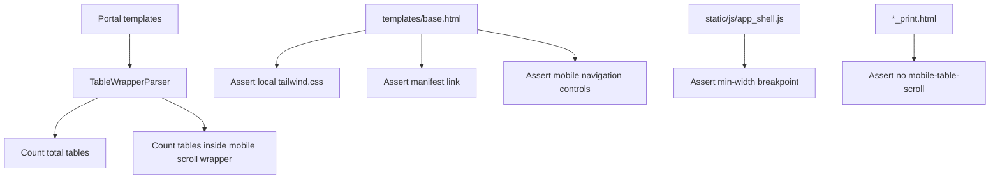

**Diagram sources**
- [tests_mobile.py:36-99](file://src/apps/portal/tests_mobile.py#L36-L99)

Additional validations include:
- Shared design tokens imported by main CSS and admin CSS.
- Theme script loaded before styles.
- Service worker scoped to `/portal/` and not caching HTML.
- Manifest start URL, scope, display mode, icon sizes, and PNG headers.
- Asset hash computation and cache version references.

**Section sources**
- [tests_mobile.py:1-182](file://src/apps/portal/tests_mobile.py#L1-L182)

### Test Data Management
IHRMS uses several strategies for test data:

- **Factory-style mixins**: `ActivityTestDataMixin` creates organizations, departments, positions, employees, projects, and related entities in `setUp`.
- **Temporary directories**: File upload tests use `tempfile.TemporaryDirectory` and Django's `override_settings` to isolate media storage.
- **Synthetic fixtures**: Browser UAT seeds lightweight records such as organizations, departments, positions, and employees with deterministic but non-sensitive values.
- **Database isolation**: SQLite uses `:memory:`; SQL Server uses a generated disposable database name that must not match the application database or an existing database.
- **Email isolation**: Tests switch to `locmem.EmailBackend` so email workflows do not send real messages.
- **Storage isolation**: M365 storage is disabled during tests; local media goes to a temporary directory.

Best practices:
- Prefer small, focused fixtures over large global datasets.
- Clean up temporary resources using `addCleanup` or context managers.
- Avoid reusing application database names for test databases.
- Mock external APIs and services when they are not part of the tested behavior.
- Use `override_settings` for environment-dependent behavior such as storage and email backends.

**Section sources**
- [tests.py:32-77](file://src/apps/activity/tests.py#L32-L77)
- [tests.py:300-340](file://src/apps/activity/tests.py#L300-L340)
- [run_tests.py:24-74](file://ops/run_tests.py#L24-L74)
- [run_browser_uat.py:96-119](file://ops/run_browser_uat.py#L96-L119)

### Test-Driven Development Approach
Although IHRMS uses Django's test framework rather than pytest, the same TDD principles apply:

- Write failing tests first for model validation, service logic, view behavior, and permission checks.
- Implement minimal code to pass the test.
- Refactor while keeping tests green.
- Use descriptive test methods and assertions that read like expected outcomes.
- Group related scenarios into mixins and test classes.
- Use mocks for external dependencies such as time, network calls, and storage.

Example assertion style derived from the codebase:
- Assert exact model fields, statuses, and relationships.
- Assert exception types and message dictionaries for validation failures.
- Assert redirect targets and rendered template names.
- Assert notification counts and message content.
- Assert HTTP status codes for unauthorized or forbidden actions.

**Section sources**
- [tests.py:78-296](file://src/apps/activity/tests.py#L78-L296)
- [tests.py:299-515](file://src/apps/activity/tests.py#L299-L515)

### Integration Test Patterns
Integration tests cover multi-step workflows and cross-module interactions:

- **Database transactions**: Use `TestCase` for transactional isolation and `TransactionTestCase` when row-level locking or database-specific concurrency behavior must be verified.
- **External API mocking**: Use `unittest.mock.patch` to freeze time, replace timezone behavior, or mock external services.
- **File upload testing**: Use `SimpleUploadedFile` to simulate PDF uploads and assert validation, persistence, and download behavior.
- **Email workflow simulation**: Assert notification records and email draft construction instead of sending real emails.
- **Cross-module side effects**: Verify that activity updates create tasks, notifications, and dashboard metrics.

**Section sources**
- [tests.py:1-800](file://src/apps/activity/tests.py#L1-L800)

### User Acceptance Testing Methodology
UAT should follow structured scenarios with clear preconditions, steps, and expected outcomes:

- Define scenario IDs and modules.
- Specify preconditions such as roles, data state, and environment.
- Record test steps including navigation, input, and actions.
- Capture expected results including status codes, redirects, visible text, and side effects.
- Record actual results and status: PASS, FAIL, BLOCKED, NOT RUN.
- Attach evidence such as screenshots, logs, and JSON reports.
- Track defects with severity, module, scenario ID, reproduction steps, and environment details.

The project's testing standards define case structure and status categories, while browser UAT provides automated evidence for UI flows.

**Section sources**
- [07_Testing_Standards.md:151-175](file://docs/07_Testing_Standards.md#L151-L175)
- [07_Testing_Standards.md:179-201](file://docs/07_Testing_Standards.md#L179-L201)
- [PROJECT_WORK_LOG.md:2079-2087](file://docs/PROJECT_WORK_LOG.md#L2079-L2087)

## Accessibility Testing Framework

**Updated** Enhanced accessibility testing infrastructure now supports multi-palette color systems (viethealth, chamdong, thanam) with comprehensive OS fallback validation and sophisticated contrast measurement capabilities.

The accessibility testing framework ensures IHRMS meets minimum WCAG 2.1 AA standards with additional touch target and focus ring requirements where feasible. The system now validates semantic HTML structure, ARIA attributes, keyboard navigation, color contrast ratios across multiple color palettes, and interactive element sizing with robust fallback validation.

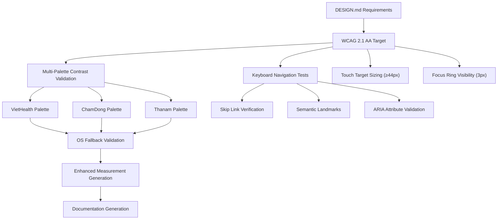

**Diagram sources**
- [DESIGN.md:131-138](file://DESIGN.md#L131-L138)
- [check_ui_contrast.py:1-181](file://ops/check_ui_contrast.py#L1-L181)
- [test_contrast_gate.py:1-109](file://src/apps/portal/test_contrast_gate.py#L1-L109)

### WCAG 2.1 AA Compliance Requirements
The design specification establishes minimum accessibility targets:

- **Color contrast**: Text ≥ 4.5:1; UI components and focus indicators ≥ 3:1; measured for both light and dark themes across all supported palettes.
- **Focus management**: 3px focus rings with 3px offset, clearly visible, not obscured by overflow or sticky headers; filled buttons have background spacing around rings.
- **Keyboard navigation**: Fully operable via keyboard with skip links, semantic landmarks (`header`, `nav`, `main`), and `aria-current="page"` for active items.
- **Touch targets**: Minimum 44px touch target areas.
- **Semantic HTML**: Semantic HTML structure takes precedence; ARIA is used only to supplement meaning.
- **Sorting**: Only use `aria-sort` when backend truly supports sorting.
- **Certification**: Do not claim "WCAG compliant" for the entire application without tool and user testing validation.

**Section sources**
- [DESIGN.md:131-138](file://DESIGN.md#L131-L138)

### Enhanced Multi-Palette Contrast Validation
The contrast validation system now supports three distinct color palettes (viethealth, chamdong, thanam) with comprehensive OS fallback validation and enhanced measurement generation.

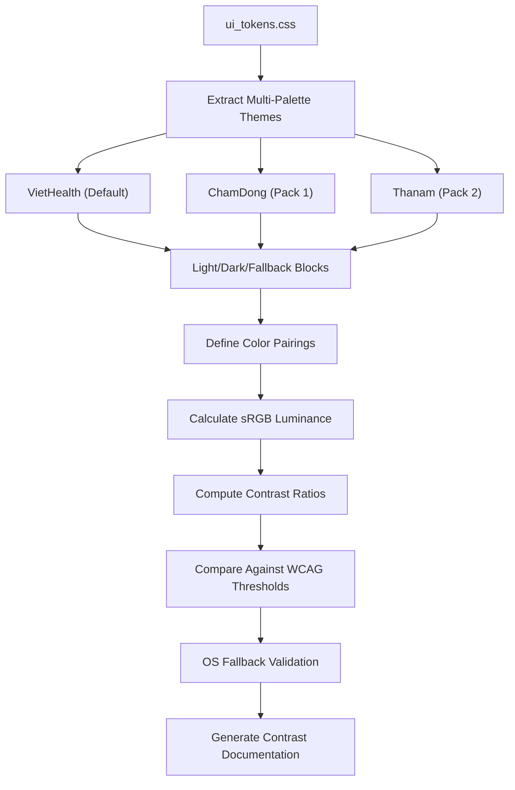

**Diagram sources**
- [check_ui_contrast.py:23-64](file://ops/check_ui_contrast.py#L23-L64)
- [test_contrast_gate.py:68-100](file://src/apps/portal/test_contrast_gate.py#L68-L100)

Key enhancements:
- **Multi-palette support**: Automatic detection and validation of viethealth, chamdong, and thanam palettes.
- **OS fallback validation**: Ensures fallback color blocks match dark theme exactly for each palette.
- **Enhanced measurement generation**: Comprehensive contrast ratio calculations across all palette/theme combinations.
- **Robust error handling**: Detailed error reporting for missing blocks and circular token references.
- **Comprehensive test coverage**: Full test suite validating palette parsing, fallback mismatches, and measurement accuracy.

Supported pairings include text/surface combinations, chart series colors, sidebar themes, status indicators, and brand colors across all three palettes. The tool validates CSS custom properties with recursive alias resolution and circular reference detection.

**Section sources**
- [check_ui_contrast.py:1-181](file://ops/check_ui_contrast.py#L1-L181)
- [test_contrast_gate.py:1-109](file://src/apps/portal/test_contrast_gate.py#L1-L109)

### Contrast Gate Tool Testing
Comprehensive test coverage ensures the contrast gate tool functions correctly across all multi-palette scenarios.

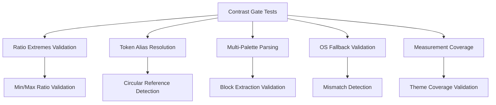

**Diagram sources**
- [test_contrast_gate.py:48-109](file://src/apps/portal/test_contrast_gate.py#L48-L109)

Test coverage includes:
- **Ratio extremes**: Validates minimum (1.0:1) and maximum (21.0:1) contrast ratios.
- **Token alias resolution**: Ensures CSS variable aliases resolve correctly.
- **Multi-palette parsing**: Confirms all three palettes (viethealth, chamdong, thanam) parse correctly.
- **Fallback validation**: Detects mismatches between OS fallback and dark theme blocks.
- **Measurement coverage**: Validates all palette/theme combinations are measured.
- **Error handling**: Tests missing pack blocks and circular token references.

**Section sources**
- [test_contrast_gate.py:1-109](file://src/apps/portal/test_contrast_gate.py#L1-L109)

### Keyboard Navigation and Interactive Element Testing
Browser-based accessibility tests verify keyboard operability and interactive element sizing across multiple contexts.

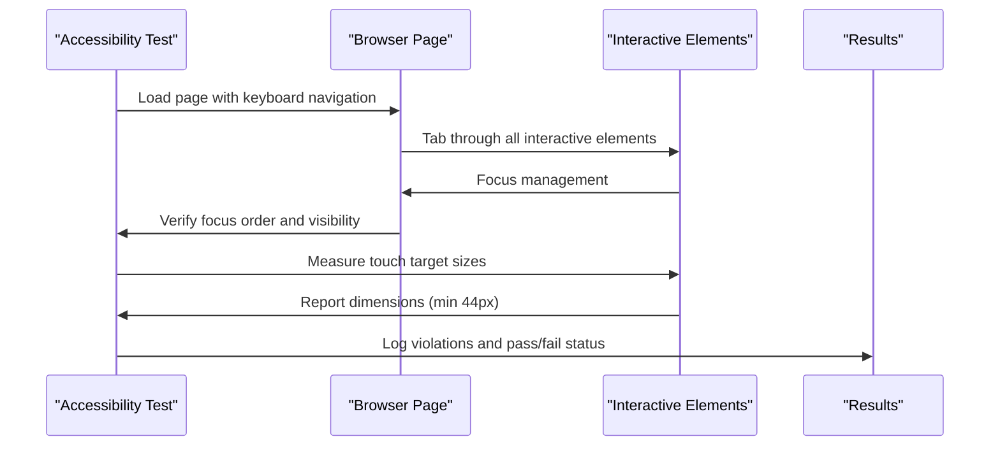

**Diagram sources**
- [run_button_states_uat.py:191-209](file://ops/run_button_states_uat.py#L191-L209)

Validation points:
- **Button sizing**: All interactive buttons meet minimum 44px height requirement.
- **Hover contrast**: Hover states maintain WCAG 4.5:1 contrast ratios.
- **Focus management**: Focus indicators are visible and not obscured.
- **Multiple contexts**: Tests run across dashboard, employee list, forms, recruitment, assets, and login pages.
- **Theme variations**: Both light and dark themes validated for accessibility compliance.

**Section sources**
- [run_button_states_uat.py:191-209](file://ops/run_button_states_uat.py#L191-L209)

## Dashboard Layout Validation

**Updated** Added comprehensive dashboard layout validation across multiple screen sizes with automated geometry measurement and responsive behavior verification.

The dashboard layout validation system ensures consistent presentation across desktop (1756px, 1440px), tablet (1280px, 1024px), and mobile (768px, 390px) viewports with both light and dark themes. It validates grid alignment, card heights, content ratios, and responsive behavior while ensuring accessibility compliance.

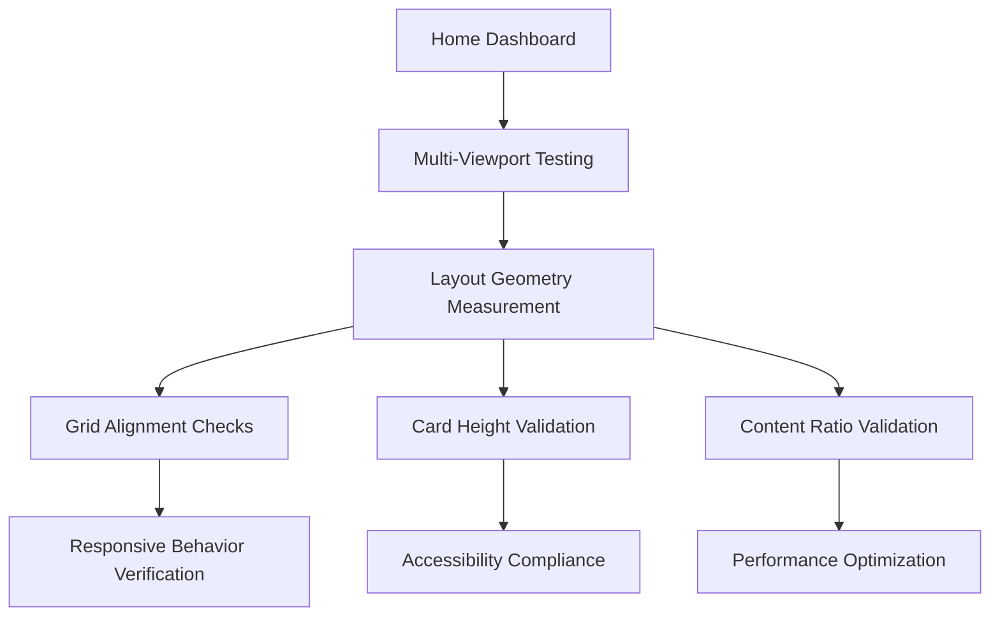

**Diagram sources**
- [run_dashboard_layout_uat.py:54-134](file://ops/run_dashboard_layout_uat.py#L54-L134)

### Multi-Screen Size Testing Matrix
The validation covers a comprehensive matrix of screen sizes and themes:

| Screen Size | Use Case | Validation Focus |
|---|---|---|
| 1756px | Desktop audit width | Full layout validation, KPI alignment, grid precision |
| 1440px | Standard desktop | First fold content, group titles, card proportions |
| 1280px | Large tablet | Responsive grid adaptation, content flow |
| 1024px | Tablet landscape | Two-column layouts, touch target sizing |
| 768px | Tablet portrait | Single column layouts, mobile navigation |
| 390px | Mobile (iPhone 12/13/14) | Mobile-specific layouts, touch targets, readability |

Each viewport is tested with both light and dark themes, validating theme retention after navigation, color contrast, and visual consistency.

**Section sources**
- [run_dashboard_layout_uat.py:46-52](file://ops/run_dashboard_layout_uat.py#L46-L52)

### Layout Geometry and Alignment Validation
The system performs detailed geometric measurements to ensure layout consistency and accessibility compliance.

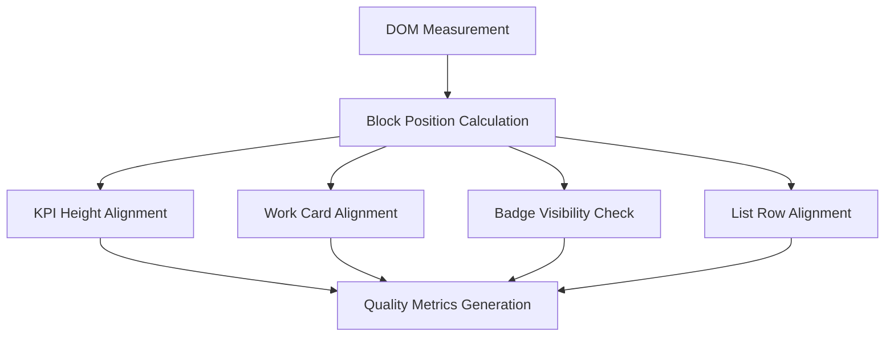

**Diagram sources**
- [run_dashboard_layout_uat.py:54-66](file://ops/run_dashboard_layout_uat.py#L54-L66)

Key validation criteria:
- **No horizontal overflow**: Pages must not exceed viewport width.
- **No inner vertical scrolling**: Cards should fit content without internal scrollbars.
- **Equal card heights**: Related cards in rows maintain consistent heights.
- **60/40 content ratios**: Paired content maintains proper proportion ratios.
- **Business group ordering**: HR, Admin, and Recruitment groups appear in correct sequence.
- **First fold content**: Critical content appears within initial viewport.
- **Touch target sizing**: All interactive elements meet 44px minimum.
- **Typography consistency**: Font sizes and line heights follow design tokens.

**Section sources**
- [run_dashboard_layout_uat.py:67-151](file://ops/run_dashboard_layout_uat.py#L67-L151)

### Visual System Compliance
The dashboard validation ensures adherence to the visual design system specifications.

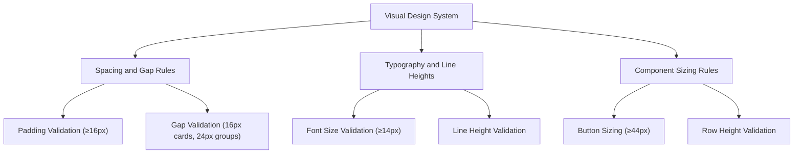

**Diagram sources**
- [run_dashboard_layout_uat.py:93-134](file://ops/run_dashboard_layout_uat.py#L93-L134)

Compliance checks include:
- **Card padding**: Minimum 16px padding on all sides.
- **Card gaps**: 16px gaps between cards, 0px gaps for KPI strips.
- **Group gaps**: 24px gaps between dashboard sections.
- **Section gaps**: 12px gaps between grouped sections.
- **Typography**: Font sizes and line heights match design tokens.
- **Row heights**: Interactive rows ≥ 44px, static rows ≥ 32px.
- **Target sizing**: All interactive targets ≥ 44px × 44px.
- **No shadow**: Cards use flat design without box shadows.
- **Focus tokens**: Focus ring width set to 3px.

**Section sources**
- [run_dashboard_layout_uat.py:93-134](file://ops/run_dashboard_layout_uat.py#L93-L134)

## Visual Regression Testing Infrastructure

**Updated** Added comprehensive visual regression testing infrastructure with automated screenshot capture, before/after comparison, and evidence generation for UI consistency validation.

The visual regression testing system provides automated evidence collection through systematic screenshot capture across multiple viewports and themes, enabling reliable detection of unintended UI changes and facilitating visual review of design iterations.

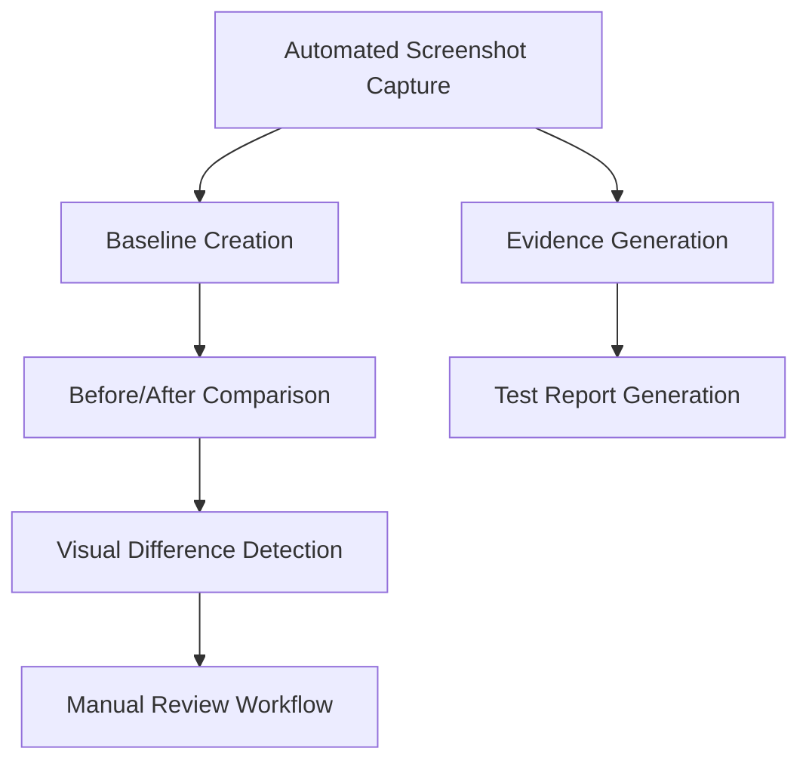

**Diagram sources**
- [capture_ui_screenshots.py:131-184](file://ops/capture_ui_screenshots.py#L131-L184)
- [run_project_forms_uat.py:184-252](file://ops/run_project_forms_uat.py#L184-L252)

### Automated Screenshot Capture System
The screenshot capture system systematically documents UI states across required sample pages, viewports, and themes.

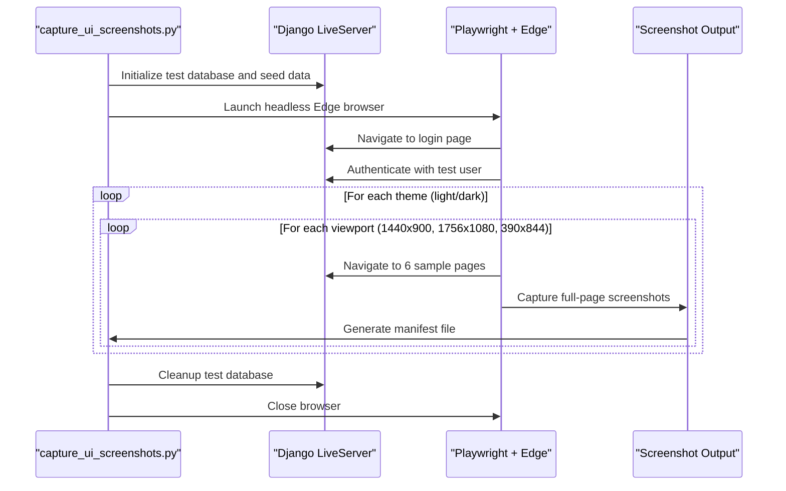

**Diagram sources**
- [capture_ui_screenshots.py:148-191](file://ops/capture_ui_screenshots.py#L148-L191)

Coverage matrix:
- **Sample pages**: Dashboard (Director/HR Manager/Employee), Employee List, Employee Form, Asset Form, Headcount Report, Login.
- **Viewports**: 1440×900 (standard desktop), 1756×1080 (audit width), 390×844 (mobile iPhone).
- **Themes**: Light and dark themes.
- **Total screenshots**: 36 screenshots (6 pages × 3 viewports × 2 themes).

The system creates synthetic test data including organizations, departments, positions, employees, leave balances, and assets to ensure meaningful screenshot content.

**Section sources**
- [capture_ui_screenshots.py:1-196](file://ops/capture_ui_screenshots.py#L1-L196)

### Project-Wide Visual Evidence Collection
The project-wide evidence collection system captures comprehensive UI screenshots across all portal routes with role-based access validation.

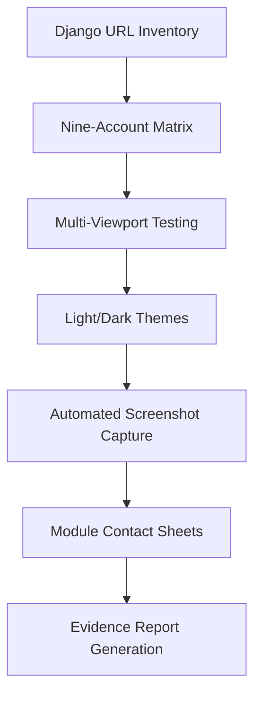

**Diagram sources**
- [run_project_forms_uat.py:184-252](file://ops/run_project_forms_uat.py#L184-L252)

Key features:
- **Complete route coverage**: Captures screenshots for all Django URL patterns excluding admin routes.
- **Role-based validation**: Tests nine different user roles with appropriate permissions.
- **Viewport matrix**: Tests at 1756px and 390px viewports for comprehensive coverage.
- **Theme switching**: Validates both light and dark theme rendering.
- **Module grouping**: Organizes screenshots by functional modules (HR, Recruitment, Reports, Office, Assets, Work, Personal-Finance).
- **Contact sheets**: Generates visual contact sheets showing before/after comparisons for each module.

The system validates that every captured page contains the portal shell (.ui-main) and excludes non-HTML responses or error pages from screenshot capture.

**Section sources**
- [run_project_forms_uat.py:184-252](file://ops/run_project_forms_uat.py#L184-L252)

### Layout Alignment Auditing
The layout alignment audit system provides comprehensive measurement of screen alignment, form field positioning, and accessibility violations across all routes and viewports.

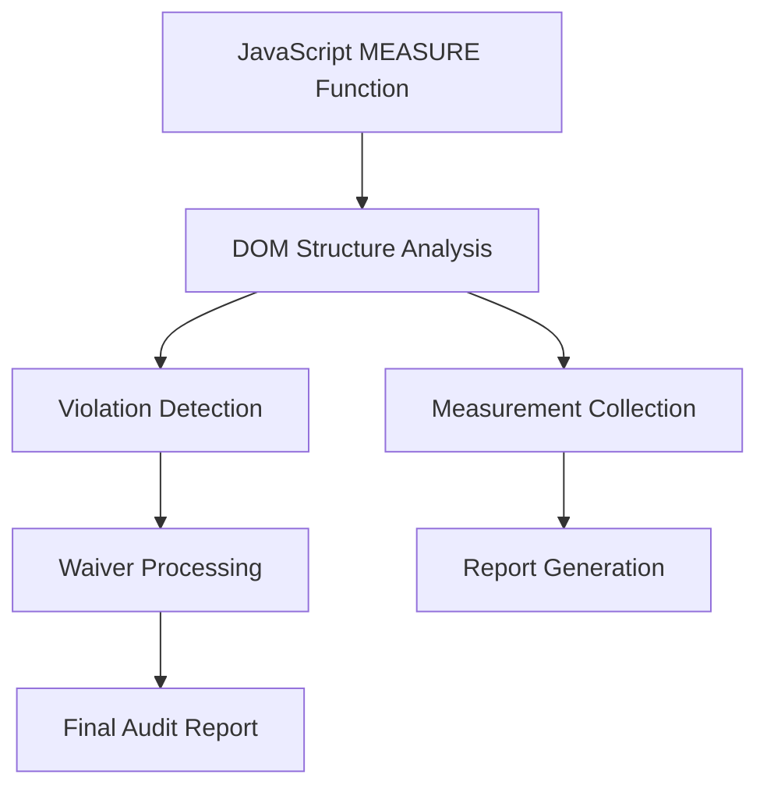

**Diagram sources**
- [run_layout_alignment_audit.py:19-96](file://ops/run_layout_alignment_audit.py#L19-L96)

Audit criteria include:
- **Frame alignment**: Content frame alignment within main container.
- **Overflow detection**: Horizontal and vertical overflow validation.
- **Card inset validation**: Minimum padding requirements for cards.
- **Title sizing**: Card title font size validation (≥17.5px).
- **Button sizing**: Button height (≥43.5px) and font size (≥14px) validation.
- **Form field validation**: Field sizing, label association, date echo functionality, and language attributes.
- **Grid alignment**: Form grid column counts, field alignment, and gap validation.
- **Action button positioning**: Form action button alignment and spacing.
- **Query bar validation**: Filter action button positioning.
- **Number alignment**: Right-aligned numeric content.

The system generates detailed violation reports with selectors, measurements, and contextual information for debugging and remediation.

**Section sources**
- [run_layout_alignment_audit.py:1-304](file://ops/run_layout_alignment_audit.py#L1-L304)

## Dependency Analysis
Testing components depend on each other in a controlled way with enhanced accessibility and visual regression capabilities:

- `ops/Run-Tests.ps1` depends on `ops/run_tests.py`.
- `ops/run_tests.py` depends on Django settings, database connection, and `DiscoverRunner`.
- `src/apps/activity/tests.py` depends on domain models, services, security roles, notifications, and portal URLs.
- `src/apps/portal/tests_mobile.py` depends on static assets, templates, and service worker configuration.
- `ops/run_browser_uat.py` depends on Playwright, Edge, Django LiveServer, and the same domain models seeded with synthetic data.
- `ops/capture_ui_screenshots.py` depends on Playwright, Edge, Django LiveServer, and synthetic data seeding.
- `ops/check_ui_contrast.py` depends on CSS token parsing and WCAG contrast calculation algorithms.
- `src/apps/portal/test_contrast_gate.py` depends on contrast gate tool functions and synthetic CSS generation.
- `ops/run_dashboard_layout_uat.py` depends on Playwright, Edge, and dashboard geometry measurement.
- `ops/run_layout_alignment_audit.py` depends on Django URL resolution, Playwright, and comprehensive DOM analysis.

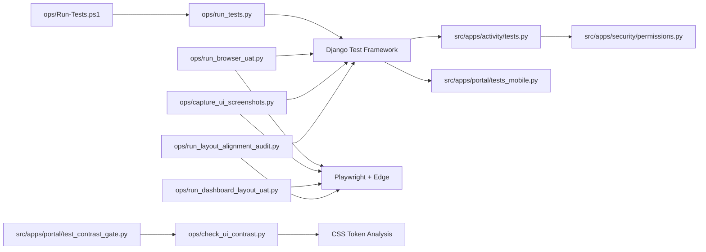

**Diagram sources**
- [Run-Tests.ps1:1-68](file://ops/Run-Tests.ps1#L1-L68)
- [run_tests.py:1-80](file://ops/run_tests.py#L1-L80)
- [tests.py:1-800](file://src/apps/activity/tests.py#L1-L800)
- [tests_mobile.py:1-182](file://src/apps/portal/tests_mobile.py#L1-L182)
- [permissions.py:1-152](file://src/apps/security/permissions.py#L1-L152)
- [run_browser_uat.py:1-34](file://ops/run_browser_uat.py#L1-L34)
- [capture_ui_screenshots.py:1-196](file://ops/capture_ui_screenshots.py#L1-L196)
- [check_ui_contrast.py:1-181](file://ops/check_ui_contrast.py#L1-L181)
- [test_contrast_gate.py:1-109](file://src/apps/portal/test_contrast_gate.py#L1-L109)
- [run_dashboard_layout_uat.py:1-177](file://ops/run_dashboard_layout_uat.py#L1-L177)
- [run_layout_alignment_audit.py:1-304](file://ops/run_layout_alignment_audit.py#L1-L304)

Coupling and cohesion observations:
- High cohesion within test modules: each test file focuses on a specific feature area.
- Low coupling between test runners and domain logic: runners configure environment and execute tests without embedding business rules.
- Permission logic is centralized, reducing duplication and making permission tests easier to maintain.
- Browser UAT is intentionally decoupled from unit tests; it validates runtime behavior rather than replacing unit coverage.
- Accessibility and visual regression tools operate independently but complement core testing infrastructure.
- Multi-palette contrast validation adds complexity but maintains clear separation between palette parsing, measurement, and validation logic.

**Section sources**
- [Run-Tests.ps1:1-68](file://ops/Run-Tests.ps1#L1-L68)
- [run_tests.py:1-80](file://ops/run_tests.py#L1-L80)
- [tests.py:1-800](file://src/apps/activity/tests.py#L1-L800)
- [tests_mobile.py:1-182](file://src/apps/portal/tests_mobile.py#L1-L182)
- [permissions.py:1-152](file://src/apps/security/permissions.py#L1-L152)
- [run_browser_uat.py:1-34](file://ops/run_browser_uat.py#L1-L34)
- [capture_ui_screenshots.py:1-196](file://ops/capture_ui_screenshots.py#L1-L196)
- [check_ui_contrast.py:1-181](file://ops/check_ui_contrast.py#L1-L181)
- [test_contrast_gate.py:1-109](file://src/apps/portal/test_contrast_gate.py#L1-L109)
- [run_dashboard_layout_uat.py:1-177](file://ops/run_dashboard_layout_uat.py#L1-L177)
- [run_layout_alignment_audit.py:1-304](file://ops/run_layout_alignment_audit.py#L1-L304)

## Performance Considerations
Performance testing should complement functional tests without slowing down CI:

- **Load testing**: Simulate realistic portal traffic using tools such as Locust, k6, or JMeter against a staging environment. Measure response times, throughput, error rates, and resource utilization.
- **Database performance**: Profile slow queries, check indexes, and validate pagination and filtering under larger datasets.
- **Memory leak detection**: Monitor process memory during long-running tests and browser sessions. Use Python profiling tools and OS-level monitoring to detect leaks caused by unclosed connections, large cached objects, or retained test fixtures.
- **Browser automation performance**: Run Playwright headlessly, limit concurrent contexts, block unnecessary resources, and reuse browser instances where safe.
- **Test suite performance**: Split slow tests into separate groups, skip database-heavy tests in fast paths, and use labels to run targeted suites.
- **Visual regression performance**: Optimize screenshot capture by processing images asynchronously, using efficient compression formats, and implementing selective screenshot capture based on change detection.
- **Accessibility testing performance**: Cache token analysis results, parallelize contrast ratio calculations, and optimize DOM traversal for large pages.
- **Multi-palette processing**: Optimize palette parsing and fallback validation to minimize CSS processing overhead.

Recommendations:
- Keep unit tests fast and deterministic.
- Reserve heavy integration and browser tests for scheduled CI jobs.
- Record performance baselines for critical endpoints and dashboards.
- Alert on regressions in response time, memory growth, and test duration.
- Implement incremental visual regression testing to reduce computational overhead.
- Use progressive enhancement for accessibility testing to prioritize critical checks.
- Cache multi-palette contrast calculations to improve performance.

[No sources needed since this section provides general guidance]

## Troubleshooting Guide

### Database Connection Problems
Symptoms:
- Tests fail because the wrong database is selected.
- SQL Server test database already exists.
- Application database name is reused.

Resolution:
- Always run tests through `ops/Run-Tests.ps1` or `ops/run_tests.py`.
- For SQLite, confirm the backend is configured for SQLite.
- For SQL Server, confirm the driver and connection allow creating a disposable test database.
- Ensure the generated test database name does not match the application database or an existing database.

**Section sources**
- [run_tests.py:40-57](file://ops/run_tests.py#L40-L57)

### Zero Tests Discovered
Symptoms:
- Wrapper reports no discovered tests.
- Running directly from the repository root finds zero tests.

Resolution:
- Run from the project root using the PowerShell wrapper.
- Do not treat zero tests as success.
- If calling Django directly, run from the `src` directory.

**Section sources**
- [Run-Tests.ps1:42-60](file://ops/Run-Tests.ps1#L42-L60)
- [README.md:83-84](file://README.md#L83-L84)

### Mock Configuration Errors
Symptoms:
- Time-dependent tests behave differently depending on the day they run.
- External services are called unexpectedly.
- File uploads fail due to storage configuration.

Resolution:
- Patch `django.utils.timezone.now` for time-sensitive workflows.
- Use `unittest.mock.patch` for external APIs.
- Use `override_settings` to disable M365 storage and set `MEDIA_ROOT` to a temporary directory.
- Assert notifications or draft data instead of relying on real email delivery.

**Section sources**
- [tests.py:177-196](file://src/apps/activity/tests.py#L177-L196)
- [tests.py:206-246](file://src/apps/activity/tests.py#L206-L246)
- [tests.py:300-340](file://src/apps/activity/tests.py#L300-L340)

### Flaky Test Identification
Common causes:
- Dependence on current date or time.
- Shared mutable state between tests.
- Concurrency assumptions not enforced by the database.
- Browser selectors changing with UI updates.

Mitigations:
- Freeze time explicitly for reminder and deadline tests.
- Use isolated fixtures and clean up temporary directories.
- Use `TransactionTestCase` only when database-level concurrency matters.
- Stabilize browser selectors and add retry logic only after identifying the root cause.
- Record logs, screenshots, and environment details for failed runs.

**Section sources**
- [tests.py:206-246](file://src/apps/activity/tests.py#L206-L246)
- [tests.py:516-580](file://src/apps/activity/tests.py#L516-L580)
- [PROJECT_WORK_LOG.md:2079-2087](file://docs/PROJECT_WORK_LOG.md#L2079-L2087)

### Browser UAT Failures
Symptoms:
- Login fails.
- Page errors occur.
- Screenshot comparison shows layout differences.
- Database cleanup does not complete.

Resolution:
- Confirm the LiveServer is running and reachable.
- Use `--headed` to debug selector issues.
- Inspect `browser-result.json`, logs, and screenshots.
- Ensure Playwright packages are installed in the specified directory.
- Verify the disposable database was destroyed after the run.

**Section sources**
- [run_browser_uat.py:1-34](file://ops/run_browser_uat.py#L1-L34)
- [PROJECT_WORK_LOG.md:2079-2087](file://docs/PROJECT_WORK_LOG.md#L2079-L2087)

### Enhanced Accessibility Testing Issues
Symptoms:
- Contrast ratio validation fails for specific palettes.
- OS fallback validation detects mismatches.
- Multi-palette parsing errors occur.
- Token alias resolution fails.

Resolution:
- Verify CSS custom properties are properly defined in ui_tokens.css for all three palettes.
- Check that viethealth, chamdong, and thanam palettes are present with light, dark, and fallback blocks.
- Ensure OS fallback blocks match dark theme exactly for each palette.
- Validate CSS variable aliases resolve correctly without circular references.
- Confirm semantic HTML structure is maintained across all palettes.

**Section sources**
- [check_ui_contrast.py:32-64](file://ops/check_ui_contrast.py#L32-L64)
- [test_contrast_gate.py:68-100](file://src/apps/portal/test_contrast_gate.py#L68-L100)
- [DESIGN.md:131-138](file://DESIGN.md#L131-L138)

### Contrast Gate Tool Debugging
Symptoms:
- Missing palette blocks detected.
- Fallback mismatches reported.
- Token resolution errors occur.
- Measurement coverage incomplete.

Resolution:
- Verify all three palettes (viethealth, chamdong, thanam) are defined in ui_tokens.css.
- Check that each palette has light, dark, and fallback blocks.
- Ensure CSS selectors match the expected pattern for palette-specific blocks.
- Validate that token aliases don't create circular references.
- Review test coverage for comprehensive scenario validation.

**Section sources**
- [check_ui_contrast.py:32-72](file://ops/check_ui_contrast.py#L32-L72)
- [test_contrast_gate.py:76-100](file://src/apps/portal/test_contrast_gate.py#L76-L100)

### Dashboard Layout Validation Issues
Symptoms:
- Layout measurements show misalignment.
- Responsive breakpoints not triggering correctly.
- Card heights inconsistent across viewports.

Resolution:
- Check CSS media queries for proper breakpoint definitions.
- Verify Flexbox/Grid layouts are properly configured.
- Ensure viewport meta tags are present in base templates.
- Validate that JavaScript layout calculations account for all screen sizes.
- Check for hardcoded pixel values that may break responsiveness.

**Section sources**
- [run_dashboard_layout_uat.py:67-151](file://ops/run_dashboard_layout_uat.py#L67-L151)

### Visual Regression Testing Issues
Symptoms:
- Screenshot capture fails.
- Baseline comparison shows unexpected differences.
- Evidence generation incomplete.

Resolution:
- Verify Playwright and Edge installation paths.
- Check synthetic data seeding for required test records.
- Ensure output directories have write permissions.
- Validate that all required viewports and themes are configured.
- Review screenshot manifests for completeness.

**Section sources**
- [capture_ui_screenshots.py:148-191](file://ops/capture_ui_screenshots.py#L148-L191)
- [run_project_forms_uat.py:184-252](file://ops/run_project_forms_uat.py#L184-L252)

## Conclusion
IHRMS testing combines fast, deterministic unit and integration tests with realistic browser-based UAT, comprehensive accessibility validation with multi-palette support, dashboard layout verification, and automated visual regression testing. The PowerShell and Python runners standardize test execution, database isolation, and environment configuration. Domain tests validate model validation, service logic, view rendering, permissions, notifications, file uploads, and workflow state. Browser UAT validates UI consistency, form behavior, navigation flows, responsive design, and role-scoped access.

The enhanced testing framework now includes WCAG 2.1 AA compliance validation with multi-palette color systems (viethealth, chamdong, thanam), OS fallback validation, sophisticated contrast measurement generation, multi-viewport dashboard layout testing, and automated visual regression evidence collection. Together, these layers provide confidence for deployment while maintaining clear separation between unit verification, integration validation, accessibility compliance with advanced color system support, visual regression assurance, and user-facing acceptance.

[No sources needed since this section summarizes without analyzing specific files]

## Appendices

### Command Reference
- Default tests (SQLite): `powershell -NoProfile -ExecutionPolicy Bypass -File .\ops\Run-Tests.ps1`
- SQL Server tests: `powershell -NoProfile -ExecutionPolicy Bypass -File .\ops\Run-Tests.ps1 -Backend sqlserver`
- Accessibility contrast validation: `python ops/check_ui_contrast.py`
- Contrast gate tool testing: `python -m pytest src/apps/portal/test_contrast_gate.py`
- Screenshot capture: `python ops/capture_ui_screenshots.py --output-dir docs/screenshots/stage1_samples`
- Dashboard layout validation: `python ops/run_dashboard_layout_uat.py --directory <external-synthetic-dir> --packages-dir <playwright-packages>`
- Layout alignment audit: `python ops/run_layout_alignment_audit.py --directory <external-synthetic-dir> --packages-dir <playwright-packages> --phase after`

**Section sources**
- [README.md:71-84](file://README.md#L71-L84)
- [check_ui_contrast.py:147-181](file://ops/check_ui_contrast.py#L147-L181)
- [test_contrast_gate.py:1-109](file://src/apps/portal/test_contrast_gate.py#L1-L109)
- [capture_ui_screenshots.py:30-56](file://ops/capture_ui_screenshots.py#L30-L56)
- [run_dashboard_layout_uat.py:8-16](file://ops/run_dashboard_layout_uat.py#L8-L16)
- [run_layout_alignment_audit.py:257-270](file://ops/run_layout_alignment_audit.py#L257-L270)

### Test Status Definitions
- PASS: Expected result matches actual result.
- FAIL: Actual result differs from expected result.
- BLOCKED: Test cannot be executed due to environment or dependency issues.
- NOT RUN: Test has not been executed yet.

**Section sources**
- [07_Testing_Standards.md:179-201](file://docs/07_Testing_Standards.md#L179-L201)

### Accessibility Compliance Checklist
- [ ] WCAG 2.1 AA minimum standards met
- [ ] Color contrast ratios validated (text ≥ 4.5:1, UI ≥ 3:1)
- [ ] Multi-palette color systems validated (viethealth, chamdong, thanam)
- [ ] OS fallback validation passes for all palettes
- [ ] Keyboard navigation fully functional
- [ ] Focus indicators visible and accessible
- [ ] Touch targets meet 44px minimum
- [ ] Semantic HTML structure maintained
- [ ] ARIA attributes properly implemented
- [ ] Skip links and landmarks present
- [ ] Both light and dark themes accessible
- [ ] No reliance on hover-only interactions

**Section sources**
- [DESIGN.md:131-138](file://DESIGN.md#L131-L138)
- [check_ui_contrast.py:23-64](file://ops/check_ui_contrast.py#L23-L64)

### Dashboard Validation Matrix
- [ ] 1756px viewport tested (desktop audit)
- [ ] 1440px viewport tested (standard desktop)
- [ ] 1280px viewport tested (large tablet)
- [ ] 1024px viewport tested (tablet landscape)
- [ ] 768px viewport tested (tablet portrait)
- [ ] 390px viewport tested (mobile iPhone)
- [ ] Light theme validated
- [ ] Dark theme validated
- [ ] No horizontal overflow detected
- [ ] No inner vertical scrolling in cards
- [ ] Equal card heights maintained
- [ ] 60/40 content ratios preserved
- [ ] Business group ordering correct
- [ ] First fold content visible
- [ ] Touch targets meet 44px minimum
- [ ] Typography follows design tokens

**Section sources**
- [run_dashboard_layout_uat.py:46-151](file://ops/run_dashboard_layout_uat.py#L46-L151)

### Multi-Palette Color System Validation
- [ ] VietHealth palette (default) validated
- [ ] ChamDong palette (pack 1) validated
- [ ] Thanam palette (pack 2) validated
- [ ] Light theme contrast ratios validated for all palettes
- [ ] Dark theme contrast ratios validated for all palettes
- [ ] OS fallback blocks match dark theme exactly
- [ ] CSS variable aliases resolve correctly
- [ ] No circular token references detected
- [ ] All palette/theme combinations measured
- [ ] Fallback mismatches properly reported

**Section sources**
- [check_ui_contrast.py:23-64](file://ops/check_ui_contrast.py#L23-L64)
- [test_contrast_gate.py:68-100](file://src/apps/portal/test_contrast_gate.py#L68-L100)
