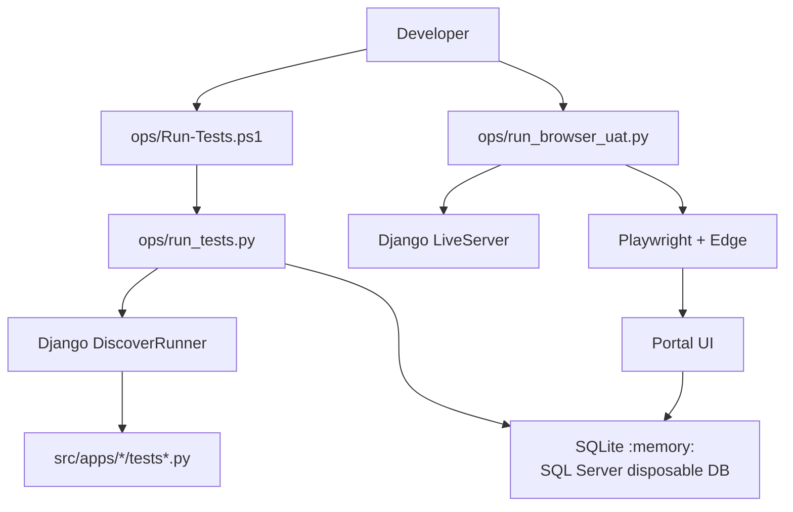
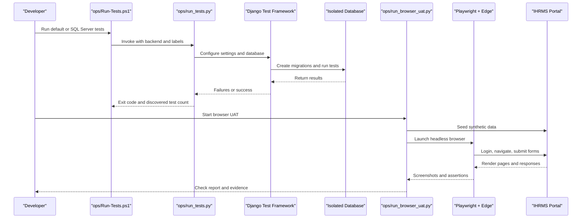
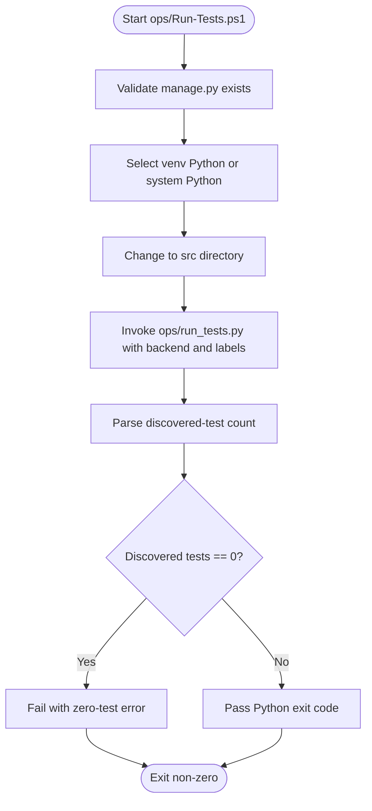
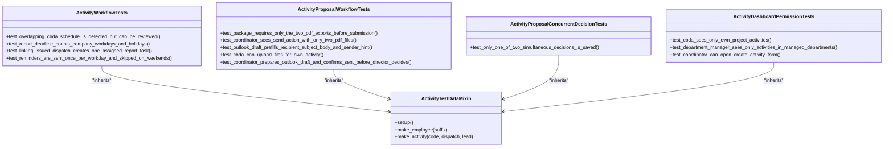
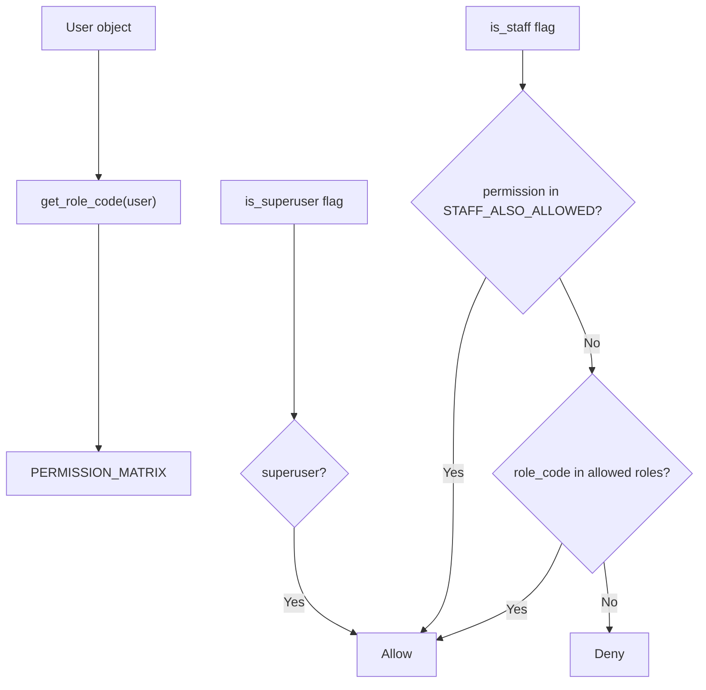
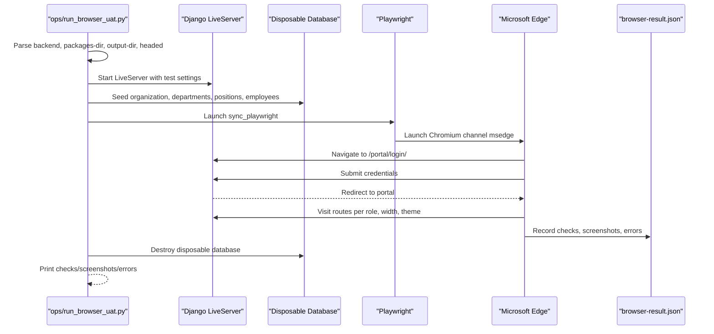
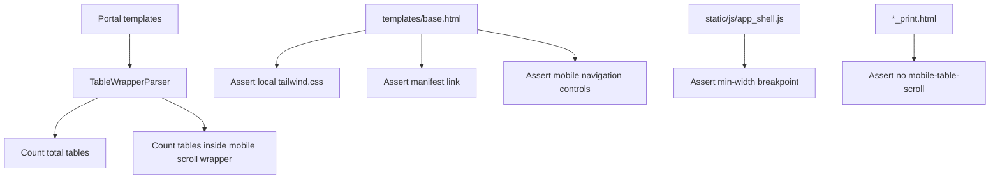
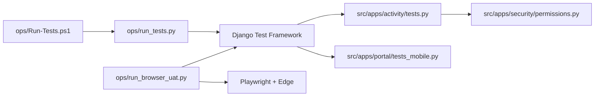

# Testing Strategy

<cite>
**Referenced Files in This Document**
- [README.md](file://README.md)
- [07_Testing_Standards.md](file://docs/07_Testing_Standards.md)
- [Run-Tests.ps1](file://ops/Run-Tests.ps1)
- [run_tests.py](file://ops/run_tests.py)
- [permissions.py](file://src/apps/security/permissions.py)
- [tests_mobile.py](file://src/apps/portal/tests_mobile.py)
- [tests.py](file://src/apps/activity/tests.py)
- [run_browser_uat.py](file://ops/run_browser_uat.py)
- [PROJECT_WORK_LOG.md](file://docs/PROJECT_WORK_LOG.md)
</cite>

## Table of Contents
1. [Introduction](#introduction)
2. [Project Structure](#project-structure)
3. [Core Components](#core-components)
4. [Architecture Overview](#architecture-overview)
5. [Detailed Component Analysis](#detailed-component-analysis)
6. [Dependency Analysis](#dependency-analysis)
7. [Performance Considerations](#performance-considerations)
8. [Troubleshooting Guide](#troubleshooting-guide)
9. [Conclusion](#conclusion)
10. [Appendices](#appendices)

## Introduction
This document defines the testing strategy for IHRMS, covering unit testing, integration testing, and browser-based user acceptance testing. It explains how tests are discovered and executed through PowerShell and Python helpers, how Django’s test framework is used, and how automated checks validate UI consistency, form behavior, navigation flows, responsive design, and permission scoping. It also documents test data isolation, external service mocking, performance considerations, continuous integration practices, and troubleshooting guidance.

IHRMS is a Django application with a portal, admin interface, and business modules. The repository includes structured test suites under `src/apps`, operational scripts under `ops`, and project documentation under `docs`.

**Section sources**
- [README.md:1-90](file://README.md#L1-L90)

## Project Structure
The testing surface spans three layers:

- **Unit and integration tests**: Django `TestCase` and `TransactionTestCase` classes live next to their modules under `src/apps/*/tests*.py`. They assert model validation, service logic, view rendering, permissions, notifications, file uploads, and workflow state transitions.
- **Operational test runners**: `ops/Run-Tests.ps1` and `ops/run_tests.py` provide a consistent entry point for running all discovered tests against SQLite or SQL Server with isolated databases and disabled external storage/email.
- **Browser-based UAT**: `ops/run_browser_uat.py` and related scripts use Playwright with Microsoft Edge to automate login, navigation, form submission, screenshot capture, and assertion across multiple roles, themes, and viewport widths.

**Diagram sources**
- [Run-Tests.ps1:1-68](file://ops/Run-Tests.ps1#L1-L68)
- [run_tests.py:1-80](file://ops/run_tests.py#L1-L80)
- [run_browser_uat.py:1-34](file://ops/run_browser_uat.py#L1-L34)

**Section sources**
- [README.md:71-87](file://README.md#L71-L87)
- [07_Testing_Standards.md:107-149](file://docs/07_Testting_Standards.md#L107-L149)

## Core Components
This section summarizes the primary testing components and their responsibilities.

| Component | Responsibility | Key Behaviors |
|---|---|---|
| `ops/Run-Tests.ps1` | PowerShell wrapper for test execution | Validates environment, selects Python executable, invokes `ops/run_tests.py`, parses discovered-test count, fails if zero tests are found. |
| `ops/run_tests.py` | Test runner configuration | Sets Django settings for tests, configures SQLite in-memory or SQL Server disposable database, disables M365 storage and real email, runs `DiscoverRunner`, enforces non-empty test suite. |
| `src/apps/activity/tests.py` | Workflow, validation, notification, and permission tests | Uses `TestCase` and `TransactionTestCase`, asserts model validation errors, verifies task creation, reminder scheduling, file upload handling, role-scoped views, and concurrency safety on SQL Server. |
| `src/apps/portal/tests_mobile.py` | Mobile and PWA baseline checks | Verifies responsive table wrappers, base template assets, print templates, theme ordering, service worker scoping, manifest metadata, and asset hashing. |
| `src/apps/security/permissions.py` | Centralized permission matrix | Defines roles, permission names, staff exceptions, and helper functions used by views and tests to enforce access control. |
| `ops/run_browser_uat.py` | Browser automation runner | Creates synthetic data, launches Edge via Playwright, logs in multiple roles, navigates routes, captures screenshots, reports checks and errors, and destroys the disposable database. |

**Section sources**
- [Run-Tests.ps1:1-68](file://ops/Run-Tests.ps1#L1-L68)
- [run_tests.py:1-80](file://ops/run_tests.py#L1-L80)
- [tests.py:1-800](file://src/apps/activity/tests.py#L1-L800)
- [tests_mobile.py:1-182](file://src/apps/portal/tests_mobile.py#L1-L182)
- [permissions.py:1-152](file://src/apps/security/permissions.py#L1-L152)
- [run_browser_uat.py:1-34](file://ops/run_browser_uat.py#L1-L34)

## Architecture Overview
The end-to-end testing architecture combines deterministic backend tests with realistic browser interactions.

**Diagram sources**
- [Run-Tests.ps1:27-67](file://ops/Run-Tests.ps1#L27-L67)
- [run_tests.py:24-74](file://ops/run_tests.py#L24-L74)
- [run_browser_uat.py:20-34](file://ops/run_browser_uat.py#L20-L34)

## Detailed Component Analysis

### Automated Test Execution Pipeline
The pipeline ensures that tests are always run from the correct working directory, with a known Python interpreter, UTF-8 encoding, and an isolated database.

**Diagram sources**
- [Run-Tests.ps1:13-67](file://ops/Run-Tests.ps1#L13-L67)

Key behaviors:
- Fails early if `manage.py` is missing.
- Prefers `venv\Scripts\python.exe` when available.
- Forces UTF-8 output encoding.
- Treats missing discovery output or zero discovered tests as failure.

**Section sources**
- [Run-Tests.ps1:1-68](file://ops/Run-Tests.ps1#L1-L68)

### Test Backend Configuration
`ops/run_tests.py` prepares a safe test environment before importing Django settings.

**Diagram sources**
- [run_tests.py:11-74](file://ops/run_tests.py#L11-L74)

Important guarantees:
- Production-like guards are disabled for tests (`APP_ENV=test`, HTTPS enforcement off).
- SQLite uses an in-memory database.
- SQL Server uses a generated disposable database name and refuses to reuse the configured application database.
- Real file storage and email are disabled; media files go to a temporary directory.
- A custom runner rejects empty test suites.

**Section sources**
- [run_tests.py:1-80](file://ops/run_tests.py#L1-L80)

### Unit and Integration Test Patterns
The activity module demonstrates representative patterns for model validation, service-layer logic, view rendering, notifications, file uploads, and permission scoping.

**Diagram sources**
- [tests.py:32-77](file://src/apps/activity/tests.py#L32-L77)
- [tests.py:78-296](file://src/apps/activity/tests.py#L78-L296)
- [tests.py:299-515](file://src/apps/activity/tests.py#L299-L515)
- [tests.py:516-580](file://src/apps/activity/tests.py#L516-L580)
- [tests.py:582-800](file://src/apps/activity/tests.py#L582-L800)

Patterns illustrated:
- **Model validation**: Assertions expect `ValidationError` for invalid states such as completing a task without a report file or before the activity ends.
- **Service-layer logic**: Tests call services like schedule conflict detection, workday calculation, and reminder sending, asserting resulting counts and dates.
- **View rendering and CSRF**: Tests log in users, POST to portal URLs, assert redirects, status codes, template usage, and rendered content.
- **File upload testing**: Tests create `SimpleUploadedFile` objects and verify required PDFs, download endpoints, and validation messages.
- **Notification simulation**: Tests assert created notifications for reminders, submissions, changes requested, and approvals.
- **Concurrency testing**: A `TransactionTestCase` simulates concurrent decision requests and expects only one successful save on SQL Server.
- **Permission scoping**: Tests verify role-based visibility for dashboards, task lists, filters, calendars, and approval inboxes.

**Section sources**
- [tests.py:1-800](file://src/apps/activity/tests.py#L1-L800)

### Permission Model and Permission Checks
Permissions are centralized in a single matrix rather than scattered across views and context processors. Tests should assert both positive and negative cases for each relevant role.

**Diagram sources**
- [permissions.py:121-151](file://src/apps/security/permissions.py#L121-L151)

Guidelines:
- Add new permissions only in `PERMISSION_MATRIX`.
- Use `has_permission(user, permission)` for programmatic checks.
- Use `permission_flags(user)` for template-level `can_*` variables.
- Keep `STAFF_ALSO_ALLOWED` minimal and explicit.
- Write tests for every role that can or cannot perform the action.

**Section sources**
- [permissions.py:1-152](file://src/apps/security/permissions.py#L1-L152)

### Browser-Based UAT Automation
The browser UAT runner automates realistic user journeys against a live Django server with synthetic data.

**Diagram sources**
- [run_browser_uat.py:1-34](file://ops/run_browser_uat.py#L1-L34)
- [run_browser_uat.py:96-119](file://ops/run_browser_uat.py#L96-L119)
- [PROJECT_WORK_LOG.md:2079-2087](file://docs/PROJECT_WORK_LOG.md#L2079-L2087)

Coverage characteristics:
- Uses real browser automation with HTTP, POST, and CSRF.
- Seeds synthetic data and never touches production data.
- Captures full-page screenshots for visual regression evidence.
- Reports checks, screenshots, and JavaScript/page errors.
- Supports SQLite and SQL Server backends.
- Can run in headed mode for debugging and supports package installation outside the repository.

**Section sources**
- [run_browser_uat.py:1-34](file://ops/run_browser_uat.py#L1-L34)
- [run_browser_uat.py:96-119](file://ops/run_browser_uat.py#L96-L119)
- [PROJECT_WORK_LOG.md:2079-2087](file://docs/PROJECT_WORK_LOG.md#L2079-L2087)

### Mobile and Responsive Design Validation
Mobile and responsive checks ensure tables are wrapped correctly, base templates load local Tailwind CSS, print templates avoid mobile wrappers, design tokens are shared, and PWA assets are valid.

**Diagram sources**
- [tests_mobile.py:36-99](file://src/apps/portal/tests_mobile.py#L36-L99)

Additional validations include:
- Shared design tokens imported by main CSS and admin CSS.
- Theme script loaded before styles.
- Service worker scoped to `/portal/` and not caching HTML.
- Manifest start URL, scope, display mode, icon sizes, and PNG headers.
- Asset hash computation and cache version references.

**Section sources**
- [tests_mobile.py:1-182](file://src/apps/portal/tests_mobile.py#L1-L182)

### Test Data Management
IHRMS uses several strategies for test data:

- **Factory-style mixins**: `ActivityTestDataMixin` creates organizations, departments, positions, employees, projects, and related entities in `setUp`.
- **Temporary directories**: File upload tests use `tempfile.TemporaryDirectory` and Django’s `override_settings` to isolate media storage.
- **Synthetic fixtures**: Browser UAT seeds lightweight records such as organizations, departments, positions, and employees with deterministic but non-sensitive values.
- **Database isolation**: SQLite uses `:memory:`; SQL Server uses a generated disposable database name that must not match the application database or an existing database.
- **Email isolation**: Tests switch to `locmem.EmailBackend` so email workflows do not send real messages.
- **Storage isolation**: M365 storage is disabled during tests; local media goes to a temporary directory.

Best practices:
- Prefer small, focused fixtures over large global datasets.
- Clean up temporary resources using `addCleanup` or context managers.
- Avoid reusing application database names for test databases.
- Mock external APIs and services when they are not part of the tested behavior.
- Use `override_settings` for environment-dependent behavior such as storage and email backends.

**Section sources**
- [tests.py:32-77](file://src/apps/activity/tests.py#L32-L77)
- [tests.py:300-340](file://src/apps/activity/tests.py#L300-L340)
- [run_tests.py:24-74](file://ops/run_tests.py#L24-L74)
- [run_browser_uat.py:96-119](file://ops/run_browser_uat.py#L96-L119)

### Test-Driven Development Approach
Although IHRMS uses Django’s test framework rather than pytest, the same TDD principles apply:

- Write failing tests first for model validation, service logic, view behavior, and permission checks.
- Implement minimal code to pass the test.
- Refactor while keeping tests green.
- Use descriptive test methods and assertions that read like expected outcomes.
- Group related scenarios into mixins and test classes.
- Use mocks for external dependencies such as time, network calls, and storage.

Example assertion style derived from the codebase:
- Assert exact model fields, statuses, and relationships.
- Assert exception types and message dictionaries for validation failures.
- Assert redirect targets and rendered template names.
- Assert notification counts and message content.
- Assert HTTP status codes for unauthorized or forbidden actions.

**Section sources**
- [tests.py:78-296](file://src/apps/activity/tests.py#L78-L296)
- [tests.py:299-515](file://src/apps/activity/tests.py#L299-L515)

### Integration Test Patterns
Integration tests cover multi-step workflows and cross-module interactions:

- **Database transactions**: Use `TestCase` for transactional isolation and `TransactionTestCase` when row-level locking or database-specific concurrency behavior must be verified.
- **External API mocking**: Use `unittest.mock.patch` to freeze time, replace timezone behavior, or mock external services.
- **File upload testing**: Use `SimpleUploadedFile` to simulate PDF uploads and assert validation, persistence, and download behavior.
- **Email workflow simulation**: Assert notification records and email draft construction instead of sending real emails.
- **Cross-module side effects**: Verify that activity updates create tasks, notifications, and dashboard metrics.

**Section sources**
- [tests.py:1-800](file://src/apps/activity/tests.py#L1-L800)

### User Acceptance Testing Methodology
UAT should follow structured scenarios with clear preconditions, steps, and expected outcomes:

- Define scenario IDs and modules.
- Specify preconditions such as roles, data state, and environment.
- Record test steps including navigation, input, and actions.
- Capture expected results including status codes, redirects, visible text, and side effects.
- Record actual results and status: PASS, FAIL, BLOCKED, NOT RUN.
- Attach evidence such as screenshots, logs, and JSON reports.
- Track defects with severity, module, scenario ID, reproduction steps, and environment details.

The project’s testing standards define case structure and status categories, while browser UAT provides automated evidence for UI flows.

**Section sources**
- [07_Testing_Standards.md:151-175](file://docs/07_Testing_Standards.md#L151-L175)
- [07_Testing_Standards.md:179-201](file://docs/07_Testing_Standards.md#L179-L201)
- [PROJECT_WORK_LOG.md:2079-2087](file://docs/PROJECT_WORK_LOG.md#L2079-L2087)

## Dependency Analysis
Testing components depend on each other in a controlled way:

- `ops/Run-Tests.ps1` depends on `ops/run_tests.py`.
- `ops/run_tests.py` depends on Django settings, database connection, and `DiscoverRunner`.
- `src/apps/activity/tests.py` depends on domain models, services, security roles, notifications, and portal URLs.
- `src/apps/portal/tests_mobile.py` depends on static assets, templates, and service worker configuration.
- `ops/run_browser_uat.py` depends on Playwright, Edge, Django LiveServer, and the same domain models seeded with synthetic data.

**Diagram sources**
- [Run-Tests.ps1:1-68](file://ops/Run-Tests.ps1#L1-L68)
- [run_tests.py:1-80](file://ops/run_tests.py#L1-L80)
- [tests.py:1-800](file://src/apps/activity/tests.py#L1-L800)
- [tests_mobile.py:1-182](file://src/apps/portal/tests_mobile.py#L1-L182)
- [permissions.py:1-152](file://src/apps/security/permissions.py#L1-L152)
- [run_browser_uat.py:1-34](file://ops/run_browser_uat.py#L1-L34)

Coupling and cohesion observations:
- High cohesion within test modules: each test file focuses on a specific feature area.
- Low coupling between test runners and domain logic: runners configure environment and execute tests without embedding business rules.
- Permission logic is centralized, reducing duplication and making permission tests easier to maintain.
- Browser UAT is intentionally decoupled from unit tests; it validates runtime behavior rather than replacing unit coverage.

**Section sources**
- [Run-Tests.ps1:1-68](file://ops/Run-Tests.ps1#L1-L68)
- [run_tests.py:1-80](file://ops/run_tests.py#L1-L80)
- [tests.py:1-800](file://src/apps/activity/tests.py#L1-L800)
- [tests_mobile.py:1-182](file://src/apps/portal/tests_mobile.py#L1-L182)
- [permissions.py:1-152](file://src/apps/security/permissions.py#L1-L152)
- [run_browser_uat.py:1-34](file://ops/run_browser_uat.py#L1-L34)

## Performance Considerations
Performance testing should complement functional tests without slowing down CI:

- **Load testing**: Simulate realistic portal traffic using tools such as Locust, k6, or JMeter against a staging environment. Measure response times, throughput, error rates, and resource utilization.
- **Database performance**: Profile slow queries, check indexes, and validate pagination and filtering under larger datasets.
- **Memory leak detection**: Monitor process memory during long-running tests and browser sessions. Use Python profiling tools and OS-level monitoring to detect leaks caused by unclosed connections, large cached objects, or retained test fixtures.
- **Browser automation performance**: Run Playwright headlessly, limit concurrent contexts, block unnecessary resources, and reuse browser instances where safe.
- **Test suite performance**: Split slow tests into separate groups, skip database-heavy tests in fast paths, and use labels to run targeted suites.

Recommendations:
- Keep unit tests fast and deterministic.
- Reserve heavy integration and browser tests for scheduled CI jobs.
- Record performance baselines for critical endpoints and dashboards.
- Alert on regressions in response time, memory growth, and test duration.

[No sources needed since this section provides general guidance]

## Troubleshooting Guide

### Database Connection Problems
Symptoms:
- Tests fail because the wrong database is selected.
- SQL Server test database already exists.
- Application database name is reused.

Resolution:
- Always run tests through `ops/Run-Tests.ps1` or `ops/run_tests.py`.
- For SQLite, confirm the backend is configured for SQLite.
- For SQL Server, confirm the driver and connection allow creating a disposable test database.
- Ensure the generated test database name does not match the application database or an existing database.

**Section sources**
- [run_tests.py:40-57](file://ops/run_tests.py#L40-L57)

### Zero Tests Discovered
Symptoms:
- Wrapper reports no discovered tests.
- Running directly from the repository root finds zero tests.

Resolution:
- Run from the project root using the PowerShell wrapper.
- Do not treat zero tests as success.
- If calling Django directly, run from the `src` directory.

**Section sources**
- [Run-Tests.ps1:42-60](file://ops/Run-Tests.ps1#L42-L60)
- [README.md:83-84](file://README.md#L83-L84)

### Mock Configuration Errors
Symptoms:
- Time-dependent tests behave differently depending on the day they run.
- External services are called unexpectedly.
- File uploads fail due to storage configuration.

Resolution:
- Patch `django.utils.timezone.now` for time-sensitive workflows.
- Use `unittest.mock.patch` for external APIs.
- Use `override_settings` to disable M365 storage and set `MEDIA_ROOT` to a temporary directory.
- Assert notifications or draft data instead of relying on real email delivery.

**Section sources**
- [tests.py:177-196](file://src/apps/activity/tests.py#L177-L196)
- [tests.py:206-246](file://src/apps/activity/tests.py#L206-L246)
- [tests.py:300-340](file://src/apps/activity/tests.py#L300-L340)

### Flaky Test Identification
Common causes:
- Dependence on current date or time.
- Shared mutable state between tests.
- Concurrency assumptions not enforced by the database.
- Browser selectors changing with UI updates.

Mitigations:
- Freeze time explicitly for reminder and deadline tests.
- Use isolated fixtures and clean up temporary directories.
- Use `TransactionTestCase` only when database-level concurrency matters.
- Stabilize browser selectors and add retry logic only after identifying the root cause.
- Record logs, screenshots, and environment details for failed runs.

**Section sources**
- [tests.py:206-246](file://src/apps/activity/tests.py#L206-L246)
- [tests.py:516-580](file://src/apps/activity/tests.py#L516-L580)
- [PROJECT_WORK_LOG.md:2079-2087](file://docs/PROJECT_WORK_LOG.md#L2079-L2087)

### Browser UAT Failures
Symptoms:
- Login fails.
- Page errors occur.
- Screenshot comparison shows layout differences.
- Database cleanup does not complete.

Resolution:
- Confirm the LiveServer is running and reachable.
- Use `--headed` to debug selector issues.
- Inspect `browser-result.json`, logs, and screenshots.
- Ensure Playwright packages are installed in the specified directory.
- Verify the disposable database was destroyed after the run.

**Section sources**
- [run_browser_uat.py:1-34](file://ops/run_browser_uat.py#L1-L34)
- [PROJECT_WORK_LOG.md:2079-2087](file://docs/PROJECT_WORK_LOG.md#L2079-L2087)

## Conclusion
IHRMS testing combines fast, deterministic unit and integration tests with realistic browser-based UAT. The PowerShell and Python runners standardize test execution, database isolation, and environment configuration. Domain tests validate model validation, service logic, view rendering, permissions, notifications, file uploads, and workflow state. Browser UAT validates UI consistency, form behavior, navigation flows, responsive design, and role-scoped access. Together, these layers provide confidence for deployment while maintaining clear separation between unit verification, integration validation, and user-facing acceptance.

[No sources needed since this section summarizes without analyzing specific files]

## Appendices

### Command Reference
- Default tests (SQLite): `powershell -NoProfile -ExecutionPolicy Bypass -File .\ops\Run-Tests.ps1`
- SQL Server tests: `powershell -NoProfile -ExecutionPolicy Bypass -File .\ops\Run-Tests.ps1 -Backend sqlserver`

**Section sources**
- [README.md:71-84](file://README.md#L71-L84)

### Test Status Definitions
- PASS: Expected result matches actual result.
- FAIL: Actual result differs from expected result.
- BLOCKED: Test cannot be executed due to environment or dependency issues.
- NOT RUN: Test has not been executed yet.

**Section sources**
- [07_Testing_Standards.md:179-201](file://docs/07_Testing_Standards.md#L179-L201)