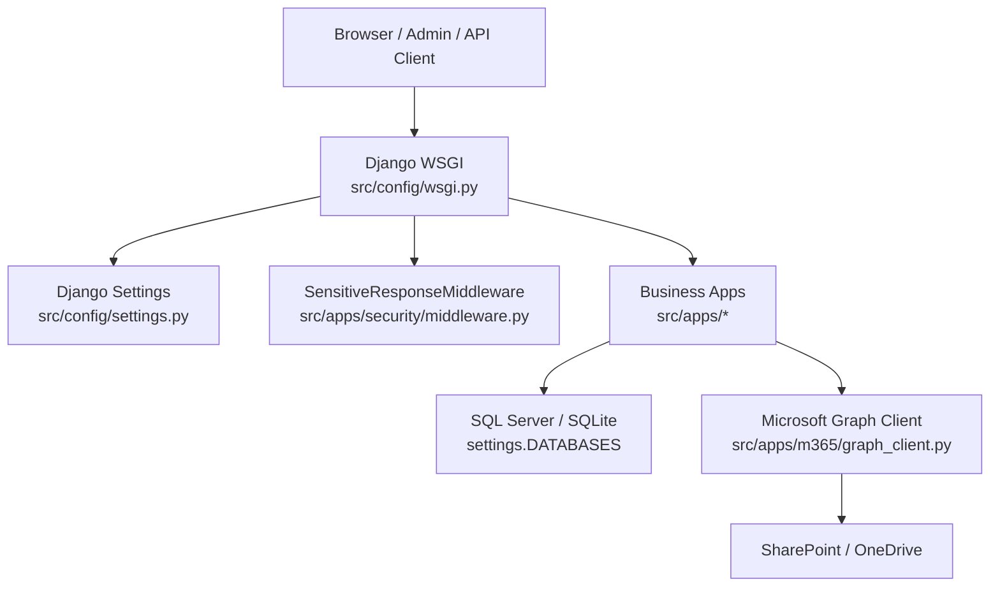
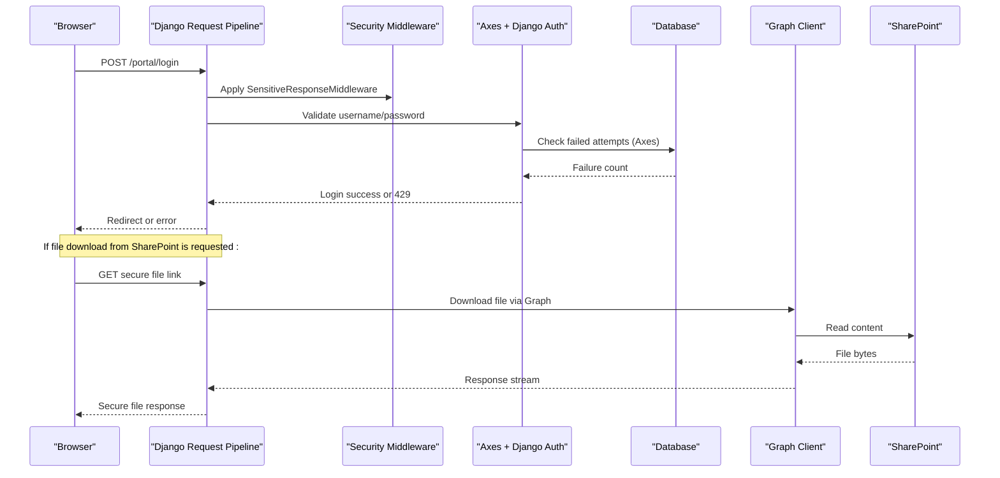
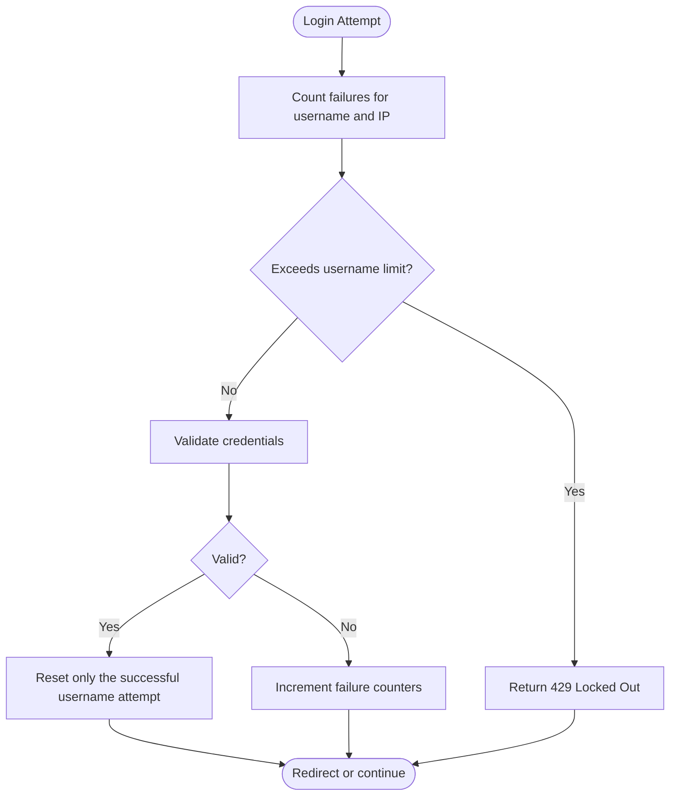
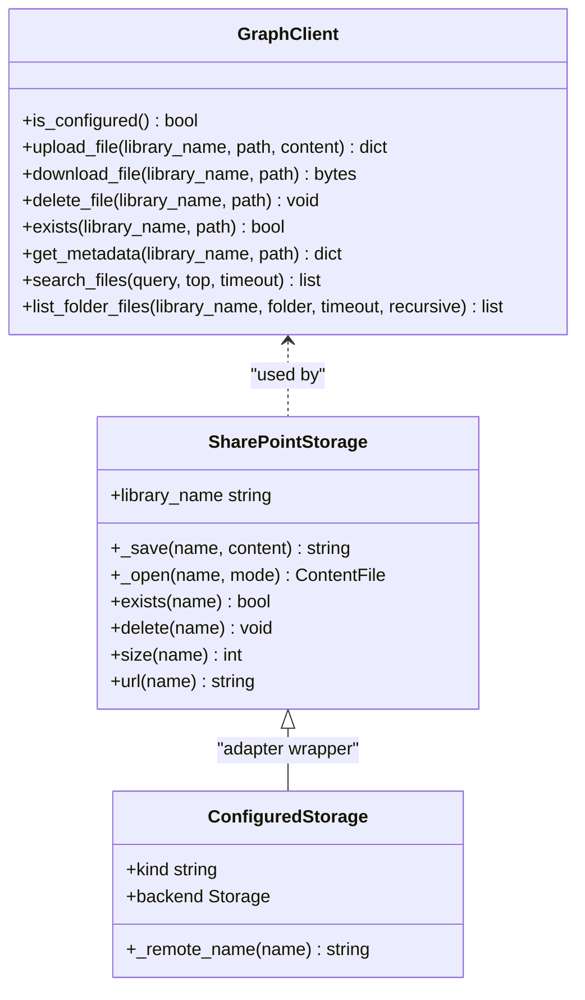
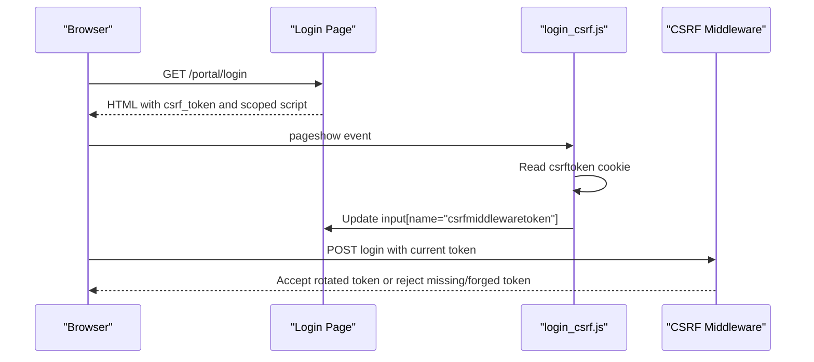
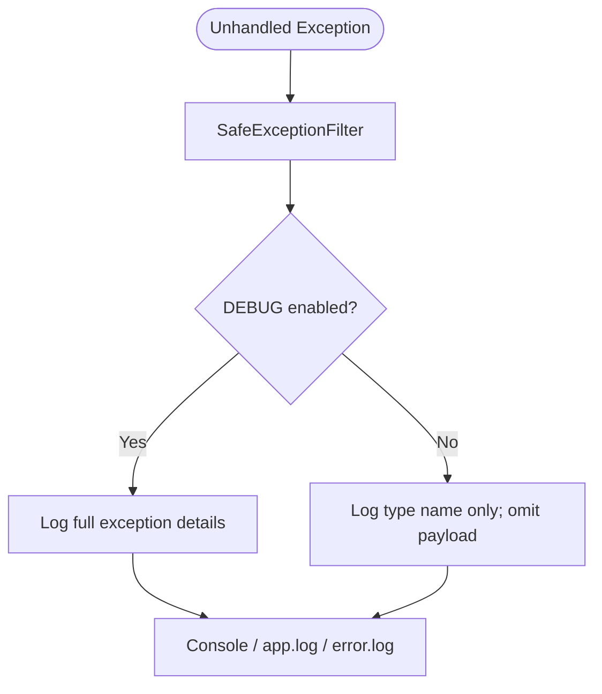
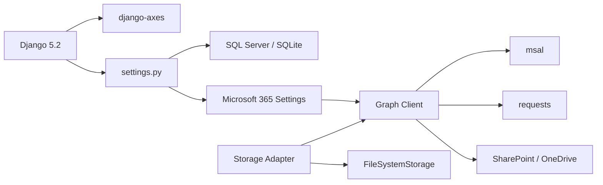

# Troubleshooting & FAQ

<cite>
**Referenced Files in This Document**   
- [README.md](file://README.md)
- [settings.py](file://src/config/settings.py)
- [login_handler.py](file://src/apps/security/login_handler.py)
- [logging.py](file://src/apps/security/logging.py)
- [middleware.py](file://src/apps/security/middleware.py)
- [graph_client.py](file://src/apps/m365/graph_client.py)
- [storage.py](file://src/apps/m365/storage.py)
- [login_csrf.js](file://src/static/js/login_csrf.js)
- [test_login_csrf.py](file://src/apps/security/test_login_csrf.py)
- [tests_approved_review.py](file://src/apps/portal/tests_approved_review.py)
- [reset_qa_data.py](file://ops/reset_qa_data.py)
- [08_Deployment_Standards.md](file://docs/08_Deployment_Standards.md)
- [Huong_Dan_Setup_TaskScheduler_SIT_UAT.md](file://docs/Huong_Dan_Setup_TaskScheduler_SIT_UAT.md)
- [PROJECT_WORK_LOG.md](file://docs/PROJECT_WORK_LOG.md)
- [MIGRATION_PLAN_task_actcode.md](file://docs/MIGRATION_PLAN_task_actcode.md)
- [MIGRATION_PLAN_timesheet_project_name.md](file://docs/MIGRATION_PLAN_timesheet_project_name.md)
- [AGENTS.md](file://AGENTS.md)
- [optimize-mssql SKILL.md](file://.github/skills/optimize-mssql/SKILL.md)
</cite>

## Table of Contents
1. [Introduction](#introduction)
2. [Project Structure](#project-structure)
3. [Core Components](#core-components)
4. [Architecture Overview](#architecture-overview)
5. [Detailed Component Analysis](#detailed-component-analysis)
6. [Dependency Analysis](#dependency-analysis)
7. [Performance Considerations](#performance-considerations)
8. [Troubleshooting Guide](#troubleshooting-guide)
9. [Migration Procedures](#migration-procedures)
10. [Security Troubleshooting](#security-troubleshooting)
11. [Known Limitations and Workarounds](#known-limitations-and-workarounds)
12. [FAQ](#faq)
13. [Expert-Level Customization](#expert-level-customization)
14. [Support and Community Resources](#support-and-community-resources)
15. [Conclusion](#conclusion)

## Introduction
This document provides practical troubleshooting, error resolution, performance tuning, migration guidance, security investigation, known limitations, FAQs, and expert customization notes for IHRMS. It is based on the Django 5.2 application under `src/`, SQL Server or SQLite configuration, Microsoft 365 SharePoint/OneDrive integration, login lockout behavior, CSRF handling, logging, and deployment standards.

## Project Structure
IHRMS is a Django application with multiple business apps under `src/apps/`. Configuration lives in `src/config/`. Microsoft 365 integration is implemented in `apps.m365`. Security features such as login lockout, sensitive response headers, safe exception logging, and storage routing are also defined there.

**Diagram sources**
- [settings.py:145-156](file://src/config/settings.py#L145-L156)
- [settings.py:197-225](file://src/config/settings.py#L197-L225)
- [graph_client.py:57-126](file://src/apps/m365/graph_client.py#L57-L126)
- [middleware.py:7-28](file://src/apps/security/middleware.py#L7-L28)

**Section sources**
- [README.md:5-46](file://README.md#L5-L46)
- [settings.py:103-143](file://src/config/settings.py#L103-L143)

## Core Components
- Application settings: environment flags, HTTPS enforcement, session policy, database configuration, logging, and Microsoft 365 options.
- Login lockout: Axes-based brute-force protection with shared IP handling.
- Logging: rotating files with safe exception filtering to avoid leaking secrets.
- Microsoft 365 client: token caching, site/drive discovery, upload/download/delete/search/list operations.
- Storage adapter: local file system or SharePoint-backed storage depending on configuration.
- CSRF handling: login-only JavaScript that synchronizes the CSRF token after rotation.

**Section sources**
- [settings.py:28-100](file://src/config/settings.py#L28-L100)
- [settings.py:158-168](file://src/config/settings.py#L158-L168)
- [settings.py:486-545](file://src/config/settings.py#L486-L545)
- [login_handler.py:9-24](file://src/apps/security/login_handler.py#L9-L24)
- [logging.py:6-13](file://src/apps/security/logging.py#L6-L13)
- [graph_client.py:57-126](file://src/apps/m365/graph_client.py#L57-L126)
- [storage.py:33-128](file://src/apps/m365/storage.py#L33-L128)
- [login_csrf.js:1-19](file://src/static/js/login_csrf.js#L1-L19)

## Architecture Overview
The request flow includes middleware for authentication, session idle timeout, CSRF, and security headers. Database access uses either SQLite for development/testing or SQL Server for SIT/UAT/production. File uploads may be stored locally or routed to SharePoint via Microsoft Graph.

**Diagram sources**
- [settings.py:145-168](file://src/config/settings.py#L145-L168)
- [middleware.py:12-28](file://src/apps/security/middleware.py#L12-L28)
- [graph_client.py:262-286](file://src/apps/m365/graph_client.py#L262-L286)

## Detailed Component Analysis

### Login Lockout and Shared IP Handling
IHRMS uses Axes with a custom handler that enforces both per-username and per-IP thresholds. A successful login by another user on the same IP does not clear failures for other usernames, preventing password spraying while allowing legitimate coworkers to log in.

**Diagram sources**
- [settings.py:158-168](file://src/config/settings.py#L158-L168)
- [login_handler.py:9-24](file://src/apps/security/login_handler.py#L9-L24)
- [tests_approved_review.py:31-48](file://src/apps/portal/tests_approved_review.py#L31-L48)

**Section sources**
- [settings.py:158-168](file://src/config/settings.py#L158-L168)
- [login_handler.py:9-24](file://src/apps/security/login_handler.py#L9-L24)
- [tests_approved_review.py:31-48](file://src/apps/portal/tests_approved_review.py#L31-L48)

### Microsoft 365 Integration and SharePoint Storage
The Microsoft Graph client manages app-only authentication, token caching, site/drive discovery, folder creation, simple and chunked uploads, downloads, deletion, existence checks, metadata retrieval, search, and folder listing. The storage layer chooses between local filesystem and SharePoint based on configuration.

**Diagram sources**
- [graph_client.py:57-126](file://src/apps/m365/graph_client.py#L57-L126)
- [graph_client.py:216-286](file://src/apps/m365/graph_client.py#L216-L286)
- [graph_client.py:329-387](file://src/apps/m365/graph_client.py#L329-L387)
- [storage.py:33-128](file://src/apps/m365/storage.py#L33-L128)

**Section sources**
- [settings.py:283-332](file://src/config/settings.py#L283-L332)
- [graph_client.py:57-126](file://src/apps/m365/graph_client.py#L57-L126)
- [graph_client.py:216-286](file://src/apps/m365/graph_client.py#L216-L286)
- [storage.py:33-128](file://src/apps/m365/storage.py#L33-L128)

### CSRF Token Handling for Login
A dedicated script keeps the login form’s CSRF field synchronized when Django rotates the CSRF cookie, especially when multiple tabs open or the page is restored from cache.

**Diagram sources**
- [login_csrf.js:1-19](file://src/static/js/login_csrf.js#L1-L19)
- [test_login_csrf.py:22-43](file://src/apps/security/test_login_csrf.py#L22-L43)

**Section sources**
- [login_csrf.js:1-19](file://src/static/js/login_csrf.js#L1-L19)
- [test_login_csrf.py:22-43](file://src/apps/security/test_login_csrf.py#L22-L43)

### Logging and Safe Exception Filtering
Application logs rotate at 5 MB with up to 30 backups. In non-debug environments, exception payloads are omitted to prevent leaking database connection strings, Graph tokens, or other secrets.

**Diagram sources**
- [settings.py:486-545](file://src/config/settings.py#L486-L545)
- [logging.py:6-13](file://src/apps/security/logging.py#L6-L13)

**Section sources**
- [settings.py:486-545](file://src/config/settings.py#L486-L545)
- [logging.py:6-13](file://src/apps/security/logging.py#L6-L13)

## Dependency Analysis
Key runtime dependencies include Django, Axes for login protection, optional Jazzmin admin theme, Microsoft Graph client libraries (`msal`, `requests`), and SQL Server ODBC driver. Storage can fall back to local filesystem when Microsoft 365 is disabled.

**Diagram sources**
- [settings.py:105-143](file://src/config/settings.py#L105-L143)
- [settings.py:197-225](file://src/config/settings.py#L197-L225)
- [graph_client.py:94-126](file://src/apps/m365/graph_client.py#L94-L126)
- [storage.py:116-128](file://src/apps/m365/storage.py#L116-L128)

**Section sources**
- [README.md:38-46](file://README.md#L38-L46)
- [settings.py:105-143](file://src/config/settings.py#L105-L143)
- [settings.py:197-225](file://src/config/settings.py#L197-L225)
- [graph_client.py:94-126](file://src/apps/m365/graph_client.py#L94-L126)
- [storage.py:116-128](file://src/apps/m365/storage.py#L116-L128)

## Performance Considerations
- Slow query identification: Use focused tests and query counting patterns to detect N+1 queries and excessive SELECT statements during search and reporting flows.
- Database optimization: Follow the MSSQL optimization skill to add `select_related`/`prefetch_related`, paginate large lists, constrain columns, and propose indexes where schema changes are approved.
- Memory usage analysis: Monitor process memory during large SharePoint uploads/downloads and report generation; prefer streaming responses and avoid loading entire files into memory when possible.
- Caching configuration: Avoid caching authenticated responses; the sensitive response middleware marks authenticated and login/admin responses as private, no-store, and must-revalidate.

Recommended actions:
- Profile ORM queries in selectors/services before and after changes.
- Add pagination and column projection for heavy reports.
- Ensure proper indexing for frequently filtered fields such as employee codes, leave status, and attendance dates.
- Keep session idle timeout and browser close expiration aligned with HR data sensitivity.

**Section sources**
- [optimize-mssql SKILL.md:1-18](file://.github/skills/optimize-mssql/SKILL.md#L1-L18)
- [settings.py:91-100](file://src/config/settings.py#L91-L100)
- [middleware.py:12-28](file://src/apps/security/middleware.py#L12-L28)
- [PROJECT_WORK_LOG.md:1982-1995](file://docs/PROJECT_WORK_LOG.md#L1982-L1995)

## Troubleshooting Guide

### Python Environment Conflicts
Symptoms:
- Import errors for required packages such as `docx`, `msal`, or `axes`.
- Test runner detects zero tests when invoked from the wrong directory.

Resolution steps:
- Create and activate a Python 3.12 virtual environment.
- Install requirements using the project’s requirements file.
- Run commands from the repository root using the venv Python executable.
- Verify dependency integrity with `pip check`.

**Section sources**
- [README.md:48-67](file://README.md#L48-L67)
- [README.md:71-83](file://README.md#L71-L83)
- [PROJECT_WORK_LOG.md:2916-2918](file://docs/PROJECT_WORK_LOG.md#L2916-L2918)

### Database Connection Failures
Symptoms:
- Cannot connect to SQL Server due to TCP/IP, dynamic port, or SQL Browser issues.
- Trusted vs SQL authentication mismatch.
- Missing or incorrect driver configuration.

Resolution steps:
- Confirm SQL Server instance is running and TCP/IP is enabled.
- Identify the dynamic port if using `localhost\SQLEXPRESS` and override `DB_HOST`/`DB_PORT` temporarily for testing.
- For SQL Authentication, set `DB_TRUSTED_CONNECTION=no` and provide `DB_USER`/`DB_PASSWORD`.
- For Windows Integrated Authentication, ensure the service account running the application has SQL permissions.
- Verify driver is installed and configured as expected.

**Section sources**
- [PROJECT_WORK_LOG.md:2916-2918](file://docs/PROJECT_WORK_LOG.md#L2916-L2918)
- [Huong_Dan_Setup_TaskScheduler_SIT_UAT.md:174-188](file://docs/Huong_Dan_Setup_TaskScheduler_SIT_UAT.md#L174-L188)
- [settings.py:197-225](file://src/config/settings.py#L197-L225)

### Permission Errors
Symptoms:
- Service account cannot write to media folders or perform backup/restore operations.
- QA reset refuses to operate on unexpected databases.

Resolution steps:
- Grant the application service account explicit read/write permissions to `src/media/` when using local storage.
- Store credentials outside the repository and use absolute paths for backup files.
- Restrict QA reset to disposable test databases with explicitly named targets.

**Section sources**
- [reset_qa_data.py:47-63](file://ops/reset_qa_data.py#L47-L63)
- [README.md:85-87](file://README.md#L85-L87)

### Microsoft 365 Integration Issues
Symptoms:
- Upload/download fails with Graph API errors.
- Site or library not found.
- Search returns empty results or unauthorized scope.

Resolution steps:
- Ensure tenant ID, client ID, and client secret are configured.
- Configure SharePoint hostname and site path correctly.
- Enable storage only after IT grants admin consent for required Graph permissions.
- Verify document library names match SharePoint display names.
- Handle retry-after headers and temporary outages gracefully.

**Section sources**
- [settings.py:283-332](file://src/config/settings.py#L283-L332)
- [graph_client.py:84-126](file://src/apps/m365/graph_client.py#L84-L126)
- [graph_client.py:147-180](file://src/apps/m365/graph_client.py#L147-L180)
- [graph_client.py:216-286](file://src/apps/m365/graph_client.py#L216-L286)

### Session Idle Timeout and Cache Control
Symptoms:
- Users are logged out unexpectedly after inactivity.
- Authenticated pages are cached by proxies or browsers.

Resolution steps:
- Adjust `SESSION_IDLE_TIMEOUT` according to operational needs.
- Confirm sensitive response middleware applies private/no-store headers to authenticated requests.

**Section sources**
- [settings.py:91-100](file://src/config/settings.py#L91-L100)
- [middleware.py:12-28](file://src/apps/security/middleware.py#L12-L28)

## Migration Procedures
General rules:
- Model and migration changes must be committed separately with an apply/rollback plan.
- Validate generated SQL on SQLite and temporary SQL Server configurations.
- Use read-only migration state checking tools; do not replace backup/restore validation.
- Never apply migrations to production without confirming target database, backup, and restore verification.

Example migration workflow:
1. Confirm server/database target and maintenance window.
2. Perform full/COPY_ONLY backup with checksum and verify restore into a separate database.
3. Run pre-migration read-only counts to validate affected rows.
4. Check migration state with the provided checker.
5. Review `sqlmigrate` output for schema changes and data backfills.
6. Test migration on a restored copy, then apply to production under authorized control.
7. Deploy code changes after migration success.
8. Post-migration checks and QA validation.
9. Rollback procedure documented in the migration plan.

**Section sources**
- [AGENTS.md:37-39](file://AGENTS.md#L37-L39)
- [MIGRATION_PLAN_task_actcode.md:8-25](file://docs/MIGRATION_PLAN_task_actcode.md#L8-L25)
- [MIGRATION_PLAN_timesheet_project_name.md:25-31](file://docs/MIGRATION_PLAN_timesheet_project_name.md#L25-L31)
- [PROJECT_WORK_LOG.md:643-646](file://docs/PROJECT_WORK_LOG.md#L643-L646)

## Security Troubleshooting

### Login Lockout Resolution
Symptoms:
- Account locked after repeated failed attempts.
- Another user on the same IP cannot trigger lockout reset unintentionally.

Resolution steps:
- Wait for the cool-off period or reset failed attempts through administrative controls if available.
- Understand that successful login by another user on the same IP does not clear failures for other usernames.
- Investigate brute-force patterns and network access restrictions.

**Section sources**
- [settings.py:158-168](file://src/config/settings.py#L158-L168)
- [login_handler.py:9-24](file://src/apps/security/login_handler.py#L9-L24)
- [tests_approved_review.py:31-48](file://src/apps/portal/tests_approved_review.py#L31-L48)

### CSRF Token Issues
Symptoms:
- Login rejected after opening multiple tabs or restoring a cached page.
- Old CSRF token submitted after rotation.

Resolution steps:
- Ensure the login page loads the scoped CSRF synchronization script.
- Verify the form contains the CSRF field and the page sets no-store cache headers.
- Do not weaken server-side CSRF checks; rely on token synchronization.

**Section sources**
- [test_login_csrf.py:22-43](file://src/apps/security/test_login_csrf.py#L22-L43)
- [login_csrf.js:1-19](file://src/static/js/login_csrf.js#L1-L19)

### Audit Log Investigation
Symptoms:
- Need to investigate login/logout events, file downloads, or export actions.
- Logs contain sanitized error messages in production.

Resolution steps:
- Review application logs and error logs under the configured log directory.
- Correlate security events with user actions and resource identifiers.
- Avoid relying solely on audit GET entries; confirm transactional audit coverage per feature.

**Section sources**
- [settings.py:486-545](file://src/config/settings.py#L486-L545)
- [logging.py:6-13](file://src/apps/security/logging.py#L6-L13)
- [PROJECT_WORK_LOG.md:3352-3357](file://docs/PROJECT_WORK_LOG.md#L3352-L3357)

## Known Limitations and Workarounds
- Microsoft 365 integration requires admin consent and correct tenant/client/site configuration; otherwise, Graph calls fail.
- SharePoint storage fallback to local filesystem occurs when Microsoft 365 storage is disabled.
- Some advanced integrations such as Outlook, Teams, and automatic email sending are not yet implemented.
- Mobile compatibility should be validated through dedicated mobile tests and real device scenarios.
- Report generation and payroll calculations require careful validation against business rules and SQL Server behavior.

**Section sources**
- [README.md:34-46](file://README.md#L34-L46)
- [graph_client.py:84-126](file://src/apps/m365/graph_client.py#L84-L126)
- [storage.py:116-128](file://src/apps/m365/storage.py#L116-L128)

## FAQ

### Permissions
- Q: Why can’t I see certain records?
  - A: Role-based access control restricts data visibility. Verify your role and permissions matrix, and confirm scoping logic in the relevant app.

- Q: How are roles assigned?
  - A: Roles include SUPER_ADMIN, SYS_ADMIN, DIRECTOR, HR_MANAGER, HR_OFFICER, DEPT_MANAGER, FINANCE_OFFICER, PROJECT_MANAGER, PROJECT_COORDINATOR, CBDA, EMPLOYEE. Assignments are managed through the security module and tested against the permission matrix.

**Section sources**
- [README.md:85-85](file://README.md#L85-L85)

### Password Resets
- Q: Why was a password change rejected?
  - A: Password validation rules and restricted reset scopes may prevent changes. SYS_ADMIN reset capabilities are intentionally limited and audited.

**Section sources**
- [settings.py:228-244](file://src/config/settings.py#L228-L244)
- [PROJECT_WORK_LOG.md:3352-3357](file://docs/PROJECT_WORK_LOG.md#L3352-L3357)

### File Uploads
- Q: Where are uploaded files stored?
  - A: When Microsoft 365 storage is enabled, files are stored in SharePoint/OneDrive; otherwise, they are stored locally under `src/media/`.

- Q: Why does upload fail with Graph API errors?
  - A: Check tenant/client/site configuration, document library names, permissions, and network connectivity. Large files use chunked upload sessions.

**Section sources**
- [storage.py:33-128](file://src/apps/m365/storage.py#L33-L128)
- [graph_client.py:216-286](file://src/apps/m365/graph_client.py#L216-L286)

### Mobile Device Compatibility
- Q: Does the portal work on mobile devices?
  - A: Mobile-specific tests exist; validate UI responsiveness and workflows on target devices.

**Section sources**
- [README.md:71-83](file://README.md#L71-L83)

## Expert-Level Customization

### Custom Permission Classes
- Extend role-based checks by defining custom permission classes and integrating them into views and services.
- Align new permissions with the existing role matrix and ensure tests cover authorization boundaries.

### Template Overrides
- Override templates under `src/templates/` to customize UI components while preserving context processors and builtins.
- Maintain consistency with the design system and frontend standards.

### Signal Handlers
- Use Django signals to react to model changes, audit events, or external integrations.
- Ensure signal handlers are idempotent and do not bypass permission checks.

### Third-Party Package Integration
- Add dependencies carefully and pin versions in requirements.
- Validate imports, configuration, and environment variables before deployment.
- Test integration behavior with mocked external services where appropriate.

**Section sources**
- [settings.py:172-188](file://src/config/settings.py#L172-L188)
- [README.md:30-32](file://README.md#L30-L32)

## Support and Community Resources
- Deployment checklist: Refer to the Django deployment checklist and company-specific go-live criteria.
- Documentation: Consult project documentation, training materials, UAT scripts, and deployment standards.
- Operational runbooks: Use task scheduler setup guides and server trial readiness documents.
- Escalation: Engage DBA for database operations, IT for infrastructure and Microsoft 365 permissions, and project leadership for production changes.

**Section sources**
- [README.md:25-31](file://README.md#L25-L31)
- [README.md:89-90](file://README.md#L89-L90)
- [08_Deployment_Standards.md:157-396](file://docs/08_Deployment_Standards.md#L157-L396)
- [Huong_Dan_Setup_TaskScheduler_SIT_UAT.md:174-188](file://docs/Huong_Dan_Setup_TaskScheduler_SIT_UAT.md#L174-L188)

## Conclusion
IHRMS provides robust security, configurable storage, and structured deployment practices. Effective troubleshooting relies on understanding login lockout behavior, CSRF handling, logging sanitization, database configuration, and Microsoft 365 integration. Follow migration procedures carefully, apply performance tuning guidelines, and consult deployment standards before production changes.